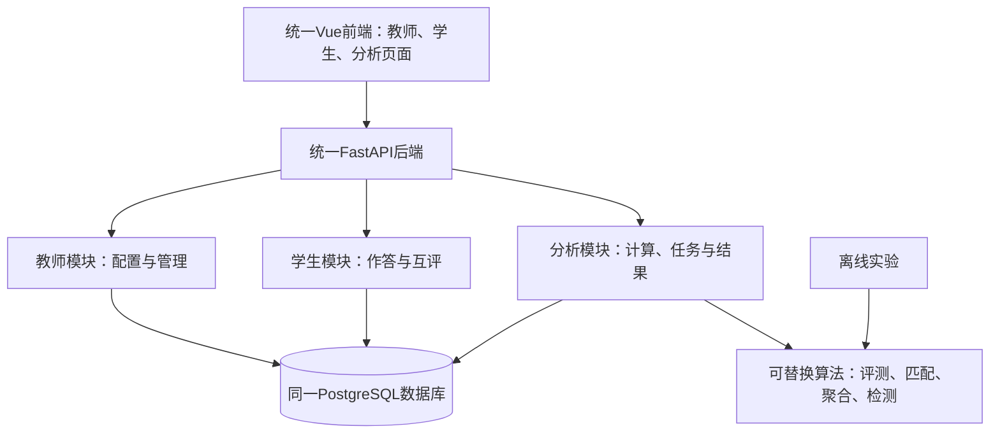

# 三人协作开发主文档

版本：教师/学生联调切片；更新日期：2026-10-25。

教师端本轮实现及边界见 [教师端架构索引](docs/design/teacher/architecture.md)。

本文件是队友进入项目后的阅读入口。先按README运行，再阅读本文件和自己负责的Issue，即可开始分模块开发。文中的“已实现”以本仓库代码为准；“规划”用于协作约定，不表示对应表和接口已经存在。

会议材料：[今天的工作与会后动作](docs/archive/meeting-2026-10-21.md)、[两张4K图与SVG源](docs/assets/diagrams/README.md)。可先用图讲主线，再查字段和Issue细节。

## 1. 项目目标和范围

本项目对应《算法设计与分析课程作业指南》的课题一：课程评审平台。支持教师管理四类题目与作业，学生作答、匿名互评，后台自动评测和分析，教师复核并发布反馈。

四类题目在业务上走两条路径：编程题走编译/测试；算法分析题、证明题、开放性问答题走主观答案/匿名互评。算法研究建议聚焦匹配、评分聚合和四类异常检测，先完成流程和可替换框架，再三人分担算法设计、复杂度和对比实验。

## 2. 这份main已经交付什么

| 能力 | 当前状态 |
|---|---|
| 统一Python后端、PostgreSQL连接与迁移 | 已实现，34张业务表，迁移pg0007 |
| 账户/课程权限/数据库会话 | 已实现，首次改密、空闲2小时与绝对24小时上限 |
| 四类演示题、量表、测试配置、班级与名单 | 已实现，1教师+6合成学生、2班、2作业 |
| 学生读题、正式提交、版本、撤回、幂等 | 已实现 |
| 代码任务与模拟结果持久化、教师查提交 | 已实现；支持MOCK与LOCAL真实执行，尚无Linux沙箱 |
| PostgreSQL自动化验证和真实HTTP联调 | 最新测试与HTTP证据见教师/学生implementation/evidence |
| 教师Vue工作台、CSV导入、四类题目与版本写接口 | 已实现，并含账号开通/重置、作业发布和截止管理 |
| 主观互评、原始评分、聚合异常、教师复核及补评/重算 | 已实现第③、④条，见[交接说明](docs/design/analysis/peer-review-api.md) |
| 正式成绩发布 | 第⑤条负责人接入逐题候选与发布政策 |
| 真实沙箱评测与复杂算法 | 后续实现与实验，不以随机值冒充真实效果 |

**底座完成**指三个人可以使用同一工程、数据库结构、模拟数据和已实现接口并行开发，不表示课程项目的全部功能已经完成。另两台电脑仍需按README首次启动验证。

## 3. 三人分工

| 标识 | 人员 | 主责 | 页面与后端位置 |
|---|---|---|---|
| T | 队友：教师负责人 | 名单、题库、作业、教师查询和复核操作入口 | backend/app/teacher；frontend/src/features/teacher |
| S | 队友：学生负责人 | 作答、历史、匿名互评、反馈 | backend/app/student；frontend/src/features/student |
| A | 你：数据库与分析负责人 | 共享模型/迁移、分析框架、匹配/聚合/检测、统计和成绩版本 | backend/app/db、analysis；frontend/src/features/analytics（待建） |

真实姓名/GitHub用户名在创建Issue时填写；上述标识只表示职责。每个人负责自己板块的页面、后端业务、验证、运行说明和报告章节。复杂算法研究后续由三人另行认领，不默认全部压给A。

- [教师Issue完整正文](docs/issues/01-teacher.md)
- [学生Issue完整正文](docs/issues/02-student.md)
- [分析Issue完整正文](docs/issues/03-database-analysis.md)

## 4. 结构与依赖

图中“经数据库交互”指后端共用真实业务事实。浏览器只调用HTTP API，不能直连数据库；教师/学生后端可以调用分析服务发起流程，不通过轮询某个任意字段碰运气触发操作。

三个人分别在本地运行同一套后端和各自数据库。最终网站运行一个前端、一个模块化后端及相应后台任务；不把三个独立网站最后拼接。

## 5. 数据库形态与信息流

先看[数据库业务地图与读写归属](docs/design/shared/database.md)，查字段看[实际21表数据字典](docs/design/shared/database-schema.md)，追完整流程看[信息流与状态](docs/design/shared/data-flows.md)。

核心关联：课程/名单 → 作业题目 → 固定题目版本 → 学生提交版本 → 评测或评审记录 → 分析结果 → 教师确认后的成绩发布。

- 教师配置题目、量表、测试集；学生实际作答产生新的提交，不能把学生答案填在题库版本里。
- 发布时固定题目配置和参与名单，后续转班不改历史名单。
- 学生提交、原始评价、算法计算结果和发布成绩分别保留，改分不覆盖原始证据。
- 唯一迁移链由A协调；T/S可提出和编写本模块迁移，经A检查顺序后合并。

## 6. 当前API怎样使用

阅读[当前API格式与完整样例](docs/design/shared/api-v1.md)。输入输出与状态规则由[底座契约](docs/design/contracts/foundation-v1.md)约束，机器可读版本为[OpenAPI快照](docs/design/contracts/openapi.json)，运行时文档位于 `http://127.0.0.1:8000/docs`。

登录后先查询courses取得课程角色，再查询assignments取得作业题目ID，不硬编码ID。所有ID是字符串，时间是UTC ISO8601，分数和权重是十进制字符串。只有教师提交列表有分页字段，其他当前列表为items数组。

新增教师写接口、互评、统计和成绩接口统一参考[下一阶段协作接口提案](docs/design/contracts/next-phase.md)。该文件内所有接口和DTO都标注“规划”，须在对应PR中落实后才成为已实现接口。

## 7. 并行开发的起跑顺序

1. 三人各自克隆/取得main，按README迁移、种子和HTTP联调；记录自己的环境差异。
2. T提交公共Vue/Vite骨架的小PR（TH00）：统一登录、课程选择、路由外壳、请求客户端、错误提示；S同时开发学生功能组件，A推进分析流程契约。
3. T实现名单/题库/作业的写入闭环；S实现当前答题接口的页面闭环；A先补互评数据与任务接口，使用确定性的基础实现。
4. A交付一组匿名任务、量表与评分请求样例；S实现互评，T实现开放/预览/复核入口。
5. 再打通聚合、异常、教师处置和发布；最后并行研究复杂算法并跑实验。

前端当前没有Vue工程，避免T/S分别生成两个不同工程。TH00合并前，S可按[前端目录约定](frontend/README.md)准备组件与样例，A不依赖前端开展后台流程。互评接口未落地时用明确标识的本地fixture，不调用不存在的接口后把404当空结果。

## 8. 谁负责写哪些数据

| 数据/动作 | 主写入口 | 其他模块如何使用 |
|---|---|---|
| 学生、班级、课程成员 | T的受控导入/管理服务 | S用于身份/展示，A用于计算与分组 |
| 题目、测试集、量表、作业、名单 | T配置，发布时统一校验 | S读取学生可见版本；A读取受信任配置 |
| 作答内容、正式提交 | S，必须本人和名单校验 | T查过程，A读固定版本 |
| 匹配结果/评审任务（规划） | A的匹配服务；T发起开放 | S只读本人的匿名任务 |
| 原始评分与评语（规划） | S的评审服务，任务归属校验 | A聚合/检测，T查证据 |
| 聚合/异常/统计（规划） | A | T/S通过各自有权限接口读取 |
| 降权/作废/补评/改分/发布（规划） | T提交决定，A统一执行并留痕 | S看发布版本；T/A看原始与修订依据 |

“数据库负责人”负责结构与一致性，不意味着所有数据写入都由A代写；T/S必须复用公共校验和事务规则。

## 9. 交付标准

每个Issue的小任务交付：可运行代码、输入输出样例、可验证的成功与失败情况、自己模块的文档和报告。PR注明使用的迁移版本、影响的API以及验证命令；修改契约先通知消费者，不等整个Issue完成才第一次合并。

整个项目交付：四类题、教师/学生流程、真实评测、匿名互评、四类异常复核、学习分析；至少选择2～3个核心问题说明算法思想/流程/时空复杂度并做实验。AI协作、参考题目、代码和图表注明来源及用途，三个人能解释关键实现。

## 10. 推送与交接

仅推送本工程目录，禁止将上级课程资料、真实学生名册、.env、本地数据库、虚拟环境和日志一起上传。题库来源见[data/source说明](data/source/README.md)，仓库包含开发用题目材料；真实名单不打包。

仓库本地main已整理；远程仓库地址与可见性由你决定，当前未自动发布。具体流程见[Git协作与推送](docs/implementation/runbooks/collaboration.md)。三个Issue文件的正文可复制到GitHub，只需指定负责人和替换实际Issue编号。

## PostgreSQL与全量快照更新

默认数据库已切换PostgreSQL，独立迁移pg0001，21张业务表不变。data/formatted提交120题、350组测试和217名脱敏学生/8班；默认导入ALGO_FULL_2026，演示课程独立保留。真实名册只在本机私有目录，公开仓库不含原姓名、学号或班名。三位成员拉取后按README重新配置本地PostgreSQL、升级迁移、演示种子和全量导入；原MySQL数据不直接混入新库。分析业务流程本轮未扩展，后续另行对齐。

## 分析运行框架交付

已完成15黑盒槽位、23步骤、四类持久化记录与独立worker，普通/补评合成链路均可运行。研究者从data/analysis取成对样例，按docs/design/analysis/black-boxes.md替换实现；会议按docs/design/analysis/meeting-walkthrough.md讲解。正式互评/发布仍需领域服务接入，不把DEMO当作正式成绩。
