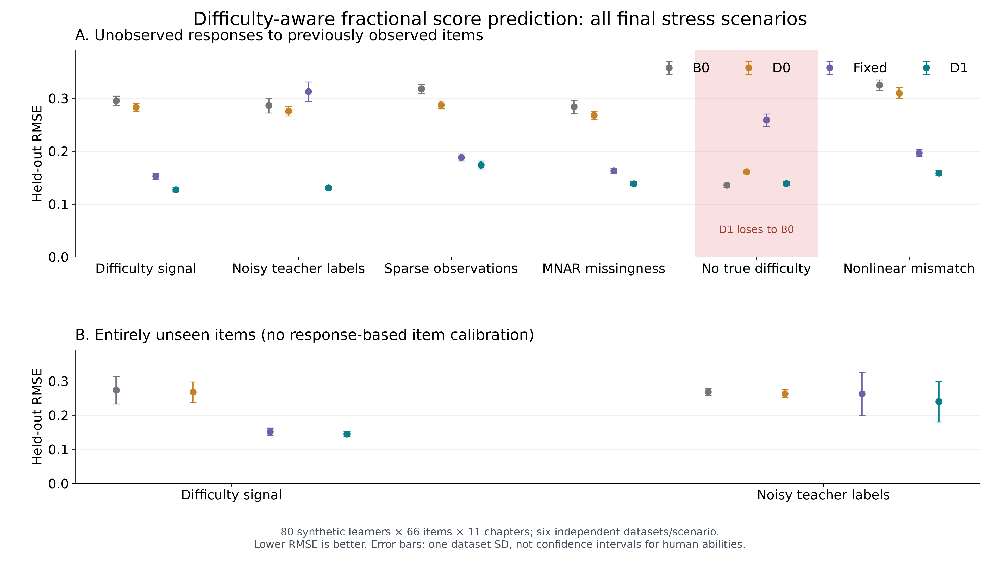

# 难度感知分数响应模型：可复现实验

2026-10-29。实验版本 `difficulty-v1`。本报告评估受控合成数据中的逐题分数预测，不构成真实学生能力、教师标注质量或课程教育效度的验证。

## 问题与对照

模型假定 `E[y_si] = sigmoid(sum_c(q_ic * theta_sc) - b_i)`，允许原始评分为 `[0,1]` 的连续分数。交叉熵仅用作拟合目标；没有将连续分数冒充二元独立试验，也没有生成模型置信区间。逐题预测与留出评分比较，避免把 B0 历史均值和 D1 的参考难度模型分当成相同预测目标。

| 对照 | 训练及预测 |
|---|---|
| B0 | 按训练评分计算每人各章加权历史均值；跨章测试题按题目章节权重组合均值。训练中完全缺失的章节仅在预测基准中使用 0.5，产品雷达仍然留空。 |
| D0 | 同一分数响应优化器，所有题目难度固定为 0；学生惩罚从验证集独立选择，形成较强的无难度对照。 |
| Fixed | 使用教师难度锚点，不用训练评分校准题目；与 D1 共用其选定参数，是锚点消融对照。 |
| D1 | 同时拟合学生章节参数和题目难度；题目以教师难度为惩罚中心。 |

正则化目标是评分交叉熵之和加 `learner_l2/2 * sum(theta²)` 和 `item_l2/2 * sum((b-anchor)²)`；锚点为 `difficulty_scale * (teacher_level-3)`。对所有对照均严格隔离留出评分，题目校准只读取训练评分。

## 生成与分割协议

每个独立数据集包含 80 名虚构学生、11 章、66 道题；每章 6 题，每三题中一题以 0.65/0.35 权重关联相邻两章。学生参数由共享水平 `N(0,0.85²)` 加章节扰动 `N(0,0.65²)` 生成。常规真难度为 `0.75*(level-3)+N(0,0.25²)`，教师标签由真等级加 `N(0,0.45²)` 后四舍五入并截到 1–5 生成。教师标签不是拟合器可访问的真难度。

给定真实期望分 `mu`，实际部分分来自 `Beta(14*mu,14*(1-mu))`，因此预测面对不可消除的评分波动。每个学生×题目至多生成一条评分。生成器保留每一对的真实期望分供离线审计；拟合器只接收训练部分分。缺失的模拟真值直接报错，不以 0 补齐。

| 场景 | 受控改变 |
|---|---|
| difficulty_signal | 常规难度、带少量噪声的教师标签；每对评分以 0.72 概率出现。 |
| mislabeled_teacher | 70% 教师标签替换为独立均匀的 1–5；剩余 30% 保留信号。 |
| sparse | 评分出现概率降到 0.20。 |
| mnar | 出现概率为 `sigmoid(0.2+2.8*(mu-0.5)+0.55*ability)`；依赖拟合器不可见的能力与真实期望分，故缺失非随机。 |
| no_difficulty | 真难度全部为 0，教师标签独立均匀；检验错误难度先验的代价。 |
| nonlinear_mismatch | 每题独立区分度 `Uniform(0.4,2.2)`；跨章题另加 `0.65*theta_1*theta_2` 交互；拟合器仍使用共同区分度 1 的线性模型。 |

已有题目任务按每位学生的完整学生×题目组随机分到 60% 训练、20% 验证、20% 测试，整数取整后略有比例差异；重复提交若存在也必须成组进入同一分割。选参只用验证部分。冻结参数后最终重复的训练和验证合并为约 80% 拟合集，约 20% 留作测试。

新题任务单独执行：每章整题留出一题，共 11 题；其余题的全部已出现评分用于训练。新题从未参与能力拟合或难度校准，预测沿用其教师锚点。该任务只在常规和错标教师两个场景运行，其训练量与已有题目任务不同，故两任务分开解释。

验证种子为 `1103,2207`；最终种子为 `31001,32003,33013,34019,35023,36037`。场景序号乘 100000 加到基础种子上；已有题目分割另加 719，新题分割另加 991。最终种子与验证种子完全隔离。统计单位是独立生成的数据集，每个场景 6 个重复；没有把同一数据集内数千条评分当成数千个独立实验。

## 选参和执行

候选 `(learner_l2,item_l2,difficulty_scale)` 共六组：`(0.05,0.3,0.75)`、`(0.15,1,0.75)`、`(0.5,4,0.75)`、`(0.15,4,0.75)`、`(0.15,1,0.4)`、`(0.5,1,0.4)`。选择目标是六场景×两个验证数据集的分数 RMSE 等权平均。D0 在相同验证分割独立比较学生惩罚 `0.05,0.15,0.5`。测试集不参与选择，也不据测试结果替换场景或种子。

D1 冻结为 `learner_l2=0.05,item_l2=0.3,difficulty_scale=0.75,max_iterations=180,tolerance=1e-6,calibrate_items=true`；D0 选择 `learner_l2=0.5`。预算在核心优化器的收敛基准之后、最终评估之前增加到 180 个坐标 Newton 扫描；达到预算上限不会被记作收敛。实验中间的验证阶段为加入独立 D0 选参而重启；未根据最终测试指标修改候选、场景或种子。详细参数、种子、源代码哈希以及选择结果冻结在 `data/analysis/experiments/difficulty-v1/protocol.json`，面向演示的精确平面参数另存 `selected-parameters.json`。

执行命令（项目根目录的虚拟环境，工作目录 `backend`）：

```powershell
../.venv/Scripts/python.exe -m scripts.experiment_ability_difficulty
```

脚本无数据库连接、外部 API 或新增产品依赖。原始验证结果为 `validation.csv` / `d0-validation.csv`；最终逐数据集×对照结果为 `per_repeat.csv` / `per_repeat.json`；汇总为 `summary.csv` / `summary.json`。每行同时保留 RMSE、MAE、对真实期望分的 RMSE、十分箱校准差、参数相关、收敛标记、扫描次数、目标函数值与耗时，保留所有失败或退化场景。

## 最终结果

完整成功执行用时 99.26 秒（当前 Windows 机器，不包含此前验证阶段重启）。72 次 D1 验证拟合、36 次 D0 验证拟合；最终 192 个数据集×任务×对照评估中，48 次是无优化器的 B0，144 次是 D0/Fixed/D1 拟合。全部最终拟合达到绝对坐标梯度不超过 `1e-6` 的收敛条件，最多 134/180 扫描。D1 单次拟合及评估平均 1.28 秒。全部验证拟合也收敛。

下面均为六个独立数据集的均值；`Δ` 为同一数据集内 `D1-B0` 的配对差，负数表示 D1 误差更低。`±` 是六个配对差的样本标准差，未冒充置信区间。

| 已有题目场景 | B0 RMSE | D0 RMSE | Fixed RMSE | D1 RMSE | 配对 ΔRMSE 均值 ± SD | D1 胜 B0 |
|---|---:|---:|---:|---:|---:|---:|
| 难度有信号 | 0.29530 | 0.28295 | 0.15248 | 0.12703 | -0.16827 ± 0.00801 | 6/6 |
| 教师错标 | 0.28617 | 0.27570 | 0.31256 | 0.13039 | -0.15578 ± 0.01536 | 6/6 |
| 稀疏评分 | 0.31771 | 0.28748 | 0.18822 | 0.17402 | -0.14369 ± 0.00973 | 6/6 |
| 非随机缺失 | 0.28405 | 0.26779 | 0.16304 | 0.13858 | -0.14547 ± 0.01205 | 6/6 |
| **无真实难度** | **0.13595** | 0.16080 | 0.25872 | **0.13903** | **+0.00308 ± 0.00171** | **0/6** |
| 非线性失配 | 0.32458 | 0.30959 | 0.19624 | 0.15866 | -0.16592 ± 0.01335 | 6/6 |

| 已有题目场景 | B0 MAE | D0 MAE | Fixed MAE | D1 MAE | 配对 ΔMAE 均值 |
|---|---:|---:|---:|---:|---:|
| 难度有信号 | 0.24867 | 0.24695 | 0.11676 | 0.09785 | -0.15083 |
| 教师错标 | 0.23936 | 0.23994 | 0.24218 | 0.10164 | -0.13772 |
| 稀疏评分 | 0.26508 | 0.25000 | 0.14596 | 0.13438 | -0.13070 |
| 非随机缺失 | 0.23377 | 0.23269 | 0.12380 | 0.10472 | -0.12904 |
| **无真实难度** | **0.10823** | 0.13456 | 0.20764 | **0.11132** | **+0.00309** |
| 非线性失配 | 0.27091 | 0.27012 | 0.15310 | 0.11716 | -0.15376 |

在这些生成机制中，D1 在有难度的五类场景均降低预测误差；教师错标时，对已有响应的题目进行校准明显优于固定教师锚点。不过，**无真实难度时 D1 在六个重复中全部输给 B0，平均 RMSE 约增加 2.3%**。错误难度先验和额外题目参数有代价，不能宣称难度建模总是更好。D0 的惩罚也按全场景验证目标冻结，并非专门为无难度场景重新调参。

新题的独立检验进一步限制了校准能力的表述：

| 整题留出场景 | B0 RMSE | D0 RMSE | Fixed RMSE | D1 RMSE | 配对 ΔRMSE 均值 ± SD | D1 胜 B0 |
|---|---:|---:|---:|---:|---:|---:|
| 难度有信号 | 0.27346 | 0.26694 | 0.15110 | 0.14484 | -0.12862 ± 0.04106 | 6/6 |
| 教师错标 | 0.26771 | 0.26309 | 0.26250 | 0.24004 | -0.02767 ± 0.06447 | 4/6 |

新题教师错标场景虽平均改善，却有两次重复退化，配对差的波动大于平均改善。其 D1 MAE 为 0.18483，B0 为 0.22773；常规新题对应 0.11243 和 0.23080。由于新题难度保持教师锚点，已有题目上的高校准表现不能外推成“能纠正从未作答题的错标”。训练中校准其他题目仍可能改善学生参数，因此 D1 与 Fixed 的新题预测也会不同。



图的误差线使用数据集之间的一个标准差，表示模拟波动，并非真实学生的置信区间。主图使用 Matplotlib 从已保存的 summary.json 绘制，PNG 为3840×2160，同名SVG可编辑；重绘脚本为 scripts/plot_ability_experiments.py，Matplotlib只用于离线出图，不是产品依赖。原单面板 rmse_by_scenario.svg/png 仍保留供核对。

辅助指标帮助辨别预测改善和参数恢复：已有题目 D1 的学生参数与模拟真值相关，常规场景约 0.930、稀疏场景约 0.678、MNAR 约 0.836；稀疏与选择偏差确实削弱参数恢复。常规题目难度相关约 0.995，错标场景约 0.985。真难度恒为零时相关系数无定义，文件保留为 `null`。相关仅是模拟量尺上的诊断，不能当成真人能力效度。

十分箱校准差和对真实 `mu` 的 RMSE 已保存在汇总和逐重复文件；它们是辅助诊断。分箱校准值依赖测试样本分布与分箱选择，不能代替逐题误差，也不构成未作答题或其他课程的校准保证。

验证候选平均 RMSE（顺序与上方候选列表一致）为 `0.15323, 0.15680, 0.18135, 0.16992, 0.15606, 0.17123`。该结果在最终评估前完成并写入冻结协议。五个实验协议保障测试通过：完整学生×题目组分割、缺失真值拒绝、11 章及分数生成可复现、整题留出隔离、B0 跨章逐题预测。实验没有运行数据库测试。

## 解释边界

生成器部分场景有意吻合模型形式，所以符合模型假设时的优势仅说明实现与模拟机制相容。MNAR 没有被该优化器显式建模；留出预测仍针对已出现评分，不代表所有未作答题目的无偏预测。新题没有训练响应，题目校准无法修复新题的教师错标。稀疏章节参数由零中心惩罚稳定，缺证据不会成为已证实的能力估计。

只有六个最终独立重复，支持描述受控场景中的配对变化；不足以提供对真实课程的推广保证。参考分 `sigmoid(theta)` 使用模型锚定量尺，仍不是跨课程可比的能力分或人格标签。正式启用前还需要真实、经授权且定版的评分数据，按课程时间和题目隔离做外部检验。
