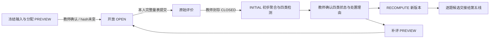

# 第③、④条链路：后端与数据设计

基线 main `938a8d2` / pg0006 / analysis-v2；本实现新增 pg0010，36张业务表。主入口为 `app/peer_review/router.py`，真实领域流程复用原分析 worker，不通过 DEMO 人工事件写入真实数据。

## 模块职责

| 模块 | 职责 |
|---|---|
| `peer_review/schemas.py` | 严格输入、完整量表、精确金额、时区、幂等标识、处置形状 |
| `snapshots.py` | 截止版本选择；单一 REPEATABLE READ 快照；课程作用域 HMAC 匿名键 |
| `core.py` | 任课权限、固定锁顺序、乐观版本、输入完整性、幂等命令 |
| `rounds.py` | 预览、发布前重校验、完整任务落库、延期、封存、补评 |
| `evaluations.py` | 学生本人权限、匿名 DTO、服务端计时、不可编辑原始评价 |
| `analyses.py` | 原始材料固定、历史独立基准、初步分析、教师处置、新版本、第五线交接 |
| `orchestration.py` | 快照 / 批次 / 人工领域事件适配，不在领域事务中嵌套 commit |
| `queries.py` | 教师轮次、分页任务、原始评价、历史版本和候选投影 |
| `analysis/algorithms/review.py` | 纯匹配与四类检测函数，只有匿名契约输入，不访问数据库 |

## 数据增量

| 表 | 业务事实及约束 |
|---|---|
| `review_rounds` | 主轮/补评、固定输入摘要、政策、截止、人工开放/封存、revision；每题最多一个未取消主轮，每个主轮最多一个活动补评 |
| `review_tasks` | round / submission / reviewer / answer_key；轮内同作品同评审唯一；首次打开及提交时间 |
| `review_evaluations` | 每任务唯一原始评价；全维度分、原总分、评语、服务端时长；按评审人＋请求ID唯一 |
| `review_analyses` | 主轮内递增版本；INITIAL 或 RECOMPUTE；批次、输入摘要、复核者/理由/证据状态 |
| `review_decisions` | 追加的评价或作品处置。降权为绝对权重，作废为0；作品改分按本题满分解释 |
| `review_commands` | 操作者、请求标识、操作、请求摘要与原始操作参数，保留延期等理由；幂等重放定位轮次/版本 |

原始评价与处置在业务 API 中只追加，无编辑/删除接口；维护数据库仍须遵循运维权限。题目、量表沿用原冻结版本。分析材料、步骤输入、结果继续保存在 `analysis_input_snapshots` / `analysis_artifacts`；每次读取校验摘要。学生 API 从固定源显式白名单投影，绝不直接返回内部快照。

## 状态及事务

三个分析子管线分别为 REVIEW_ALLOCATION（分配→人工开放→人工封存）、REVIEW_ANALYSIS（初聚合与时长并行；其后偏离/偏差/关系→人工复核）、REVIEW_RECOMPUTE（重聚合→有效逐题候选）。所有真实输出 `is_mock=false`，不回退到合成数据。证据不足也允许进入人工复核及逐题空值投影；不破坏旧 FULL/DEMO 的依赖策略。

写请求先锁操作者，再锁 Assignment（教师命令）、主轮、补评轮、具体任务。发布命令在锁 Assignment/主轮之前，额外按ID顺序锁定全部原名单用户及成员，确保发布前的账号/成员摘要校验与任务创建原子一致；不会形成“主轮→学生账号”的反向锁顺序。学生评审锁操作者→主轮→具体轮→任务。封存与评分共享主轮锁：评分先提交就进入封存集合，封存先提交则评分被拒绝。学生评分不递增教师配置 revision，避免多人评分使教师封存一直冲突。

作业发布后的名单及冻结题目沿用已有不可改规则；互评发布后禁止重新开放原作业提交或改源截止。学生撤回也锁 Assignment 并刷新状态，避免关闭/快照竞争。互评轮次延期以 `review_rounds.review_deadline` 为准，作业原有 `review_deadline` 仅用于原计划，不随补评改写。

人工命令的请求ID＋操作者锁保证相同内容重试重放；同ID不同内容返回409。配置命令还需 revision，发布及复核还需 source_hash。检测状态确认必须与服务器四类实际状态完全相等，不能只勾选“正常”。越权返回403/404；所有互评响应禁止缓存。

原始材料固定后，教师处置为新事实；最新同目标处置生效：KEEP 恢复评价权重1或清除作品改分；DOWNWEIGHT 设指定权重而非反复乘；INVALIDATE 设0；OVERRIDE 保留原聚合值，另记题目分与归一化值。没有自动迭代降权。补评有独立开放/封存事件，后续分析包含所有已封存轮次，输入保留完整处置列表与摘要。

worker 沿用120秒租约、token隔离、最多3次尝试和显式重试；不锁互评轮次。计算在领取事务之外，提交结果校验租约与 token。算法名称/版本在创建时固定，安装算法变化时要求新建批次，不能悄悄用新代码覆盖旧版本。

## 隐私与历史

HMAC键使用课程＋用途＋ID，保留课程内历史可比性，跨课程隔离。身份映射只存教师可访问的私有源；学生只读本人任务、正文、冻结题干/量表和本人已交评价。正文不自动识别个人信息，具体限制见功能说明。

长期偏差/关系历史只取同课程、当前范围内评审人与作者、早于本主轮创建的已复核初步分析材料，最多20个主轮、1000条。每条历史比较基准排除该评审本人，用其他有效评审的中位数，且须满足最低同伴数。历史从固定输入重新投影，不读未来结果，也不把重算版本重复算作新样本。分配的重复关系软成本另取最近10000个已发布任务，且完全固定于分配输入。
