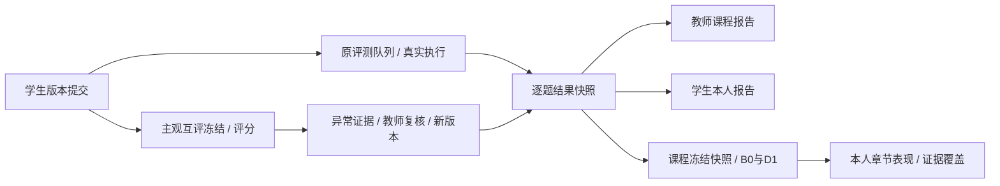

# 教师、学生与分析模块整合设计

日期：2026-10-30。整合 main `938a8d2`、互评实现和组员复杂度轨迹分支 `213fa7f`、章节表现交付分支 `151d891`，保留原提交历史。当前数据库36张业务表，单一迁移head为pg0010。

## 六条链路的实际完成度

| 链路 | 本版状态 | 已具备能力 | 明确未完成部分 |
|---|---|---|---|
| ① 编程评测 | 开发链路已接入 | 真实LOCAL执行、队列、固定测试与上下文、候选选择；题目分读取有证据的结果 | Linux隔离执行仍是原项目后续项；部分加权计分没有逐测试点证据时留空 |
| ② 内容证据 | 部分接入 | 同题代码Winnowing相似对/片段/簇、版本化证据、教师查看 | 文本相似、AI辅助信号仍为NOT_IMPLEMENTED；没有自动处罚或伪造研究结果 |
| ③ 主观互评 | 已接入 | 固定版本、完整匹配、人工开放、本人匿名量表评分、服务端计时、原始评价 | — |
| ④ 聚合与异常 | 已接入 | 四类证据、覆盖/不足状态、教师处置、补评及新版本重算 | — |
| ⑤ 逐题结果 | 已接入现行约定 | 编程与主观候选汇合、不可变逐题快照、来源引用与下游输入 | 遵循2026-10-27团队决定，不恢复原会议图中的作业总分/发布节点 |
| ⑥ 学习分析 | 部分接入 | 按题覆盖、班级题目均值、个人题目表现、记录事件计数、课程级冻结证据进入B0/D1、11章节表现、难度对照与本人面板 | 旧mastery/empirical_difficulty与legacy ability插件保留为NOT_IMPLEMENTED，B0/D1为独立已实现扩展 |

因此不能宣称“六条链路和全部研究算法均完成”。界面将部分接入与已接入分开，并列出五个历史占位插件（旧ability已另接B0/D1）。复杂度分析是已接入的附加研究能力，独立于分数。

## 统一数据边界

`backend/app/analysis/question_results.py`建立QUESTION_RESULTS批次，复用分析输入、运行和产物表，不新增第二套成绩表。固定过程在独立REPEATABLE READ事务读取已关闭且截止到达的作业；一次快照最多300位学生、10000个题目样本、8MiB。请求幂等按操作者和request_id串行处理。

- 编程候选复用现有 `choose_best` 排序，要求任务已成功完成、非模拟、当前执行模式/运行配置、冻结测试数一致以及合法最终判定。使用项目的ACCEPTED常量，拒绝系统错误和判定/通过数矛盾。
- 全测试点真实通过可得归一化1。部分通过仅在冻结测试点权重全部相同且为正时使用通过比例；权重不同时，缺少逐测试点结果则保留WEIGHTED_CASE_EVIDENCE_UNAVAILABLE，不能把通过数比例冒充加权分。
- 主观候选只读主轮当前有效重算产物，保留analysis_id、version、artifact_id、output_hash、source_hash；活动补评或新分析未完成时不得回退旧分。
- 逐题行保留本题满分、归一化值、题目分、未交/缺评/待处理原因、知识点权重与难度。零分与缺失严格区分，不产生跨题总分或个人作业均分。
- 输出保存在 `result_snapshot` 产物，含 `grades` / `results_snapshot_version`，兼容既有第六线 `capture_input`。同时固定 ability_input_v2 所需题目版本、章节映射、范围与评分来源，章节模型通过课程快照接入。
- 快照固定后不随原始数据变化。后续评分、处置或执行上下文变化需另建快照，旧快照和理由保留。

教师投影含当前范围的学生与来源；学生投影先按本人过滤，再计算覆盖及事件数，不返回其他学生身份、班级统计或隐藏测试点权重。通用分析批次查询依然只允许本课程教师。所有新增报告响应禁止缓存。

## 接口与页面

| 接口 | 权限 / 用途 |
|---|---|
| GET `/api/v1/analysis/courses/{id}/workflow-status` | 本课教师；六条实现状态、五个占位模型及课程实际记录数 |
| POST `/api/v1/analysis/courses/{id}/question-results` | 本课教师；request_id、assignment_id字符串、非空reason，固定逐题快照 |
| GET `/api/v1/analysis/courses/{id}/question-results/latest` | 课程身份；可选assignment_id、limit≤100、offset；教师全范围，学生仅本人 |
| GET `/api/v1/analysis/question-results/{batch_id}` | 读取固定历史版本，相同权限投影与分页 |

教师新增 `/teacher/analysis` 分析中心及 `/teacher/results` 逐题结果；统一导航到相似、复杂度、互评、结果。学生新增 `/student/courses/:courseId/learning` 与 `/student/courses/:courseId/ability`，沿用现有作答、版本详情、复杂度、本人互评入口。权限始终由后端独立检查。

前端共用 `features/analytics/Results.vue`，分别展示课程和个人投影；不在浏览器拼接同学数据。固定结果前需选择作业、填写理由并确认；响应丢失保留原请求ID。报告展示固定时间/版本，缺评为空，模型未实现有明确说明。

## 布局与视觉

`frontend/src/workspace.css`为统一设计层，覆盖教师、学生和分析页，保留原业务逻辑。参考答题平台常用的题面/编辑器分栏、清晰工具栏与低干扰内容区，未复制品牌素材。

- 桌面题面与编辑器接近等宽，编辑器略宽；题面独立滚动，代码带行号和独立水平滚动。
- 页面横向留白22–44px；卡片正文20–26px，修复原学生题面、结果、复杂度面板贴边。
- 标题25–31px、章节16–20px、正文14–15px、辅助信息11–13px；正文行距与代码行距分别调整。
- 统一边框、圆角、按钮、状态、表格、焦点；窄屏恢复单栏、菜单折叠，表格在容器内滚动。

## 迁移冲突处理

组员已使用pg0007–pg0009，未发布的互评pg0007改编号为pg0010，down_revision=pg0009，功能表不变。新建库或来自团队pg0006/pg0009的库直接 `alembic upgrade head`。

本机此前运行的是另一个未发布pg0007（互评版）：已先完整备份，再仅对这一本机库校验实际表结构，补齐复杂度迁移并核对完整metadata一致后更新版本标识。原34表行数逐表保持不变。此历史本机修复不是可通用的升级流程，其他机器不要直接stamp；先核实库的真实schema。测试库按既有约定可清空，另行从空库验证完整升级/降级/再升级。

## 复杂度调度衔接修正

API、评测与复杂度worker必须使用相同的执行模式和运行配置。复杂度领取仅匹配本worker上下文；错误环境的worker不会把他处的合法任务消费为INELIGIBLE。后端与界面均可显式重试已恢复资格的INELIGIBLE/FAILED报告，新的请求ID才入队，同ID重放不重复计算，本版本最多3次尝试。旧报告、错误、轨迹及重试请求保存在history。

每次领取固定report_id、attempt_no、started_at，写回同时校验此三元组、RUNNING状态及租约。过期worker即使在新尝试已领取后返回，也不能覆盖新结论。成功报告仍按提交与算法版本保持幂等；不因为刷新页面重新执行源码。

## Student ability 接入

2026-10-30保留 feat/student-ability-delivery 的提交历史，补齐教师生成、正式课程快照、B0/D1计算与学生本人面板。详见[章节模型接入设计](student-ability-integration.md)。无需新增迁移。
