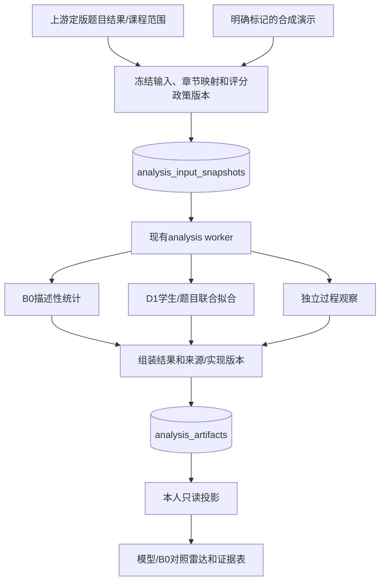

# 学生章节表现评价算法设计说明

2026-10-30接入更新：B0/D1已通过课程级冻结快照连接真实编程与互评复核来源，并提供教师生成及学生本人入口；[当前接入设计](student-ability-integration.md)。本页此前关于等待上游的说明为交付时状态。

版本：1.0 · 日期：2026-10-29 · 交付分支：`feat/student-ability-d1`

本说明面向课程报告、组会讲解与队友接入。当前交付包含 B0 描述性基线、D1 难度感知模型、独立过程观察、可复现实验及个人雷达面板。

## 1. 问题定义与交付范围

平台需要在不同题型、不同题目难度、评分尚不完整的条件下，说明学生在算法课程各章节的作答表现。直接平均分不能区分“简单题得高分”和“困难题得高分”，最终是否通过也不能完整描述修改过程。

本项目采用双轨输出：

- **B0：已观测表现。** 汇总实际已评分题，回答“在本次题目集合中表现怎样”。
- **D1：参考难度模型表现。** 用题目难度与学生章节参数解释成绩，回答“在模型定义的参考难度下，预期表现怎样”。

两者输出对象不同，差值不能直接解释为学习进步。提交过程作为单独观察，不加到能力总分中。

本轮不计算每次作业总分或综合rating，不输出掌握概率、人口百分位或未经校准的置信区间。受控合成实验不能证明真人能力或岗位胜任力效度。

## 2. 章节、题型与分析范围

章节轴由原始题库文件夹确定，代码和顺序稳定：

| 代码 | 章节 | 代码 | 章节 |
|---|---|---|---|
| CH01 | 贪心算法 | CH07 | 排序与查找 |
| CH02 | 分治算法 | CH08 | 数据结构 |
| CH03 | 动态规划 | CH09 | 数学与数论 |
| CH04 | 图论 | CH10 | 位运算与杂项 |
| CH05 | 搜索与回溯 | CH11 | 数组与模拟 |
| CH06 | 字符串 | — | — |

题库共120题：70道编程题按原文件夹单章归属；50道主观题中45题已有暂定映射，5题保持UNMAPPED。跨章题的归因权重为工程选择，保留复核标记，不假称测量校准。细粒度知识点标签不因章节映射而删除。

映射及依据保存在：

- `data/analysis/chapter-taxonomy.json`
- `data/analysis/question-chapter-mapping.json`

分析范围为课程已发布作业的累计范围。学生名单独立于已布置关系保存，因而“没有布置任何题”的学生仍能获得明确状态。实际来源必须由上游提供完整冻结输入；不从实时数据库猜测历史。

编程、算法分析、证明、开放问答都参与分析；后三种在题型诊断中归为SUBJECTIVE。同章两类题按章节权重合并，不额外规定各占50%。

## 3. 输入、输出与符号

| 符号 | 含义 |
|---|---|
| $s,i,c$ | 学生、作业题目实例、章节 |
| $\Omega$ | 具有有效定版评分的学生—题目记录集合 |
| $y_{si}\in[0,1]$ | 上游提供的单题归一化成绩，可含0和1 |
| $q_{ic}\ge0$ | 题目对章节的归因权重，映射题满足总和约为1 |
| $d_i\in\{1,2,3,4,5\}$ | 教师主观难度等级 |
| $a_i=\gamma(d_i-3)$ | 题目难度的先验锚点 |
| $\theta_{sc}$ | 学生章节参数，无天然百分制单位 |
| $b_i$ | 通过当前冻结评分校准的题目难度参数 |
| $\lambda_\theta,\lambda_b>0$ | 学生、题目参数的正则化强度 |

### 3.1 输入契约

D1采用独立包装契约 `DifficultyInputV1`：

```json
{
  "learning_input": {
    "contract_version": "ability-b0-v1",
    "source_kind": "DATABASE | SYNTHETIC_FIXTURE | DEMO",
    "results_snapshot_version": "上游结果版本",
    "scoring_policy_version": "计分政策版本",
    "chapter_taxonomy_version": "chapter-taxonomy-v1",
    "chapter_mapping_version": "question-chapter-map-v1",
    "scope": {
      "scope_kind": "COURSE",
      "scope_label": "课程累计范围",
      "student_keys": ["匿名学生标识"],
      "assignment_ids": ["已发布作业标识"],
      "expected_pairs": ["学生—题目实例及状态"]
    },
    "chapter_taxonomy": ["11章词表"],
    "items": ["题目实例、题库代码、版本、题型、满分、难度、章节权重"],
    "grades": ["唯一采用成绩及结果来源引用"],
    "parameters": {"method": "B0", "merge_policy": "CHAPTER_WEIGHT"}
  },
  "model_parameters": {
    "learner_l2": 0.05,
    "item_l2": 0.3,
    "difficulty_scale": 0.75,
    "max_iterations": 180,
    "tolerance": 0.000001,
    "calibrate_items": true
  },
  "processes": ["可选的已冻结提交事件，不参与主模型拟合"]
}
```

以上为结构示意，字符串说明不是可直接提交的真实对象。完整机器可读schema由 `/api/v1/analysis/difficulty-contract` 返回。

输入必须校验学生/题目引用、章节权重、评分范围、唯一性及状态一致性。同一学生—题目的同值同来源重复可去重；冲突定版成绩拒绝。跨作业重复布置同一道题时，题目实例ID不同，不按题库代码擅自合并。

### 3.2 输出与解释

后端逐学生固定输出11章，字段包括：

- `value`：D1参考难度0上的模型期望分；缺有效评分时为null。
- `baseline_value`：同一输入的B0原始章节均值。
- `theta`：章节参数，仅供可解释诊断与版本审计。
- `status`、题数、权重总量、Kish有效数、覆盖度、缺失原因。
- 编程/主观的**原始**子均值，不冒充模型分别估计的能力。
- 优化是否收敛、迭代次数、目标函数值、模型参数及证据版本。

教师1—5级难度仅提供有序先验。映射尺度0.75是验证集选定的参数，不等于教师等级已被校准为logit。不同课程没有共同锚点时，不能直接比较章节参数或参考分。

## 4. B0描述性基线

对于学生 $s$ 在章节 $c$ 的已评分题集 $V_{sc}$：

$$
B0_{sc}=\frac{\sum_{i\in V_{sc}}q_{ic}y_{si}}
{\sum_{i\in V_{sc}}q_{ic}}.
$$

例如同章两道编程题分别为0.8和1.0，一道主观题为0.5，权重均为1，则B0为0.7667。两类题数量会影响合并结果，题型子均值同时展示，以便解释。

未提交、待评、无效记录不补零。归因权重不是题目满分权重、题型固定占比或评分者可信度。Kish量 $(\sum q)^2/\sum q^2$ 对权重整体缩放不变，只作均衡度诊断。

## 5. D1正则化分数响应模型

### 5.1 条件均值

$$
\eta_{si}=\sum_c q_{ic}\theta_{sc}-b_i,
\qquad \mu_{si}=\sigma(\eta_{si})=\frac{1}{1+e^{-\eta_{si}}}.
$$

同样的成绩在不同难度的题上可提供不同信息。题目参数由当前训练评分在教师锚点附近校准；它与学生参数共同拟合，不是人为在题分上加“难题奖励”。

### 5.2 目标函数

$$
\mathcal L=\sum_{(s,i)\in\Omega}
\left[\log(1+e^{\eta_{si}})-y_{si}\eta_{si}\right]
+\frac{\lambda_\theta}{2}\sum_{s,c}\theta_{sc}^{2}
+\frac{\lambda_b}{2}\sum_i(b_i-a_i)^2.
$$

连续部分分使用条件均值/准似然意义下的交叉熵拟合目标；不将分数伪装成整数次伯努利试验。目标对参数凸，严格正的二次惩罚使活跃参数上的解唯一并固定量尺。该优化性质不等于统计效度或无偏性。

正则化能使全0、全1或小样本参数保持有限，避免无惩罚完全分离导致参数发散。完全没有证据的章节即使内部可给先验，也不在雷达中作为有效分数显示。

## 6. 优化算法：稀疏坐标Newton

令题目偏移 $\delta_i=b_i-a_i$，把所有学生参数与题目偏移组成坐标向量 $v$。初值均为0，预测子缓存初始化为 $-a_i$。每条记录仅连接非零章节参数及一个题目偏移，题目偏移的系数为-1。

对坐标 $j$，关联记录为 $A_j$，系数为 $x_{rj}$，惩罚为 $\lambda_j$：

$$
g_j=\lambda_jv_j+\sum_{r\in A_j}x_{rj}(\mu_r-y_r),
$$

$$
h_j=\lambda_j+\sum_{r\in A_j}x_{rj}^2\mu_r(1-\mu_r)>0.
$$

候选更新为 $\Delta_j=-g_j/h_j$。实现将单步限制在[-2,2]，再回溯检查该坐标相关目标函数没有增大；同步更新缓存预测子。所有键固定排序，不使用随机优化顺序。

```text
输入：题目元数据、训练评分、正则化和优化参数
校验并去重学生—题目评分，按稳定键排序
建立稀疏“坐标→关联记录”索引
初始化学生参数=0，题目偏移=0，eta=-教师难度锚点
repeat 最多 max_iterations 次：
    按固定顺序遍历活跃坐标：
        根据当前缓存eta计算梯度g和曲率h
        若 |g| 已低于容差，跳过该坐标
        计算并截断Newton步
        回溯检查局部目标，再更新参数和eta缓存
    重新计算全部活跃坐标梯度
    若最大绝对梯度 <= tolerance：converged=true，结束
返回参数、目标函数值、扫描次数和收敛标记
```

每步最多40次回溯。达到180扫描上限但梯度未达标时，返回 `converged=false`，页面明确标为暂定结果，不伪称优化成功。sigmoid与softplus均使用稳定形式，允许0/1端点且不直接求观测分数的logit。

## 7. 预测、展示和缺失语义

留出题目的预测为 $\hat y_{si}=\sigma(\sum_cq_{ic}\hat\theta_{sc}-\hat b_i)$。未参与校准的新题沿用其教师锚点，不能假装校准过。

雷达上每章的模型参考分为 $\sigma(\hat\theta_{sc})$，含义是“参考难度0、只关联该章的假想题”的模型期望分。它不是现实任务的通用成功概率或掌握概率。原始均值与模型参考分双轨展示，明确二者对象不同。

| 状态 | 判断 | 页面行为 |
|---|---|---|
| NOT_COVERED | 本章对该学生没有已布置题目 | 隐藏该轴 |
| NO_EVIDENCE | 已布置，但没有有效定版评分 | 留空并显示原因，不补零 |
| LOW_EVIDENCE | 有评分但不足3题，或评分覆盖不足50% | 显示值和低证据提示 |
| OK | 达到公开的展示证据门槛 | 显示值、题数、覆盖和类型分项 |

3题与50%是可配置工程门槛，不是测量学定理。真实原始0分在B0中保持0；D1正则化后的参考分可以不为0，页面将两者分开，不改写正式题分。全等分只作诊断，不自动降为低证据。有效轴不足3个时不强画多边形。

## 8. 独立提交过程观察

过程输入按学生、题目及提交序号冻结，报告提交记录数、首次/最近/最佳已观测分、首次AC序号以及相邻同类失败对数。序号有缺口时不重编号，也不把不连续事件当作相邻提交。

这些观察不改变D1损失或章节分。提交次数多不等于能力差，提交时间间隔不等于有效思考时间，CE/WA/TLE也不是同一种认知错误。它不是Jadud原始EQ的复现。

当前演示过程为明确标记的合成轨迹，用于验证管道与展示。正式过程证据尚未接入时返回available=false，不根据真实题分生成虚构提交史。

## 9. 系统结构、串并行与可复现性



输入冻结先于计算，结果持久化先于读取。B0与过程观察是独立逻辑分支；D1因共享题目参数需要联合迭代，不宣称不同学生的拟合统计独立。当前实现用固定顺序串行坐标更新，避免并发更新覆盖缓存。

相同输入、参数和实现版本得到相同结果。参数从验证选定文件复制进新快照；历史快照和hash不重写。新B0/D1是独立版本扩展，不替换历史15槽位或原占位ability批次。

正式和合成来源分别查询，学生API从认证身份推导student_key，只返回本人结果。无正式来源时明确等待，不使用模拟结果回退。最新等待/失败批次不会伪装成已经完成的旧结果。

## 10. 时间与空间复杂度

设R为去重后的有效成绩条数，L为每题非零章节数，D为活跃参数数，S为学生数，C=11，I为题目数，T为扫描次数。

- 索引构建约O(RL+I)；稳定排序另需O(R log R+I log I+D log D)。
- 单次坐标扫描和收敛检查约O(RL+D)，回溯上限40为固定常数。
- 拟合总时间约O(T(RL+D))，另加排序预处理；没有构建R×D稠密矩阵。
- 稀疏索引及缓存空间O(RL+D)，最终参数和章节输出还需O(SC+I)。
- 过程观察主要为分组与排序，E条事件最坏约O(E log E)，不参与优化循环。

本机实验中D1单次拟合及评估平均约1.28秒，使用80名模拟学生、66题。实际时延取决于评分数量、稀疏性与收敛条件，不能以该值承诺任意规模性能。

## 11. 实验设计与结果

### 11.1 对照与隔离

比较B0、无难度模型D0、固定教师难度Fixed及联合校准D1。验证集选择D1惩罚和难度尺度；D0的学生惩罚独立选取，避免弱化对照。Fixed共用D1参数，仅作为校准消融。

每组80名虚构学生、66题、11章。验证种子与最终种子不重合；学生—题目记录按组分割，不让同题重复提交跨训练和测试。已有题目任务按约60/20/20分割，配置冻结后最终拟合用约80%、测试留20%。另外完整留出11道题检验新题。

六个场景均保留，每场景六个独立最终数据集。总计72次D1验证、36次D0验证、192次最终对照评估；其中144次需优化，全部收敛，最多134/180扫描。

### 11.2 逐题留出预测

| 场景 | B0 RMSE | D0 RMSE | Fixed RMSE | D1 RMSE |
|---|---:|---:|---:|---:|
| 有难度信号 | 0.29530 | 0.28295 | 0.15248 | 0.12703 |
| 教师难度错标 | 0.28617 | 0.27570 | 0.31256 | 0.13039 |
| 稀疏评分 | 0.31771 | 0.28748 | 0.18822 | 0.17402 |
| 非随机缺失 | 0.28405 | 0.26779 | 0.16304 | 0.13858 |
| 无真实难度差异 | 0.13595 | 0.16080 | 0.25872 | 0.13903 |
| 非线性失配 | 0.32458 | 0.30959 | 0.19624 | 0.15866 |

D1在前述五类有难度场景降低误差；没有真实难度差异时六次重复均输给B0，平均RMSE约增加2.3%。这个失败场景没有被删去。新题教师错标时只胜出4/6次，不能把已有题目上的校准成功外推为能够纠正从未作答题的错误难度标签。

主图见[4K实验图](../../../data/analysis/experiments/difficulty-v1/difficulty-model-validation.png)。完整MAE、配对差、数据集标准差、种子、源文件hash和负例见[实验报告](difficulty-experiments.md)及 `data/analysis/experiments/difficulty-v1/`。图中误差线为独立数据集之间的标准差，不是学生能力置信区间。

### 11.3 验证边界

部分生成场景与模型结构相容，所以优势首先说明实现能够恢复受控结构；不代表真实课程也有相同增益。MNAR场景的留出预测仍针对已出现记录，不等于对全部未作答题无偏。模拟参数恢复、真实能力效度和教学效果是三件不同的事。

## 12. 工程实现索引

| 文件/模块 | 职责 |
|---|---|
| `analysis/algorithms/difficulty_model.py` | 通用纯优化器与逐题预测 |
| `analysis/algorithms/ability_difficulty.py` | 章节适配、B0对照及过程观察 |
| `analysis/framework/difficulty_contracts.py` | 专用输入输出及范围约束 |
| `analysis/framework/difficulty_line.py` | 参数冻结、演示元数据及轨迹来源 |
| `analysis/framework/ability_b0_line.py` | 复用批次创建、来源校验和本人投影 |
| `analysis/framework/catalog.py`、`graph.py` | 版本化扩展注册及单任务线路 |
| `frontend/.../student/Ability.vue` | 对照雷达、证据表、过程及收敛提示 |
| `scripts/experiment_ability_difficulty.py`（backend内） | 无数据库的可复现实验 |

后端代码路径均相对于 `backend/app/`，前端路径相对于 `frontend/src/features/`。核心算法不导入Web或数据库，不读取姓名、秘密配置、当前时间或随机全局状态。

实现标识：算法key `ability_d1`，实现名 `difficulty_fractional`，实现版本 `2`，契约 `ability-difficulty-v1`。无需新增数据库迁移，复用已有分析任务、输入与结果表。

## 13. 运行与交接

在backend目录运行：

```powershell
..\.venv\Scripts\python.exe -m scripts.demo_student_ability_difficulty
..\.venv\Scripts\python.exe -m scripts.experiment_ability_difficulty
```

第一个命令创建新合成批次并执行真实优化，返回实际课程ID和演示地址；第二个重跑实验。为保留交付结果，可给实验传 `--output` 指向新目录。

本机演示：[D1个人面板](http://127.0.0.1:5173/student/courses/1/ability?demo=1&model=d1)。使用已有demo.student01，密码仅保留在本地.env。其他机器按CLI返回的课程ID访问，不硬编码ID。

主要API：

| 方法 | 路径 | 用途 |
|---|---|---|
| POST | `/api/v1/analysis/courses/{id}/student-ability/difficulty-batches` | 教师创建D1任务 |
| GET | `/api/v1/analysis/batches/{id}/input` | 教师查冻结输入和hash |
| GET | `/api/v1/analysis/batches/{id}` | 教师查状态与artifact |
| GET | `/api/v1/courses/{id}/my-ability/difficulty` | 学生本人正式投影 |
| GET | `/api/v1/courses/{id}/my-ability/difficulty/demo` | 学生本人合成投影 |
| GET | `/api/v1/analysis/difficulty-contract` | 登录后查完整JSON Schema |

交给队友的正式输入依赖为：已发布作业范围、学生—题目关系、唯一采用的单题归一化成绩、题目/评分政策版本，以及可选过程证据。正式编程计分与互评聚合由上游负责人提供，本算法不重新判题、不替教师决定缺交计分政策。

## 14. 完成判据与后续工作

本轮已交付：算法和单元测试、训练/验证/测试隔离的模拟实验、原始结果与图、数据库持久化执行、本人权限、前端演示及设计说明。

尚不等于整个三人项目全部完成：真实计分和互评接入、正式评分发布、真人效度及更广泛教学应用仍有各自责任边界。5个未映射题和标记待复核的归因权重仍可由课程负责人后续修订；新映射必须升级版本，不能改写历史结果。

## 15. 方法来源与AI辅助说明

1. Papke, L. E., & Wooldridge, J. M. (1996). *Econometric Methods for Fractional Response Variables with an Application to 401(k) Plan Participation Rates*. 方法来源见[NBER记录](https://www.nber.org/papers/t0147)。支持分数响应建模的一般背景，不直接证明本项目有效。
2. Bolsinova et al. (2022). *Tracking a multitude of abilities as they develop*. [开放原文](https://pmc.ncbi.nlm.nih.gov/articles/PMC9796260/)。提供学生/题目区分与动态测量背景，本项目没有复现其Urnings模型。
3. Li et al. (2022). *PST: Measuring Skill Proficiency in Programming Exercise Process via Programming Skill Tracing*. [作者PDF](https://yxonic.github.io/pdfs/li2022pst.pdf)。支持关注代码迭代过程，本项目没有复现其图神经网络。
4. [CodeSignal官方评分说明](https://support.codesignal.com/hc/en-us/articles/13408542717079-Understanding-Assessment-Score)、[HackerRank代码质量说明](https://support.hackerrank.com/articles/9625818007-code-quality-evaluation)仅作产品参考，不声称复制商业参数或招聘效度。

本实现的章节载荷、二次惩罚、坐标优化、输入契约和展示由项目独立组合设计。AI辅助资料检索、代码、测试和文档整理；实验数值来自实际脚本运行与保存的原始结果，不是语言模型估算。汇报者应能解释模型、复杂度、反例及系统边界。
