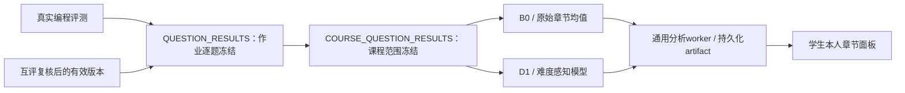

# Student ability 与课程平台接入设计

更新：2026-10-30。来源 `feat/student-ability-delivery`，提交 `151d891`；接入 `feat/course-platform-integration`。保留 B0、D1 算法与历史实验；本轮完成正式逐题来源、教师入口与学生导航。数据库仍为36张业务表，迁移head pg0010，无新增表或迁移。

## 数据链路

作业逐题快照新增 `chapter_metadata` 与经过 `AbilityInputV2` 校验的 `ability_input_v2`，一次固定题目代码、版本、题型、满分、教师难度、11章映射/权重、名单、布置题对、评分状态及评分引用。映射版本同时含文件摘要，不通过实时库推测旧版本的章节归属。新题没有代码映射时保留空章节权重，逐题证据继续保留，但不强制归类到雷达。

课程快照只合成不可变作业快照。默认采用各作业最新的一个 COMPLETE 逐题快照；API也可显式选择历史来源。同一作业选择两个版本会拒绝，防止重复计数。不同作业的题目项分别作为作答证据，即使复用同一题目版本也按各自作业项区分。学生名单取已选快照名单的并集，仅在各作业实际名单中生成布置题对；不把未布置算成未交。范围标明采用多少次已固定作业，不声称覆盖课程所有作业。

章节映射、词表、计分政策必须一致；版本不同会返回冲突，不静默拼接。旧快照缺少完整元数据时必须重新固定该作业的逐题结果，旧快照不改写。新增评分、补评或改分后依次生成新的逐题快照、课程快照和模型批次；旧模型继续引用原冻结输入。

## 评分语义

- 编程分只读现有经过真实运行上下文、测试集数量、合法判定与通过数一致性验证的结果；部分得分仍要求等权测试点证据，不新增未经确认的计分规则。
- 主观分只读教师复核后的有效重算产物，保留版本与摘要引用。
- 有分记为 SCORED，未交记为 NOT_SUBMITTED，互评待处理/样本不足记为 PENDING；其他证据不可用记为 INVALID。真实0分保持0，不以未交或缺评填零。
- B0按题目章节权重合并，D1保留其固定模型参数与参考难度语义。D1与B0差值不解释成学习进步或知识掌握概率。
- 正式过程轨迹本轮不从实时提交记录重构；D1 `process_evidence=UNAVAILABLE`，不由得分编造提交次数或首次通过。原有独立合成轨迹演示继续明确标记。

## 后端职责与接口

| 文件/接口 | 职责与权限 |
|---|---|
| `backend/app/analysis/question_results.py` | 一致性读取作业证据、固定章节元数据；校验root/artifact/hash与非mock标记 |
| `backend/app/analysis/course_results.py` | 只由冻结逐题产物组成课程范围输入，不读取当前题目/名单来补历史 |
| POST `/api/v1/analysis/courses/{id}/course-results` | 本课教师；`request_id`、`reason`、可选`source_batch_ids`字符串数组；返回课程快照id、来源数、评分覆盖 |
| POST `…/student-ability/b0-batches` | 本课教师；`mode=REAL_INPUT`、`source_batch_id`引用课程快照、`request_id`；创建B0任务 |
| POST `…/student-ability/difficulty-batches` | 同上，创建D1任务；模型参数随本次输入固定 |
| GET `…/student-ability/status` | 本课教师；各模型最新正式批次及运行状态，缺证据不显示为已评分 |
| GET `/api/v1/courses/{id}/my-ability` | 当前课程学生本人；B0个人投影，禁止缓存 |
| GET `/api/v1/courses/{id}/my-ability/difficulty` | 同上，D1个人投影；`/demo`仍是独立合成入口 |

每个创建请求以操作者与request_id串行幂等。创建课程快照时默认查找已选范围，各作业只采用一个版本；同ID重放返回已固定版本，不因出现新来源而改变。正式模型批次复制来源输入并固定hash，worker不回读实时题分；查询验证结果摘要。课程快照上限100次作业、300位学生、10000个学生题目样本、8MiB，超限返回可操作错误。范围较大时通过source_batch_ids显式缩小。

学生接口只选择当前课程和相同模型/来源的最新批次，返回本人11章估计及范围标签、采用作业数；不返回其他学生、完整输入、证据题目key或原始评审。最新等待/失败状态不会自动回退旧分，未布置隐藏，待评留空。教师原始输入查询始终在后端核验本课教师身份。

## 前端职责

| 文件 | 职责 |
|---|---|
| `frontend/src/features/analytics/AbilityGeneration.vue` | 教师逐题结果页底部的生成理由、范围确认、课程快照→B0/D1创建及状态刷新 |
| `frontend/src/features/analytics/Results.vue` | 逐题结果与学习报告；改掉原“能力算法未接入”提示，学生链接到章节面板 |
| `frontend/src/features/student/Ability.vue` / `ability.ts` | B0/D1切换、雷达/少于3轴时条形图、覆盖与缺失、题型诊断、来源版本和范围说明 |
| `frontend/src/features/student/StudentLayout.vue` / `app/router.ts` | 学生导航及 `/student/courses/:courseId/ability` 路由，与作答、互评、学习报告并存 |

教师创建过程响应丢失时保留课程/B0/D1三个命令ID；再次提交相同输入重放已有批次，避免半成功产生重复任务。页面在确认中说明采用每次作业最新已固定快照；它与顶部所选单次作业筛选的范围不同。前端不接收原始分数或上传算法结果。

## 验证与边界

自动化覆盖真实编程候选、互评复核产物→章节模型，0与缺失、多个作业合并、历史选择及防重、映射版本冲突、旧元数据拒绝、摘要破坏、本人权限、mock隔离和前端断网重试。完整HTTP脚本见 `scripts/smoke_ability_integration_http.py`；验收记录见[本轮证据](../../implementation/evidence/integration/2026-10-30-student-ability.md)。

B0/D1是已实现的独立扩展；旧 `ability`、`mastery`、`empirical_difficulty` 槽位保留历史契约，不能因此再次声称“学生章节能力尚未实现”，也不能声称所有旧研究插件已经完成。文本相似、AI辅助信号仍待接入。既有实验为受控合成数据，不能证明真人效度；本机验收使用合成课程的真实LOCAL评测与互评证据，不代表真人成绩。继续遵守团队不生成作业总分/发布总分的约定。

## 通用worker并发修正

最终回归复现同批次两个worker领取时父批次行也被锁定，导致另一worker偶发跳过该批次全部READY任务。领取SQL现使用 PostgreSQL `FOR UPDATE OF analysis_runs SKIP LOCKED`，只锁任务行；完成阶段仍锁批次与任务并校验尝试token/租约。新增测试在独立连接持有父批次行锁，验证任务仍可被另一个连接领取，避免依赖线程时序才能复现。
