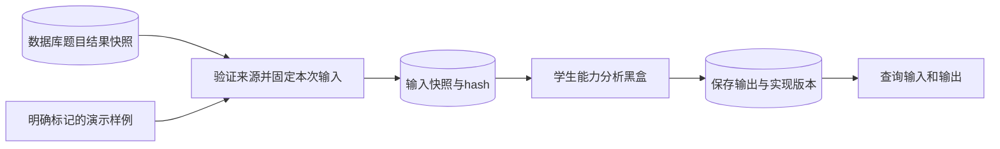

# 第六条线：线路先贯通，能力算法保持黑盒

2026-10-27。只实现接线、输入保存、现有占位黑盒调用、输出保存与查询，不研究能力维度、指标或算法。原ability插件、输入输出类型及模拟函数均未修改。



STUDENT_ABILITY是独立批次类型，只有一个ability任务，不先运行匹配、互评、异常检测等其他线路。原FULL的23步联调仍保留。两种批次都复用现有表和worker，无需新增数据库迁移。

## 入口与样例

当前课程教师可调用：

- POST `/api/v1/analysis/courses/{course_id}/student-ability/batches`
- GET `/api/v1/analysis/batches/{batch_id}/input`
- GET `/api/v1/analysis/batches/{batch_id}`

创建独立演示：`{"mode":"DEMO","seed":20261026,"request_id":"sixth-demo-001"}`。需要复用同课程已经保存的题目结果时，追加字符串`source_batch_id`。接口不接受浏览器提交原始分数或伪造算法结果。

输入查询返回现有ability契约payload、seed、对应input_hash、算法输入snapshot_id，以及独立source_hash/source_snapshot_id与源batch/artifact引用。`input_hash`严格对应`payload`，可以直接用于离线调用现有黑盒。输入复制并固定后，后续来源变化不会改动本次分析输入。

在backend目录，演示独立线路：

```powershell
..\.venv\Scripts\python.exe -m scripts.demo_student_ability
```

复用当前课程已有的题目结果快照（替换实际批次ID）：

```powershell
..\.venv\Scripts\python.exe -m scripts.demo_student_ability --source-batch-id 7
```

没有真实上游结果时验证等待状态：

```powershell
..\.venv\Scripts\python.exe -m scripts.demo_student_ability --mode REAL_INPUT
```

DEMO输出明确is_mock=true，仅验证线路，不代表真实学生能力。REAL_INPUT没有来源则WAITING_INPUT/QUESTION_RESULTS_REQUIRED；不能拿DEMO来源冒充真实输入。真实来源已齐但能力插件仍未实现时，任务可以完成计算调度并返回NOT_IMPLEMENTED，而不是伪造能力值。

先保留现有LearningInput/Estimate作为传输格式，不在这里决定能力维度或建模方法。之后论文调研确定算法再替换黑盒，并按框架要求升级实现版本。

## 调试注意

更新代码后重启API和全部分析worker：旧worker不了解单任务批次结构。当前数据库仍为pg0006。学生无权创建批次或查看通用分析输入/结果；每位教师只能操作任课范围。

2026-10-30整合：可读取QUESTION_RESULTS真实逐题快照；能力插件仍为占位，不产生能力分。当前整合迁移head pg0010。见[整合设计](platform-integration.md)。
