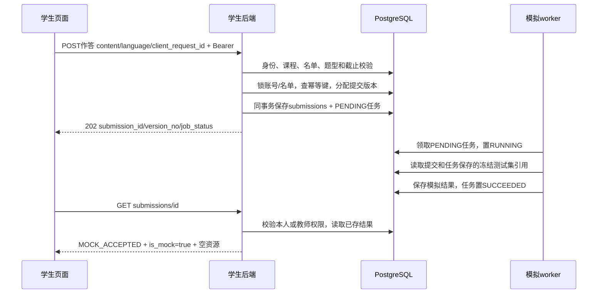
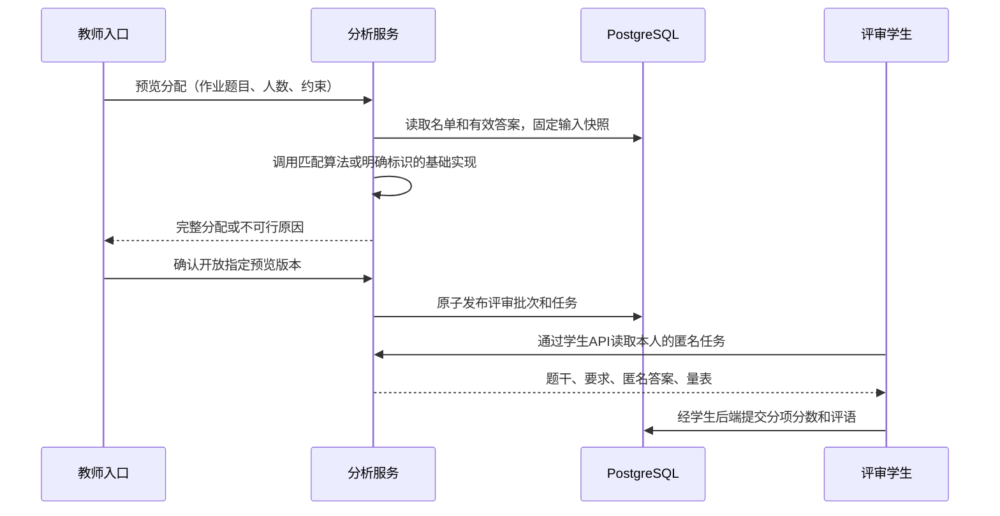

# 信息流、状态和失败处理

本文件把“从数据库拿、再写回”拆成可实现的步骤。当前流程标“已实现”，下一阶段标“规划”。字段细节见[数据库](database.md)与[当前API](api-v1.md)。

## 1. 当前：编程提交到模拟结果

| 环节 | 输入 | 写入 | 输出或失败 |
|---|---|---|---|
| 读题 | 登录身份、item_id | 无 | 学生可见字段；不可见404 |
| 提交 | 源码、语言、幂等键 | 新提交+JUDGE任务 | 202；同请求返回原ID，改内容409 |
| 校验 | 课程、名单、OPEN、服务端截止、允许语言、内容字节数 | 未通过不写任何记录 | 越权/截止/字段错误明确返回 |
| 执行 | 任务中的提交与test_suite快照 | RUNNING后持久化结果 | SUCCEEDED或FAILED；不执行真实源码 |
| 查结果 | submission_id、本人/教师身份 | 无 | 查同一份结果，不每次随机 |

判题尚未完成时result=null；SUCCEEDED只说明模拟任务处理结束，不说明代码通过。FAILED无伪造分数，保留任务错误状态；当前详情响应不提供内部异常栈。

## 2. 当前：主观提交

S读取题目与rubric → 提交content、client_request_id（language为空） → 后端检查身份/名单/截止 → 新建submissions → 返回AWAITING_REVIEW，result为空。

此时没有自动判分、没有评审任务，也不会因教师页面打开而隐式触发互评。后续匹配服务必须选择截止前最后一次有效正式提交，排除草稿/撤回，并固定版本。

## 3. 当前：教师查过程

T登录 → courses取得任课身份 → teacher/courses/id/submissions按题目/学生过滤 → 返回本课程提交摘要 → 按submission_id查详情。不能把当前提交查询当作成绩查询；单题有效结果属于后续结果服务。

## 4. 规划：名单与题库导入、作业发布（T）

CSV文件 → 预览（行号、问题、待新增/复用/更改） → 教师确认 → 再校验并事务更新账号/班级/课程成员。导入同学号复用账号，资料差异须确认，缺少旧成员不自动删除。

题库材料 → 拆题干/教师参考/测试/量表 → 保存题目草稿版本 → 教师核对公式与评分 → 组作业 → 发布事务固定版本、配置和名单 → 学生可见。

发布事务必须检查同课程、四类必填配置、权重总和、知识点、截止顺序和人数配置。失败整体回滚，不出现半份作业开放。参考资料与隐藏测试不进入学生响应。

## 5. 规划：教师开放互评到学生评价（T发起，A生成，S填写）

上图S到DB仍经过学生后端权限与事务校验。匹配输入含真实作者/候选学生，只有受信任服务和任课教师能读取；返回学生的DTO不含作者ID/学号、原提交ID或其他评审者名单。教师看到P/Q是谁，不等于P能看到Q或作者是谁。

无解时预览报告约束和缺口；不能静默允许自评、减少评审人数或发布部分正式任务。已发布后不随意洗牌，补评作为独立有原因操作。

## 6. 规划：评分聚合、异常复核、发布（A计算，T决定）

原始分项评价 → 归一化 → 聚合预览；同时结合评分/时长/历史关系进行四类检测 → 提供证据与样本量 → T决定保留/降权/作废补评/人工修订 → A执行、重算、留痕 → T确认发布 → S查看已发布分与匿名意见。

检测只产生疑点，不直接给学生扣分。多条规则命中同一评价不得重复降权；不足评价不补零。变更失败不能把异常状态先标成已处理。固定单题结果、依据和修订版本，学习分析直接读取题目结果快照。

聚合可使用初步参考分，但不能用含自身评分的结果循环证明自身可信。算法基线、随机种子和参数随结果记录；真实算法结论需实验支持。

## 7. 规划：学习分析

A读取已记录的提交、判定、评价、已发布成绩 → 按明确口径计算 → T/S的分析页面展示。T看任课范围，S只看本人授权内容。报告提供分母、样本数、时间范围、缺失/待评。提交快不直接等于使用AI或不认真；运行时间不能直接推断渐近复杂度。

## 8. 状态与异常处理汇总

| 情况 | 当前处理/下一阶段要求 |
|---|---|
| 同请求重试 | 已实现：返回原提交；重用键但更换内容409 |
| 并发提交 | 已实现：串行分配版本，提交与任务同事务 |
| 截止前成功、截止后重试 | 已实现：相同已成功请求可返回原记录，新请求拒绝 |
| 任务写入失败 | 已实现：提交回滚，500统一错误，不返回假成功 |
| 另一学生查源码 | 已实现：404，不返回私有内容 |
| 旧库版本 | 已实现：ready=503，先迁移 |
| 撤回PENDING代码 | 已实现：保留提交，置WITHDRAWN，任务CANCELLED |
| worker进程中断 | 当前单worker：停旧worker后手动recover-running；真实评测需租约回收 |
| 互评人数不足/无解 | 规划：阻止发布并说明原因 |
| 缺评/异常待决 | 规划：待处理或教师明确授权低样本结算，显示样本量 |
| 已发布后改分 | 规划：新增修订和发布版本，保留旧依据 |
