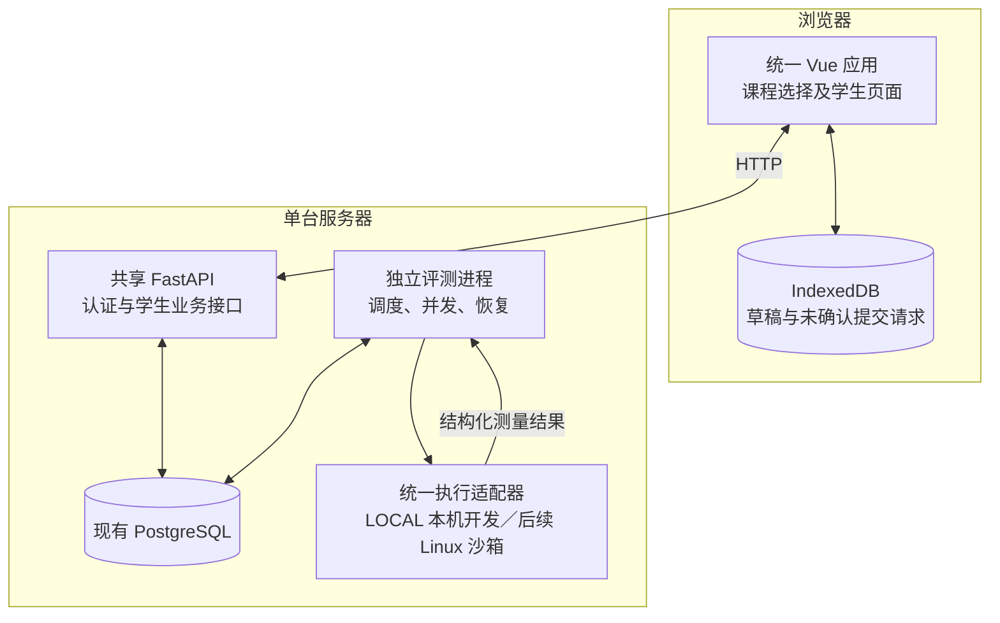

# 学生作答与评测开发设计

日期：2026-10-24。开发分支：`feat/student-submission`。需求快照提交：`3be855d`。

本文是待实现的开发方案，不是功能完成报告。需求依据见 [功能讨论记录](../../features/student/answer-and-judge.md)。当前可调用接口见 [API 实现快照](../shared/api-v1.md)，本文的新接口和字段在完成实现前均不可当作已有能力。

具体执行步骤已拆为 [学生作答与评测实施计划](../../implementation/plan/student-implementation-plan.md)，包含 SP00–SP24 的前置依赖、文件落点、完成标准及验收映射；设计与实际执行记录分别维护。

| 文档 | 用途 |
|---|---|
| [本文](development.md) | 模块边界、前端、数据增量、开发顺序和验收 |
| [学生与认证接口设计](api.md) | 已有／新增接口、请求响应、错误和权限 |
| [单节点评测设计](judge.md) | 调度、沙箱、测试、恢复、最佳提交和容量验证 |
| [功能讨论记录](../../features/student/answer-and-judge.md) | 用户决定及教师／数据库协作事项 |
| [审核处理与交接](../../reviews/student-review-resolution.md) | RV01–RV09 修订映射、AD01–AD05 已定调整和未决交接 |
| [教师端职责清单](../../features/teacher/responsibilities.md) | 明确归教师端的功能、已有基础、对接要求及验收 |

## 1. 设计基线

| 编号 | 已确定规则 |
|---|---|
| R01 | 同一 Vue 工程、同一登录入口；不手选身份，按当前课程成员角色进入功能页 |
| R02 | 登录后先选择课程，只有一门也不自动跳过；首次改密优先于选课 |
| R03 | 教师端负责账号开通、初始密码发放及密码重置入口；学生侧首次登录强制改密 |
| R04 | 实际操作可续期，空闲 2 小时失效；一次登录最长 24 小时，轮询不算活跃 |
| R05 | 四类题目，编程和主观题两套编辑组件；主观题当前只保存答案 |
| R06 | 编程语言沿用教师的 Python 3、C++、C、Java 配置，每题只允许配置内的语言 |
| R07 | 单文件、标准输入输出，不支持多文件项目和自装依赖 |
| R08 | 草稿仅本机自动保存；正式提交新增版本，旧代码和答案保留 |
| R09 | 编程提交与任务同事务保存，评测结果异步落库；服务端决定截止和权限 |
| R10 | 编程最佳版本按通过数降序、CPU 时间升序、内存升序、提交时间降序选择；语言不加权 |
| R11 | 主观题最终候选沿用最后一次未撤回有效提交的约定；本轮不评分、不触发互评 |
| R12 | 单节点、多个执行名额，每名学生全课程合计最多同时执行 3 份；总并发可配置 |
| R13 | 持久化排队、故障恢复、排队反馈；不做多节点和跨课程配额调度 |
| R14 | 截止前已接收的任务在截止后继续执行；服务故障可重评原提交，内容不可更改 |
| R15 | 已提交和已通过分别统计；模拟结果不能算真实通过 |
| R16 | 沿用现有 PostgreSQL 表关系、SQLAlchemy 和 Alembic，仅协调必要的增量迁移 |
| R17 | 开发阶段 LOCAL 本机真实执行，is_mock=false；不测 CPU／内存，后续接入 Linux 沙箱 |
| R18 | 学生只交付单题／一次提交的汇总反馈，内部逐点判定，不要求逐点资源展示或结果表 |
| R19 | 测试总预算的配置／发布校验主要由教师负责，评测提供规则和执行保护 |

最新审核调整覆盖先前逐点反馈草案：学生只查看一次提交的判定、通过数／总数、可用的汇总资源与编译诊断。LOCAL 资源显示“未测量”，不作零值或 Mock。公开测试配置仍可在题面展示输入输出，题面样例与公开配置独立；执行过程不要求逐点持久化或外发输出，隐藏测试原始内容始终不返回。

实际账号不混用教师和学生身份；继续沿用课程成员角色鉴权，不为跨课程角色混用假设新增账号模型、密码重置规则或测试场景。

以下属于本方案给出的技术默认值，可通过实现验证调整：草稿防抖 1 秒、活跃续期节流 60 秒、任务轮询 2～10 秒、自动重试次数和任务租约参数。节点总并发、运行镜像及编译器版本必须根据部署机器验证后固定，本文不宣称已完成选型或容量测试。

## 2. 总体结构和边界



- 沿用 FastAPI 主应用、公共登录和课程权限、SQLAlchemy 会话及统一错误响应。
- API 快速完成接收与查询；评测进程独立启动，统一执行接口按显式模式使用本机开发进程或后续 Linux 沙箱。
- 沿用 `analysis_jobs` 作为持久化任务队列，第一版不新增 Redis、Celery 或独立消息服务。
- 评测进程独立于 API 进程；API 重启不会清空任务，学生登录失效不会取消任务。
- 最佳提交由后端统一选择，学生与教师后续复用同一规则；前端不自行认定最终采用版本。
- 本轮不改写教师发布作业、选题、名单、延期、重开或成绩发布功能；使用现有演示作业联调。
- 接收端独立限频、限积压、限请求体，执行端限制并发；两者共同生效。新请求因容量拒绝时明确“未接收”，已接收任务保持持久化。

## 3. 前端页面和路由

以下是拟新增路由；现有教师业务路由继续保留。

| 路由 | 页面 | 核心职责 |
|---|---|---|
| `/login` | 共享登录页 | 账号密码、错误、提交中状态；移除教师专属文案和优先教师跳转 |
| `/account/change-password` | 改密页 | 首次强制改密及主动改密；成功后更换当前登录凭据 |
| `/courses` | 课程选择页 | 课程名称、学期、当前课程角色；加载、空列表、错误和退出 |
| `/student/courses/:courseId` | 学生课程首页 | 作业列表、提交进度、当前进行中评测入口 |
| `/student/courses/:courseId/assignments/:assignmentId` | 作业详情 | 题目导航、DDL、逐题已提交／已通过／待评测状态 |
| `/student/courses/:courseId/assignments/:assignmentId/items/:itemId` | 作答页 | 题目、编辑器、草稿、提交、最近与最佳结果 |
| `/student/courses/:courseId/submissions` | 本人历史 | 作业、题目筛选及分页，不在列表批量返回源码 |
| `/student/courses/:courseId/submissions/:submissionId` | 版本详情 | 只读内容、时间、资源、测试反馈；载入编辑器及服务故障重评 |

学生课程首页即该课程详细区，不另加必须先经过的跨课程学生首页。作答页的父作业和题目关系必须与接口返回一致；URL 不能赋予权限。

### 3.1 登录和课程导航

1. 登录成功读取 `must_change_password`。需要改密时进入改密页，否则进入 `/courses`。
2. 登录成功后不自动选择第一门课，也不因账号在某一门课是教师就全局进入教师页。
3. 选择学生课程进入其学生课程首页；选择教师课程设置共享课程上下文后进入现有教师工作台。
4. 根路径 `/`：未登录进入登录页；已登录且无当前课程进入课程选择页。
5. 刷新课程深链接：检查会话、首次改密状态及目标课程权限后恢复；不强制再次选择。
6. 未登录的深链接只保留站内返回位置；重新登录仍先选课，选择同一目标课程后可继续上次作答。
7. 切换课程先保存草稿、清理页面请求和轮询，再载入新课程；迟到响应通过请求序号及课程 ID 丢弃。
8. 无课程显示联系管理员的空状态。无权访问某课程退回选择页并解释原因；网络故障保留重试入口。

当前 `shared/session.ts` 会自动选择教师课程，需要改为共享用户、课程列表和显式选择。沿用一个 `courseId` 上下文，移除其教师专属含义；按用户隔离存储。课程切换统一回到选课入口，保留教师编辑页面已有的未保存变更拦截能力。

### 3.2 组件和状态职责

建议在 `frontend/src/features/student` 下组织，命名可随实际代码规范微调：

```text
student/
  StudentLayout.vue
  CourseHome.vue / AssignmentDetail.vue / AnswerWorkspace.vue
  SubmissionHistory.vue / SubmissionDetail.vue
  components/
    ProblemStatement.vue / ProgrammingEditor.vue / SubjectiveEditor.vue
    SubmissionStatus.vue / JudgeFeedback.vue / DraftStatus.vue
  composables/
    useDraft.ts / useSubmission.ts / useJudgePolling.ts
  api.ts / types.ts / draft-store.ts
```

公共新增 `CourseSelect.vue`、`ChangePassword.vue` 及活跃会话逻辑；继续复用 `shared/api.ts`、Markdown、公式、确认框和分页。第一版沿用 Vue Composition API 的状态组织，不为本轮引入额外全局状态框架。

- 页面负责组合和路由上下文；编辑器负责文本、语言及编辑体验，不直接管理登录和数据库。
- `useSubmission` 管理提交快照和幂等重试；`useJudgePolling` 管理进行中任务，不为每条历史记录创建独立计时器。
- 草稿、服务端提交、任务结果分别存放；切换查看历史不能自动覆盖当前草稿，载入旧答案需明确操作。
- 编程编辑器采用可替换组件接口：`modelValue`、`language`、`readonly`、内容变更事件。具体编辑器库在实现时选择并锁定依赖，基础作答闭环不依赖特定库。
- 主观编辑采用 Markdown／LaTeX 和安全预览；复用当前清洗渲染逻辑。第一版不增加图片、附件或富文本上传。

### 3.3 草稿和未确认请求

采用 IndexedDB，数据库按应用环境区分。草稿键包含 `user_id + assignment_item_id + language`，主观题使用固定语言标识 `subjective`。

草稿记录包含内容、语言、更新时间、草稿递增修订号、题目版本、本机最后确认提交 ID 和其内容摘要。保存失败显示失败状态，并保留手动复制内容的能力。

- 输入后防抖 1 秒；切题、切语言、切课及退出前尽力完成保存。不能只依赖关闭页面事件保存。
- 初次进入恢复“代码和语言”整体：先选择最近使用且仍允许的语言并读对应草稿；没有任何草稿时才读取最近有效提交，并将其语言与正文成对恢复。
- 手动切换语言只恢复该语言的草稿，或查询 `language` 筛选下的最近有效提交；不能把 Python 正文放入 C++ 草稿键。没有该语言内容时为空，不借用其他语言正文。
- 语言不再被允许或历史题型不匹配时，只读提示，不静默替换语言再提交。异步恢复同样校验用户、题目、语言和请求序号。
- 提交时固定正文、语言、题目 ID、请求标识及草稿修订号，不受随后编辑影响。
- 请求发送前将该快照记入本机未确认请求记录；网络结果不明时，以相同请求标识和完全相同内容重试。
- 恢复页面后提示确认原请求状态，不静默把不确定请求改成新提交。新修改属于另一份提交，需要新请求标识。
- 收到回执只确认当时的内容摘要。若编辑器已有新修改，继续显示未提交；不清空新草稿。
- 多标签页通过修订号与页面实例 ID 检测写入冲突，发生冲突时提示恢复／保留副本，不静默覆盖另一页。
- 存储中的密码、token 和源码互相分离；草稿不保存密码。注销保留本账号草稿，但下一账号不能自动载入。
- 编程内容限制 65,536 UTF-8 字节，主观限制 262,144 UTF-8 字节，沿用当前服务端限制；前端按字节提示。

### 3.4 自动续期和轮询

- 共享活跃管理器监听页面可见时的真实输入、点击、触摸和导航操作；后台轮询、草稿保存计时器不产生新活跃事件。
- 首个有效操作可发送续期，此后最多每 60 秒一次，并在有尚未上报的新操作时补发；没有新操作不发保活请求。
- 续期接口采用服务端时间更新 2 小时空闲窗口，并受原登录 24 小时绝对上限约束；活跃事件采样存在最多一个节流周期的误差。
- 同一标签页续期使用一个共享 Promise；失败不递归调用自身。短暂断网保留状态，明确 401 才进入重新登录流程。
- 共享请求客户端为每个请求捕获 `auth_generation + token_snapshot`。登录、改密换 token、主动退出均推进认证代次；只有与当前代次和凭据一致的 401 才能清会话。旧代次的 401／续期／登录／业务响应不能覆盖新身份和期限，详见接口设计 RV06。
- 登录过期时保存草稿、停止业务轮询、保存安全的站内返回位置；重新选课后恢复，不自动提交内容。
- 任务初始每 2 秒查询，长时间等待逐步放宽至 10 秒；隐藏页面暂停或降低频率，重新可见立即刷新。
- 活跃任务采用批量状态接口；当前版本详情可单独刷新。终态、退出页面及账号变化时清理计时器和请求。
- 任务发现使用有上界的游标扫描并持续读取到末页，不把 ACTIVE 的第一页视为全集。累计超过 100 个 ID 时每批最多 100、最多两个批次并发，当前作答优先；已跟踪 ID 持续查询到终态，不因从 ACTIVE 列表消失就删除。
- 批量 404 时不以二分探测他人 ID：停止旧集合，刷新课程权限并重扫当前可见任务；失权移除，仍可见任务重新分批。短时间重复失权则退避并提示重新载入，不无限循环。分页协议见接口设计。
- `FAILED` 是自动处理终态，停止轮询并显示重评入口；重评成功后重新加入轮询。

## 4. 后端功能模块

后端功能边界保持为七个模块，内部文件划分服务于这些职责：

| 模块 | 输入和输出责任 |
|---|---|
| 账号、课程与权限 | 登录、会话查询、首次及主动改密、续期、退出、课程角色校验 |
| 作业与题目读取 | 可见作业、题目固定版本、公开测试、语言、DDL 和评分要求 |
| 答案提交与版本 | 现有提交／撤回流程、幂等、版本、字节数及服务端截止校验 |
| 评测任务管理 | 队列、每人 3 份和总并发、尝试、租约、恢复及重评请求 |
| 代码执行与测试 | 四语言 LOCAL 真实执行、内部判定和汇总；后续 Linux 隔离及资源测量 |
| 评测结果与最佳提交 | 结果持久化、安全投影、最佳与最近提交、主观有效版本 |
| 本人记录与反馈 | 本人历史、批量任务状态、逐题进度和错误反馈 |

具体请求和响应见 [接口设计](api.md)。评测算法和事务见 [评测设计](judge.md)。

复用 `common/auth.py` 和 `permissions.py`，在统一依赖中区分“已认证”和“已完成首次改密”。仅认证依赖允许会话查询、改密、续期和退出；其他业务依赖要求改密完成。课程权限仍按目标资源真实所属课程检查。

登录创建会话、主动／首次改密、密码重置采用同一用户行锁与重新读取凭据协议；不能只在改密时删会话而允许旧密码登录请求随后插入新会话。API 路径专属请求体上限和跨进程共享限流在昂贵密码校验前生效，详见接口设计。

建议将新评测逻辑归入 `backend/app/judge`，既有 `analysis/contracts.py` 和模拟入口通过适配层保持兼容。学生模块不另写第二套身份校验或最佳选择逻辑。源码文件的移动可以分阶段完成，不为目录重组阻塞闭环。

## 5. 数据库复用与增量迁移方案

继续使用当前数据库和全部现有关系：`users/auth_sessions`、课程成员、题库版本、测试集、作业及名单、`submissions`、`analysis_jobs`、`judge_results`。不新增学生专属用户表、题库、作业副本或草稿表。

以下是满足新能力的最小增量提案，均需与数据库负责人协调；这里只设计，不执行迁移：

| 对象 | 建议增量 | 用途 |
|---|---|---|
| `users` | `must_change_password`、`password_updated_at` | 首次改密和密码重置；已有正常账号默认不强制改密，新开通账号显式设为需要 |
| `auth_sessions` | `last_active_at`、`absolute_expires_at` | 空闲与绝对期限分开；新登录以创建时间确定 24h 上限，改密更换会话时继承原绝对截止；`expires_at` 保留为空闲截止 |
| `analysis_jobs` | `available_at`、`phase`、`attempt_no`、`attempt_token`、`owner_id`、`heartbeat_at`、`lease_expires_at`、`recovery_cycle_no`、`automatic_retries_used`、`last_manual_retry_at` | 排队、恢复、启动所有权、冷却和累计周期限制；最大重试次数读取受控配置 |
| `judge_attempts` 新表 | 任务、尝试号、状态、执行环境标识、沙箱标识、起止时间、故障摘要 | 同一提交的多次基础设施尝试留痕，不增加学生提交数 |
| `judge_results` | `passed_cases`、`total_cases`、`executed_cases`、结果尝试 ID、`execution_mode`、`runtime_profile`、`measurement_status`、有界编译诊断及过期状态 | 单份汇总、环境区分和最佳选择；保留唯一结果及可空资源字段 |
| `judge_retry_requests` 新表 | 请求标识、提交、发起人、对应任务／恢复周期及接收时间 | 防止重评响应丢失后重复重置重试预算；发起人和请求标识联合唯一 |
| `request_rate_limits` 辅助表或等价共享计数器 | 桶类型、脱敏键、时间桶、计数、到期 | API 多进程原子限流，可短期清理；与永久业务幂等记录分开 |

约束和索引要求：

- `judge_attempts(job_id, attempt_no)` 唯一；当前尝试标识与最终结果来源必须可核对。
- 保留一个提交唯一 JUDGE 任务和一个正式结果的约束；服务故障重试发生在没有有效结果时。
- 计数非负，`passed_cases <= executed_cases <= total_cases`。CE 可以为 `0 <= 0 <= total`；真实全量执行完成时 `executed_cases=total_cases`。
- 模拟结果新增计数字段可为空，不把已有模拟数据回填成真实通过。
- LOCAL 的真实结果允许资源为空，不触发“必须测量”的全局数据库约束；测量要求由 execution_mode/profile 明确。后续 Linux 的预期测量失败才走服务故障。
- 活跃任务按状态／可执行时间／ID 查询，提交历史按学生／题目／版本查询；先复用现有索引，再依据查询计划增补。
- 初次改密及密码重置需锁同一用户行。续期只能更新仍存在的会话，不用 upsert 复活已注销会话。
- 不直接把 CPU、输出或重试信息塞进任意 JSON 后绕过类型和约束；任务 `parameters` 继续存冻结输入引用和执行配置快照。
- 本轮不以学生交付为由新建 `judge_case_results`。若以后保留逐点表，另补结果／测试点唯一及测试集归属约束，不恢复为本轮必做项。
- 正式提交、汇总及最小来源保留；诊断、运行日志、过期会话和限流桶按评测设计 RV09 的时间／总量策略清理，不能清掉仍有效的幂等记录。

迁移拆为认证扩展、评测扩展两个顺序明确的增量；实际 revision 根据合并时最新 head 生成，不预占编号，不改写 `pg0001`。旧会话的绝对期限可按 `created_at+24h` 回填，最后活跃时间只能采用保守的既有时间依据，不凭空延长；无法可靠迁移的会话失效并提示重新登录。此策略须在认证迁移交接中明确。

## 6. 进度和候选版本的含义

- `has_submitted`：至少有一份未撤回的正式提交，和评测是否完成分开。
- `has_passed`：在当前服务器绑定的评测上下文中，至少一份未撤回真实结果全部通过。LOCAL 也是真实开发通过，页面标记环境和未测资源；不能冒充正式 Linux 测量。主观为 `null`。
- `latest_submission`：最近未撤回提交，可仍在排队或为服务故障。
- `best_submission`：只在当前 execution_mode 和兼容 runtime_profile 内选择；LOCAL 空资源在比较时后置、相同则继续比最近时间，不把开发和 Linux 指标混排。
- `effective_submission`：主观题最近有效提交；编程题与当前最佳候选相同。
- `has_unresolved_jobs`：仍有排队、执行、待恢复或服务故障未解决的任务，提示当前最佳仍可能变化。
- 本轮只展示“当前最佳”，不实现正式成绩冻结和发布。后续教师结算必须检查未解决任务，不能把其静默算成答案错误。
- 计数均按本人、当前作业名单和当前题目范围计算，撤回后同步重算。作业总进度可展示“已提交 x/n；编程已通过 y/m”。

## 7. 教师和共享模块交接

教师端职责已单列为 [学生作答联调所需的教师端职责](../../features/teacher/responsibilities.md)，可直接交给教师端负责人；下面保留跨模块索引。

| 编号 | 事项 | 本轮落点 |
|---|---|---|
| C01 | 作业创建、发布、名单、DDL 和开关 | 教师队友沿用现有契约实现，本轮不补页面 |
| C02 | 账号开通、初始密码发放和重置入口 | 已明确为教师端职责，由教师端提供操作入口；开通设 `must_change_password=true`，重置使旧会话失效并再次要求改密 |
| C03 | 共享认证、选课流程 | 本轮可修改公共模块，同时回归教师登录、改密后选课及未保存编辑保护 |
| C04 | 数据增量和接口扩展 | 给数据库负责人字段／约束／样例，按最新迁移链升级 |
| C05 | 教师读取最终候选 | 复用同一选择服务；不能在教师页面自行选最近编程提交代替最佳 |
| C06 | 主观题互评人数约束 | 保留现有配置，当前不生成互评任务；需要无互评配置时再决策 |
| C07 | 公开测试与题面样例 | 教师已有配置能力；学生扩展只返回公开测试，保持两套内容独立 |
| C08 | 真实评测原分工 | 既有文档将其列入分析侧，本轮已纳入学生闭环；实现前协调共享代码归属，避免两套执行器 |
| C09 | 测试集总预算 | 教师负责配置／发布校验，评测提供预算公式和节点上界并强制执行；现有接口缺字段需教师及数据库协调，学生仅展示反馈 |

账号管理分工已确定：**账号开通、初始密码发放和密码重置及其操作入口全部归教师端。**具体页面和实现形式由教师端负责人安排；学生端仅对接共享认证契约，实现登录、首次改密与自动续期，不另做管理入口。该项是待教师端交付的依赖，不再是待用户决定的职责归属。不为并不存在的同账号跨课程混用身份扩展密码重置风险，预算交接同样按已定教师职责推进。

## 8. 开发顺序和交付切片

| 阶段 | 开发内容 | 可验收结果 |
|---|---|---|
| SL0 契约 | 对齐本文接口、数据增量和运行环境假设 | 需求和现有实现边界清楚；教师配合事项可交接 |
| SL1 登录与选课 | 认证增量、首次改密、续期、统一课程选择、教师接入回归 | 学生和教师均能按课程权限进入，2h／24h 边界可用模拟时钟验证 |
| SL2 真实作答闭环 | 四题型、安全题面、本机草稿、提交快照、历史 | 用现有 API 完成真实持久化；编程模拟结果明确标记 |
| SL3 查询与进度 | 本人历史、题面公开配置、完整批量发现、最近／最佳 | 刷新可恢复，单份汇总无隐藏泄露；最佳规则用结构夹具验证 |
| SL4 本机执行适配 | 四语言 LOCAL、总墙钟及输出保护、内部判定和单份汇总 | AC／WA／CE／开发墙钟超时／RE 真实可区分，CPU／内存为空但非 Mock |
| SL5 并发与恢复 | 单节点调度、个人 3 份、全局上限、租约、重评 | 超额排队、进程故障恢复、不重复结果、不突破名额 |
| SL6 开发联调验收 | LOCAL 的 UI／API／数据库联调、限流／恢复／泄露检查 | 开发真实链路和教师回归证据齐全，文档准确标记未测资源 |
| SL7 后续 Linux 适配 | 同一执行接口接入隔离、CPU／内存测量 | 正式隔离及资源测量单独验收，不与开发阶段混称完成 |

SL3 的 Mock 夹具继续标 Mock。SL4～SL6 的 LOCAL 真实执行标开发环境，不标 Mock；SL7 才能宣称 Linux 隔离和资源测量完成。启动生命周期与登录竞争等 P1 在任何正式开放使用前必须通过验收。

## 9. 验收矩阵

以下是待编写／执行的验收场景，不表示当前测试已覆盖或通过。沿用 PostgreSQL 专用验证库，禁止清空项目业务库。

| 编号 | 场景 | 预期 |
|---|---|---|
| AC01 | 分别使用教师、学生账号登录并选择各自课程 | 同一入口、先选课，不构造同账号跨课程混用角色场景 |
| AC02 | 无课程、一门课、无权课程深链接 | 空状态明确；一门仍选；无权访问不返回业务数据 |
| AC03 | 初始密码登录并直接请求作答接口 | 改密前 403；改密后可选课；旧会话失效 |
| AC04 | 编辑器持续输入且无业务提交 | 会话续期，草稿不因会话刷新丢失 |
| AC05 | 页面闲置且后台仍在轮询 | 2 小时后失效，轮询不延长会话 |
| AC06 | 持续活跃跨过 24 小时 | 强制重新登录，续期不越过绝对上限 |
| AC07 | 退出／重置和续期并发 | 已作废会话不能被续期恢复 |
| AC08 | 切课、切语言、刷新、多标签页编辑 | 内容隔离，冲突可见，迟到响应不串题 |
| AC09 | IndexedDB 不可用或存储失败 | 明确提示，不假报草稿已保存 |
| AC10 | 提交等待中继续编辑 | 回执只确认原快照，新内容仍待提交 |
| AC11 | 请求响应丢失、重复点击、重启页面重试 | 同键同内容仅一份版本；改内容重用键返回冲突 |
| AC12 | 截止前接收、截止后同键重试和新键提交 | 原请求可查询／重放，新提交拒绝 |
| AC13 | 中文字节边界、空答案、错误语言 | 前后端一致校验，无非法记录 |
| AC14 | 主观题提交 | 无 JUDGE 任务、无伪造分数，可看版本 |
| AC15 | 另一学生访问历史、状态、结果和重评 | 不返回他人数据，不泄露资源存在性 |
| AC16 | 测试程序故意输出输入内容 | 只交付汇总，原始测试输出不持久化或外发 |
| AC17 | 四语言 LOCAL 正确、错误、编译失败及异常 | 真实判定、汇总持久化、资源为空且 is_mock=false |
| AC18 | 无限循环、过量输出和子进程 | LOCAL 墙钟／输出／进程清理生效；内存隔离作为 SL7 单独验收 |
| AC19 | 第 4 份个人任务和其他学生任务 | 本人最多 3 份；其他有资格任务可运行 |
| AC20 | 多个领取者竞争、重复启动调度器 | 总并发／个人限制有效，不重复启动同一任务 |
| AC21 | 执行器中断、节点重启和过期写回 | 先清理旧沙箱再恢复；旧尝试不能覆盖新结果 |
| AC22 | 自动恢复失败后截止后重评 | 原源码不变，历史尝试保留，不新增学生提交 |
| AC23 | 相同通过数、不同时间内存、不同语言 | 完整执行既定排序，空指标不作零，时间排除排队和编译 |
| AC24 | 最新较差、最佳撤回、仍有未解决任务 | 最佳候选正确变化，撤回排除，待恢复状态明确 |
| AC25 | 教师题库、导入和未保存变更流程 | 公共模块调整后原能力仍可用 |
| AC26 | 暂停旧执行器，恢复清理后再让它尝试启动 | 统一生命周期锁内重验所有权，旧程序不能迟到创建／启动 |
| AC27 | 旧密码登录与首次改密／重置交错提交 | 登录在同用户锁内重验，旧会话不会删除后又创建 |
| AC28 | 多进程、不同请求键反复提交／重评 | 限频、积压、冷却、累计预算、熔断共同生效，429 有反馈 |
| AC29 | 缺编译器／不支持运行配置／永久超容量 | 明确配置失败，不永久 PENDING，不无限自动重试 |
| AC30 | 独立连接同时持主锁及领取锁 | 锁键区分无自阻塞，主连接丢失停止派发 |
| AC31 | 改密或重登录后旧请求迟到 401／续期响应 | 新 token、身份和期限不受旧认证代次影响 |
| AC32 | 超过 100 任务、发现中完成／失权 | 游标到末页、分批轮询，404 后重建可见集合，不遗漏或无限重试 |
| AC33 | 最近提交 Python，手动切换 C++ 且无其草稿 | 代码语言成对恢复，C++ 不被 Python 正文污染 |
| AC34 | 日志总量达上限、会话／诊断过期 | 辅助数据有界清理，正式历史及幂等语义保留 |
| AC35 | LOCAL 与 Linux 同通过数但不同资源能力 | 按当前环境上下文选择，不混排；LOCAL 不因空指标失败 |
| AC36 | 未配置逐点结果表运行完整题目 | 可用内部逐点判定计算汇总，不把逐点表当交付依赖 |
| AC37 | 教师总预算缺失／越界／合法长题 | 开发推导有标识，发布校验及执行上界一致，学生不改配置 |

文档阶段只检查本地链接、JSON 示例、格式和契约一致性；不以未运行的业务测试作完成证据。编码后执行对应模块测试、前端类型检查／构建、PostgreSQL 集成及真实 HTTP 联调。具体测量场景见评测设计。
