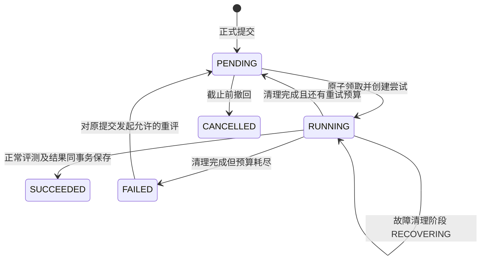

# 单节点评测开发设计

日期：2026-10-24。配套 [主开发设计](development.md) 和 [接口设计](api.md)。本文描述待实现方案，现有 `analysis/worker.py` 仍是单个模拟 worker，不能直接用于真实代码执行。

## 1. 范围和运行前提

- 单节点运行 API、PostgreSQL 及评测调度／执行组件；评测独立进程启动。
- 节点有多个执行名额，每名学生全课程合计最多同时执行 3 份提交。不分课程配额、不做多节点调度。
- 一份提交占一个名额，涵盖初始化、编译、依次测试及必要清理。测试点不再各占一个学生执行名额。
- 数据库保存任务、尝试及结果；源码只从固定提交读取，测试只从该任务的冻结引用读取。
- 开发阶段采用 **LOCAL 本机编译／解释执行**，以后通过同一执行接口接入 **LINUX_SANDBOX**。LOCAL 是真实运行，不是 Mock，但不宣称提供正式 Linux 沙箱隔离或 CPU／内存测量。
- 具体 Linux 容器／隔离工具在后续接入时验证；本机开发不以安装 Linux 虚拟环境为先决条件。两种执行器均需支持受控启动、终止进程树、输出上限和墙钟预算。
- 学生交付为单题／一次提交的汇总结果。内部依次判定测试点以统计通过数，不要求逐测试点资源展示或逐点结果表。

本轮审核修订追踪见 [审核处理与交接](../../reviews/student-review-resolution.md)。本文新增防护均为待实现设计，不能据此宣称现有执行器已修复。

## 2. 功能组件和职责

| 组件 | 职责 |
|---|---|
| 调度器 | 选择具备资格的任务、占用名额、登记尝试、派发执行 |
| 执行管理器 | 以统一生命周期接口管理本机进程／Linux 沙箱、语言适配、编译、测试和清理 |
| 可信判题器 | 在学生执行环境外读取期望输出，比较程序输出并汇总结果 |
| 恢复器 | 检查租约、核对沙箱、清理旧执行、安排有界重试 |
| 结果服务 | 原子保存结果和任务终态、安全投影、最佳提交比较 |

建议对应 `backend/app/judge/{scheduler,executor,languages,checker,recovery,results,selection}.py`，执行适配器分别为 local 和 linux_sandbox。统一接口提供 prepare、start、run_case、terminate、inspect 和 cleanup；测试点结果仅在内部聚合。所有创建／启动／终止操作经过同一 ExecutionSupervisor，不允许工作进程绕过它直接启动程序。这是节点内组件，不新增浏览器可访问的评测微服务。

## 3. 输入冻结与执行配置

提交同事务创建 JUDGE 任务，`parameters` 固定以下引用：

```json
{
  "problem_version_id":"41",
  "test_suite_id":"51",
  "execution_mode":"LOCAL",
  "runtime_profile":"local-dev-v1"
}
```

source 和 language 从提交记录读取，不从学生重评请求重新接收。实际执行前校验：引用存在、版本／测试配置归属一致、测试集已冻结且非空、语言被允许、运行配置可用、比较器已支持。

`runtime_profile` 的受控配置应记录四语言编译器／解释器版本、镜像摘要或等价不可变环境标识、编译参数、CPU／内存统计方式和判题器版本。数据库结果可存完整受控配置引用，学生只看公开版本标签。

执行模式为 LOCAL、LINUX_SANDBOX 或 MOCK，结果同时记录 execution_mode、runtime_profile 和 measurement_status。LOCAL 的 CPU／内存为 null、measurement_status=UNAVAILABLE_LOCAL、is_mock=false；Linux 正常测量为 MEASURED；编译失败无运行指标为 NOT_EXECUTED。

同一作业的当前评测上下文由服务器受控运行配置绑定并固定，包含模式及兼容的运行配置版本，学生不能自行切换。进度／最佳查询返回这个上下文，并只在该上下文内比较。开发 LOCAL 数据与正式 Linux 数据不混入同一个资源排名；切换阶段使用独立开发／正式作业数据，不能静默覆盖旧结果或在仍开放的同一作业中更换统计口径。本轮允许跨语言比较，不对语言加权。

## 4. 调度与并发

### 4.1 总并发和个人名额

参数 `JUDGE_MAX_CONCURRENCY=C` 控制节点总名额，`JUDGE_PER_STUDENT_CONCURRENCY=3` 是已确认规则。

必须同时满足：

```text
节点占用名额 < C
该学生占用名额 < 3
任务 PENDING 且 available_at <= 当前时间
原提交未撤回，任务属于当前执行模式
节点具备该语言和资源配置的执行能力
```

占用名额包括 RUNNING 和尚未完成清理的 RECOVERING；清理旧程序前不能提前释放。全局 C 小于 3 时，个人实际并发自然也不会超过 C。

节点 C 需按可用 CPU、内存及允许的最大编译／运行内存预留配置，不能只提高数字。Linux 按资源限额预留，LOCAL 按主机容量保守设置，并明确其不测量、不保证逐程序内存隔离。

任务接收和调度必须区分临时与永久问题：名额不足、可恢复服务暂停为暂时等待；缺少编译器、未知语言适配器、不支持的运行配置、配置资源需求超过节点能力或预算非法，属于明确的配置故障。提交前可识别的配置故障返回 409，不创建永远无法领取的任务；已接收后才发现则转 FAILED 并给安全故障码，不无限留在 PENDING，也不自动耗尽所有重试。修复配置后才允许恢复原提交。

### 4.2 领取事务

单节点仅允许一个活跃的调度主进程。以下锁分属不同用途，不复用键或连接持有方式：

| 锁 | 标识示例 | 持有方与释放 |
|---|---|---|
| 调度主锁 | PostgreSQL 双整数 advisory key `(48121,1)` | 专用、固定连接的 session 锁；启动 try-lock，退出显式解锁，断连接自动释放；连接不得回连接池 |
| 领取事务锁 | `(48121,2)` | 当前领取事务连接上的 xact 锁，提交／回滚自动释放；不得与主锁同键 |
| 接收容量锁 | `(48121,3)` | API 接收事务的 xact 锁，保证全局积压检查与入队原子化 |
| 单任务生命周期锁 L(job) | 固定锁目录中以完整十进制 job_id 命名的 OS 跨进程锁 | 启动、恢复、终止与清理共用；临界区结束释放，不向被测子进程继承锁句柄 |

上述 PostgreSQL 锁号在代码中集中声明并检查命名空间冲突。生命周期锁采用操作系统跨进程原语，不能用各进程私有的 threading.Lock 代替；POSIX 可用文件锁，其他宿主需实现并测试等价原语，否则拒绝启动该本机执行适配器。

主锁连接失效时立即停止派发新任务，不依赖其他池连接继续领取。已运行任务仍按租约管理，新主进程先核对旧任务与沙箱后再补充执行名额。

建议流程：

1. 领取事务获取固定节点调度锁，读取节点及各学生占用名额。
2. 从 PENDING 中按 `available_at, id` 选择具备资格的最早任务。新任务 available_at 为入队时间，重试为退避结束时间。
3. 达到个人上限的学生任务暂时跳过，继续找其他可执行任务；不创建跨课程优先级。
4. 按统一顺序锁提交、任务，重新确认未撤回、任务状态及可执行时间。
5. 分配新的不可重复尝试标识，累计 attempt_no 加一，建立尝试记录；任务置 RUNNING，设置归属、心跳及租约。
6. 提交事务后将带 attempt_token 的启动请求交给 ExecutionSupervisor，按 4.4 的互斥协议启动。初始化失败也属于已登记尝试。

伪代码：

```text
while 调度器健康:
    begin transaction
    acquire node scheduling lock
    count occupied slots, including recovering tasks
    find oldest eligible pending job
    if none: commit and wait for next short polling interval
    lock submission -> job
    recheck eligibility
    create attempt, claim job and lease
    commit
    supervisor.start(execution_mode, attempt_token)
```

数据库事务不跨越编译和测试全过程。线程池／进程池不能直接共用同一个 SQLAlchemy Session。

### 4.3 锁顺序和竞争

- 涉及提交和任务的领取、撤回、恢复、完成、重评统一使用 `Submission -> AnalysisJob -> 当前尝试` 顺序。
- 领取路径为 `领取事务锁 -> Submission -> AnalysisJob -> 尝试`，仅登记名额，不在该事务内等待生命周期锁或执行进程。
- 生命周期路径为 `L(job) -> Submission -> AnalysisJob -> 尝试`，不在持有 L(job) 或行锁时再申请领取事务锁。名额只有领取事务能增加；清理后原子减少不需要反向申请领取锁。
- 调度先领取则撤回看到 RUNNING 后拒绝；撤回先提交则调度看到 WITHDRAWN 后取消，不能启动已撤回答案。
- 个人执行数是服务端可信状态，不根据浏览器请求数量、标签页数或课程分开计算。
- 租约是可恢复的执行所有权，不表示租约过期即可假定旧进程已经停止；名额回收必须包含实际清理。

### 4.4 启动与恢复共用的生命周期协议（RV01）

仅在领取时检查 token 不能阻止旧执行器暂停后迟到启动。所有启动和恢复都必须经过同一监督器及 L(job)：

1. 启动请求可排队，但真正创建／启动前先获取 L(job)，在锁内重读数据库，确认 token、归属、RUNNING、有效租约及非 RECOVERING 阶段。
2. 在同一临界区创建并登记可追踪执行标识后才能放行被测程序。LOCAL 可用受控启动器和启动闸门：子进程先等待，登记进程组及防 PID 复用标识成功、再次核验 token 和租约后才放行；闸门关闭／监督器在登记前退出时子进程结束。
3. 恢复器同样先获取 L(job)，再撤销旧 token、检查并终止对应执行，确认创建请求已结束且没有存活进程后才回队列或释放名额。
4. 恢复先完成时，旧启动请求之后获得 L(job) 会因 token 已失效而被拒绝；启动先完成时，恢复必须找到并终止已登记执行。
5. 创建／启动调用超时属于“结果未知”，不能等同于“未启动”。具有异步创建行为的驱动必须提供确定性执行名、创建意图和状态核对；无法确认请求已结束或执行已终止时继续占名额并告警，不释放锁定事实后再允许迟到创建。
6. 锁内仅完成受控创建、登记、放行／终止，不把整段测试放在 L(job) 中。数据库不可用或无法核验所有权时不放行新程序。

验收必须人为暂停旧启动者到恢复清理之后，再恢复它；只检查迟到写回被拒绝不足以证明没有重复运行。

## 5. 语言和沙箱执行

### 5.1 单文件约定

| 语言 | 内部文件名 | 提交要求 |
|---|---|---|
| Python 3 | `main.py` | 标准库及固定运行环境；编译检查语法后运行 |
| C++ | `main.cpp` | 单文件主程序，标准输入输出 |
| C | `main.c` | 单文件主程序，标准输入输出 |
| Java | `Main.java` | 无 package，入口类 Main，标准输入输出 |

编译命令由受控语言适配器生成并以参数数组启动，源码、语言或题目文本不能拼成 shell 命令。具体语言标准和版本固定在运行配置中，页面展示语言说明；最终镜像及版本在真实执行适配阶段锁定并记录。

### 5.2 两种执行模式的边界

LOCAL：在专用临时目录中以参数数组调用本机编译器／解释器；限制墙钟和输出，登记并终止进程树，复用统一生命周期协议。只用于开发测试，不宣称具备网络、文件、CPU 或内存的 Linux 沙箱隔离。不采集 CPU／内存，不能据此生成 MLE 或伪造资源数据；缺指标不算基础设施故障。

LINUX_SANDBOX：后续正式隔离执行适配，满足以下要求；这些能力不是 LOCAL 的已实现承诺。

- 每份提交独立工作目录及受限执行环境，使用非特权用户；不挂载数据库目录、凭据、源码仓库或容器控制接口。
- 学生程序不获得数据库连接配置和宿主环境中的秘密信息。
- 编译和运行均关闭外部网络，限制进程数、CPU、内存、输出及磁盘写入；运行依赖预先固定。
- 期望输出由可信判题器持有，不挂载到学生环境。每个测试只经 stdin 传入自己的输入，不一次挂载全部隐藏测试文件。
- 测试点启动新的被测进程及干净可写目录，保留只读编译产物；上一测试点的文件或子进程不能影响下一点。
- 超限和正常结束均清理进程树。只有确认清理完成后释放名额；无法确认时保持恢复状态并告警，不能把泄漏进程当成空闲资源。
- 限制墙钟时间以处理阻塞、睡眠和无输出程序，但资源排序使用被测程序及其子进程的 CPU 时间。

Linux 容器、资源控制、文件权限和进程限制需组合验证。具体工具不是本轮已部署事实，不能仅因运行在容器里就宣称隔离完整。

### 5.3 资源参数技术默认值

以下为可配置的实现起点，需真实测试调整，不改变已确认的个人并发 3 和会话规则：

| 参数 | 初始方案 |
|---|---|
| 编译墙钟上限 | 30 秒，独立于教师的运行 CPU 限额 |
| 编译内存和进程上限 | 按语言运行配置设置，纳入节点容量预算 |
| 每测试点 CPU／内存上限 | Linux 使用冻结配置；LOCAL 仅将受控墙钟保护用于开发，不声称已执行 CPU／内存限额 |
| 每测试点墙钟上限 | `max(1000ms, 3 * cpu_limit_ms)`，运行配置可统一调整 |
| 每测试点 stdout+stderr 原始输出上限 | 4 MiB，超过为输出超限，不无限累积 |
| 程序原始输出 | 仅在内部受限缓冲中比较并立即丢弃，不作为学生逐点持久化交付 |
| 编译诊断保存／展示上限 | 每份 16 KiB，过滤宿主路径，按保留策略清理 |
| 心跳／租约 | 每 10 秒心跳，租约 120 秒 |
| 基础设施自动重试 | 每恢复周期最多 2 次，退避 5 秒、30 秒；新的学生恢复周期还受冷却和累计预算约束 |

任务整体预算由教师配置／发布校验负责，评测模块提供编译、测试点数、逐点墙钟和清理开销的预算公式及节点可支持上界。学生端只展示配置和超限反馈。现有教师接口尚无总预算字段，应记录 C09 交接；缺少该字段的开发数据暂由受控配置按相同公式推导，不由学生 API 静默更改教师配置。

执行器始终保留总墙钟保护，教师配置不能突破节点保护上界；不能用固定 60 秒截断所有题目。长任务周期性心跳，租约不等于程序运行限额。

## 6. 测试点判定和结果汇总

### 6.1 流程

1. 领取后创建环境并检查运行配置，编译／语法检查失败产生 CE，执行点数为 0。
2. 编译成功后按冻结顺序执行全部测试点，不在第一次 WA/TLE/RE 后直接停止；通过数需要完整评估。
3. 每个测试内部累计判定，Linux 还累计资源；正常学生程序错误不阻止后续测试，不要求逐点入库。
4. 执行设施故障导致尝试无效，停止后续测试并进入恢复；LOCAL 的预期空资源不属于故障。Linux 承诺测量却无法可信测量时才按设施故障处理。
5. 汇总后清理环境，按当前尝试标识保存单份汇总、必要诊断和任务 SUCCEEDED；内部测试输出丢弃。

### 6.2 判定类别

| verdict | 条件 |
|---|---|
| ACCEPTED | 编译成功且全部测试点通过 |
| WRONG_ANSWER | 程序正常退出，输出比较未通过 |
| COMPILATION_ERROR | 源码编译／语法失败，或学生触发编译资源限制 |
| TIME_LIMIT_EXCEEDED | Linux CPU／墙钟超限；LOCAL 仅报告明确标识的开发墙钟超限 |
| MEMORY_LIMIT_EXCEEDED | Linux 资源控制器明确报告内存超限；LOCAL 不凭错误文本猜测 MLE |
| RUNTIME_ERROR | 被测程序异常退出、非法操作等 |
| OUTPUT_LIMIT_EXCEEDED | stdout+stderr 超过受控输出上限 |

缺编译器或不支持配置按 RV04 明确失败；容器／进程启动失败、测试配置读取失败、数据库故障及 Linux 已承诺但无法可信测量资源属于设施故障，不伪造学生程序判定。LOCAL 预期不测量不在此列。

编译后逐点判定优先依据资源控制器的明确超限原因，再检查退出情况和输出。整体 verdict：全部 AC 则 AC，否则使用冻结顺序中第一个非 AC 点的类别；通过数始终独立统计。CE 无逐点结果，但 total_cases 仍为冻结测试点总数。

### 6.3 输出比较

沿用教师当前唯一配置 `TEXT_TRIM_TRAILING`，本轮给出确定语义：统一 CRLF／CR 为 LF，去除每行末尾的空格和制表符，再去除文件末尾空行后比较。保留行首空白、中间空白和中间空行；不采用浮点误差或特殊判题。

教师输入和期望输出按 UTF-8 编码。比较器对字节流执行上述确定的换行及 ASCII 行尾空白归一化，再比较字节，不因学生输出非法 UTF-8 而抛解码异常；无法与期望匹配即 WA。公开输出展示可使用替换非法字符的解码方式，但不能以展示文本替代原始字节判题。编码、空输出、CRLF、末尾空行和中间空白均需比较器边界测试。

### 6.4 计数和资源

- `total_cases`：冻结测试点总数；非空配置才执行。
- `executed_cases`：真正完成判定的测试点数；CE 为 0，正常全量运行等于 total。
- `passed_cases`：判定 AC 的测试点数；按数量比较，现有 weight 不参与最佳排序。
- Linux CPU：累计各测试点被测进程及子进程实际 CPU 时间，排除编译、排队、环境启动和比较器，先累计后向上换算整数 ms。
- Linux 内存：各测试点资源域峰值再取最大值，向上换算 KiB，包含语言运行时开销，不按语言归一化。只交付一次提交的汇总值。
- Linux 墙钟超限点保留实际 CPU；其测量设施故障按服务故障处理。LOCAL 真实通过数和判定有效，但 CPU／内存为 null，不用墙钟替代 CPU。
- CE 无运行资源为 null、measurement_status=NOT_EXECUTED。模拟为 is_mock=true；LOCAL 为 is_mock=false，不因空资源降格成 Mock。
- 公共比较口径在运行配置中固定，部署容量压测必须评估高并发对波动和误判的影响。

### 6.5 反馈投影

学生只需要一次提交的整体判定、通过数／总数、可用资源及编译诊断，不要求逐点结果或逐点资源页面／表。公开测试配置可在题面展示输入输出，保持与题面样例独立；执行过程只内部逐点判定。

公开和隐藏的程序 stdout/stderr 仅在内部有界缓冲中完成比较后丢弃，不作为交付必需数据持久化。隐藏输入、期望输出及可还原内容不进入汇总 message 或运行日志。若未来另做逐点反馈，需单独扩展契约，不能沿用旧草案的逐点表作为本轮必建要求。

即使学生故意 `print(stdin)`，隐藏测试的程序输出也不能外发。异常栈、运行日志、资源错误详情同样按公开性处理；编译错误可反馈源码诊断，但过滤宿主路径及内部执行信息。

## 7. 任务、尝试和恢复



phase 是任务细分进度或派生字段，不把 COMPILING、RECOVERING、AWAITING_REVIEW 随意塞入现有数据库 status 枚举。

### 7.1 心跳和所有权

每次领取产生新 attempt_token，绑定累计尝试号、owner 和沙箱标识。续租、阶段更新及结果完成均以 `job_id + attempt_token + status=RUNNING` 做条件更新；受影响行数为 0 时执行器已失去所有权，必须停止并丢弃其结果。

执行器持续跟踪最近一次成功续租时间；不能在长时间无法续租时无界运行。超过本地有效租约需终止本尝试，避免恢复器清理／重派时旧程序仍活着。

### 7.2 故障恢复顺序

1. 检测租约过期、管理进程丢失或节点重启遗留任务。
2. 获取 L(job) 后按统一行锁顺序条件接管，撤销原执行 token 并换成恢复器令牌，保留尝试记录；继续占用名额，旧 token 不能续租、写回或再获准启动。
3. 根据 job、attempt、进程组／防 PID 复用标识或沙箱标签终止旧执行及所有子进程，核对未决创建请求并清理临时资源。
4. 确认停止后结束该尝试，记录安全故障码和内部诊断引用。
5. 有自动预算则安排 available_at 并回到 PENDING；无预算则置 FAILED。此时才释放名额。
6. 领取新尝试时使用全新 token；旧结果永远不能覆盖新尝试。

不能只执行 `RUNNING -> PENDING` 就视为恢复完成。旧 mock CLI 的 `--recover-running` 仅供停止全部旧模拟 worker 后使用，不能套用到真实并发执行。

恢复时若发现正式结果已与任务终态一起提交，应读取该结果，不新建重复结果。保存提交汇总、尝试成功和任务 SUCCEEDED 同事务；本轮不要求逐点表。

### 7.3 服务故障重评

只针对无有效结果的基础设施 FAILED，保留原 submission 和 JUDGE 任务。请求需幂等，累计尝试历史不清空。新的恢复周期还受账号限频、单任务冷却、累计手动恢复周期上限和运行配置熔断限制，换请求 ID 不能绕过。截止后仍可处理原提交，但不可变更代码、语言或测试输入引用。

重评接收前必须确认旧沙箱已清理。正常 CE／WA／TLE 等有有效结果，不开放这个服务故障入口。未来教师批量重测属于另一类操作，不在本轮接口中混入。

## 8. 最佳提交选择

### 8.1 候选和排序

候选范围：本人、当前作业题目、未撤回、有效接收、冻结配置及当前评测上下文一致、存在完整真实评测结果。LOCAL 真实结果可参与开发上下文的候选选择；Linux 参与正式上下文，不能混用。设施失败、执行中、排队和 Mock 排除。CE 是真实结论，可为零通过候选，运行资源为空。

比较键：

```text
(-passed_cases,
 cpu_time_ms if known else +infinity,
 memory_kib if known else +infinity,
 -submitted_at,
 -version_no,
 -submission_id)
```

后两项是提交时间相同情况下的确定性兜底，不新增评分因素。空值只在比较器中视为缺失且后置，数据库及响应仍为 null，不伪造实际无限大或零资源。

- 全部通过优于部分通过，8 个优于 7 个；同通过数比较 CPU，再比较内存，最后比较最近提交。
- 不按 Python／C++／C／Java 分组或加权。
- LOCAL 中两个资源键都缺失时继续比较提交时间，不因此转服务故障；UI 显示“未测量”，不显示 0。CPU／内存优选顺序在 Linux 模式保持原约定。
- 全部零通过时仍可给出当前候选；必须显示尚未通过。全为 CE 时通过后置空值及最近版本得到确定候选，不显示资源为 0。
- 若完全没有真实结果，best=null；latest 可仍存在。

### 8.2 更新和一致性

第一版从已有真实结果查询计算候选，不在 submission 上写可失效的 `is_best` 标记。结果完成、撤回、重评状态变化后，查询得到新的当前候选；分页历史不能只在当前页选最佳。

同一响应的进度与候选使用一致读取快照或单批查询组装。异步结果到达时 UI 刷新最佳候选，而不是把最后返回的结果直接标为最佳。

截止后继续完成已接收任务。仍有未解决任务时展示“当前最佳，尚有任务未完成”；正式成绩冻结由后续教师／成绩模块决定，不由本轮查询自动发布。

主观题不用此比较器，按最后一次未撤回有效提交取候选。

## 9. 模拟兼容与上线切换

- 执行模式为 MOCK、LOCAL、LINUX_SANDBOX；新任务显式带模式。兼容旧数据时缺少模式只解释为 Mock，旧草案 REAL 不作为缺省映射，需要显式迁移受控配置。
- 调整各 worker 的领取条件，确保模式隔离；未修改的旧 mock worker 禁止与本机／Linux 真实模式混跑。
- mock 结果保持 MOCK_ACCEPTED、is_mock=true 和空资源，选择器排除；演示页面必须持续标记。
- 已完成模拟结果不原地伪装成真实结果。真实验收使用新建真实提交及独立验证数据，保留唯一结果约束。
- 开发环境显式启用 LOCAL，标记真实执行但未测资源；后续完成 Linux 验证才切换正式环境。缺所选运行环境时明确失败，不私自切换模式或回退伪 AC。

## 10. 容量与运行验收

在线人数、集中提交数、每份提交测试点数和平均执行时长分别记录。队列吞吐粗略随 `C / 平均单份执行时间` 变化；这只是规划估计，不是承诺时延。

用合成账号进行单节点压力验证：

| 场景 | 检查项 |
|---|---|
| 同一学生同时提交 10 份 | 同时执行最多 3，其余持久化排队，最终均有明确状态 |
| 多名学生集中提交，含 200 账号场景 | 节点不超过 C，其他学生不被某个人的排队头阻塞 |
| 相同任务并发领取／重复启动调度器 | 每次只有一个有效执行所有者，名额不超限 |
| 四语言和不同测试量混合 | LOCAL 记录墙钟、排队与吞吐且资源为空；Linux 后续记录汇总 CPU／内存 |
| 单份故障、管理进程退出、节点重启 | 无丢任务，先清理后重派，旧尝试不能写结果 |
| 故意制造失控子进程、超量输出和文件访问 | 限制生效，无跨提交内容泄露，任务结束后资源清理 |
| 截止附近集中提交和重评 | 接收时间规则正确，合法队列不中断，新内容截止后拒绝 |
| 相同程序重复测量，低并发与目标并发对比 | 测量波动、超时误判和资源争抢得到验证 |

输出至少包括执行模式、环境配置、C、规模、排队与墙钟时延分位数、吞吐和失败／恢复次数。LOCAL 不补造资源峰值，Linux 后续测量资源。容量不足先降低并发或增加单机资源；多节点及跨课程调度仍不纳入本轮。

## 11. 接收保护、重评预算与故障熔断（RV03／RV04）

个人并发 3 只限制运行，接收端还必须独立保护容量。以下是可配置开发起点，部署前根据压力测试确认；不是已生效生产限额。

| 保护 | 初始设计 |
|---|---|
| 正式提交 | 每账号每分钟 10 次、瞬时突发 3；本人 PENDING+RUNNING 最多 20，节点积压上限配置化 |
| 全局入队 | 在接收容量锁内检查磁盘／数据库水位、全局积压并提交任务；超过水位返回 429/503，不假报已接收 |
| 手动重评 | 同一任务至少间隔 60 秒，学生累计最多新开 3 个恢复周期；每账号每小时 10 个新周期；自动重试另按每周期 2 次 |
| 同配置服务故障 | 60 秒内连续 3 次设施故障触发配置级熔断，暂停启动并告警；冷却后仅放一个探测，成功才恢复 |
| 永久配置故障 | 立即标记不支持／非法配置，不反复探测消耗全部任务预算；修复后受控解除 |
| 告警 | 队列达到上限 80%、最老任务等待异常、磁盘低水位、未知存活进程或熔断时告警 |

节点积压上限和磁盘水位必须在部署配置明确给出，不提供无限积压缺省；未配置时不能正式开放接收。开发默认可用剩余磁盘 20% 预警、10% 暂停新接收作为起点，实际数据库／日志卷分别核对。

幂等重放先查已有记录，不能重复消耗提交／重评业务次数；匿名流量和错误请求仍受粗粒度限流。限流使用稳定账号 ID 而非 token 或请求 ID，在节点各 API 进程间共享并原子更新，可用 PostgreSQL 小型时间桶表，不使用每进程独立字典假装全局生效。不得把 limiter 的短 TTL 清理策略用于删除业务幂等记录。

429 带 Retry-After 和重试时间，前端保留草稿；容量拒绝是“未接收”，不自动延长 DDL。已成功接收的任务不因队列后来满了而丢弃。重评累计预算耗尽后由维护人员核对故障并有审计地放行，不能靠学生换键无限重置。

## 12. 辅助数据清理和容量（RV09）

- 正式提交正文、版本、最终汇总结果、执行环境、最小尝试来源及重评幂等记录随业务历史保留，不按辅助日志 TTL 删除。
- 编译诊断单份最多 16 KiB，建议保留 30 天、总体预算默认 256 MiB 可配置；清理后保留“诊断已过期”状态，不删除 verdict、通过数和环境。达到 80% 告警，上限先清过期文本；仍不足时让最旧诊断提前过期或跳过新诊断保存并标记原因，容量硬上限优先于最长保留天数，不阻断正式历史查询。
- 节点结构化运行日志建议 7 天、滚动容量 1 GiB，日志轮转双重限制；不包含源码、密码、token 或测试原始输入输出。
- 尝试详细诊断建议 90 天后压缩／清理，最小尝试 ID、任务、环境、终态和结果外键保留；不能删掉仍被正式结果引用的记录。
- 过期会话在过期 24 小时后清理；登录限流时间桶建议 24 小时后清理。会话清理不影响提交和任务。
- 本机临时文件在执行结束立即清理，启动扫描遗留文件；存活／创建结果未知的执行目录不按 TTL 盲删。生命周期锁文件不在线按 TTL 删除，避免不同 inode 形成两把锁，只能受控停机维护。
- 本机草稿接近浏览器配额时提示清理已提交副本，不静默删除未提交答案；过期运行诊断与学生草稿是不同保留策略。
- 清理任务分批执行、幂等、可记录容量指标；磁盘／数据库高水位要联动接收保护，不能仅依赖每天一次定时清理。

如以后重新引入逐点持久化，需单独评估容量并补 `result_id + test_case_id` 唯一、测试点与冻结测试集的归属约束；该表不属于本轮学生交付的必需增量。

运行时需观察任务 ID、尝试号、归属、阶段、租约、队列长度和错误码；日志不包含密码、token、学生完整答案或隐藏测试内容。启动／停止及故障恢复命令在执行器实现后补充到实际运行说明，不在本设计中提供尚不存在的脚本作为可执行入口。
