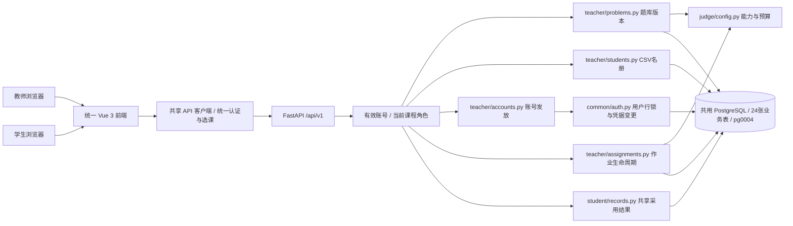

# 教师端架构与交付索引

更新：2026-10-25。教师端已从题库与名单管理扩展为学生作答所需的教学管理闭环：**录题与冻结 → 名册导入 → 账号开通和初始密码发放 → 作业草稿与发布 → 截止及开关管理 → 查看学生采用版本和评测结果**。所有模块继续共用 Vue 工程、FastAPI 服务与 PostgreSQL 数据库。

| 文档 | 内容 |
|---|---|
| [前端架构](frontend.md) | 页面、路由、组件、共享登录与课程状态 |
| [后端架构](backend.md) | 服务分层、权限、事务与并发锁 |
| [数据库边界](database.md) | pg0002–pg0004 兼容、共享表与不可变配置 |
| [教师 API](api.md) | 实际接口、DTO、错误与总预算协议 |
| [运行与验收](../../implementation/runbooks/teacher-setup.md) | 启动、升级、测试、合成账号联调 |
| [本轮验证记录](../../implementation/evidence/teacher/2026-10-25-student-integration.md) | TD01–TD08 对应实现与实测边界 |
| [功能职责清单](../../features/teacher/responsibilities.md) | 已约定的教师与学生模块协作要求 |

## 1. 总体结构

## 2. 教师端交付

- 统一登录、首次改密、显式选课及按课程角色进入工作区；重新载入页面也接入真实操作续期。
- 四类题库、题干/教师参考/代码/知识点、公开与隐藏用例、评分量表、总预算；草稿保存、冻结、派生新版本及归档恢复。
- CSV 名册预览和确认导入，保留前导零、拒绝跨课程资料覆盖；名册导入不等同于账号开通，也不会自动修改旧作业名单。
- 单个或当前页批量开通/重置（接口最多50人）：独立随机初始密码、仅本次响应与页面展示、受控下载发放清单、首次改密与全部旧会话撤销。教师自行逐人发放，不自动发送邮件。
- 作业草稿、冻结版本选题、分值/权重/评审人数、按班级/学号/姓名筛选及指定名单；可只读发布或开放提交。发布后固定版本、配置、分值、名单及班级快照。
- 修改截止、提前关闭、重开；与学生接收提交共用作业行锁，关闭不取消已接收的评测任务。
- 教师查看某学生进度、共享采用候选、历史和只读提交快照；复用学生端结果展示组件，不把模拟或未完成结果称为正式成绩。

## 3. 数据和模块边界

1. 继承学生端的 `pg0002` 认证与 `pg0003` 评测生命周期；追加 `pg0004`，仅给 `test_suites` 加可空 `total_budget_ms` 和范围约束，仍为24张业务表，不改写旧迁移或旧冻结配置。
2. 新保存的配置固定预算值；历史 NULL 配置按共享规则推导并标记 `LEGACY_DERIVED`。发布与重开检查节点能力，LOCAL 执行器使用同一预算，学生只读展示预算及来源。
3. 作业发布复用题目完整性规则，检查所属课程、题型、父题目版本 FROZEN、指定测试集/量表归属及权重和；不能仅看到配置 FROZEN 就发布。
4. 共享认证是凭据变更的唯一实现入口；学生端仍负责登录、改密、作答、任务调度和重评。教师不会绕过服务直接批量改密码字段。
5. 本轮不交付匿名互评分配、评分聚合、异常处置、正式成绩发布或 Linux 沙箱。LOCAL 的执行环境与限制继续以学生评测运行说明为准。

## 4. 协作方式

本轮分支 `feat/teacher-student-integration` 从已合并学生端的 main 建立。审阅顺序：本索引 → 数据库与 API → 共享认证/预算变更 → 教师页面与验证记录。旧教师题库 PR 已合并，不复用旧 PR 继续堆叠变更。

教师与学生开发者升级前先备份自己的本机库，然后执行 `alembic upgrade head`。真实名册、数据库备份、初始密码和访问令牌不进入 Git。后续互评与成绩仍按相应任务单推进，不关闭整个教师模块任务。
