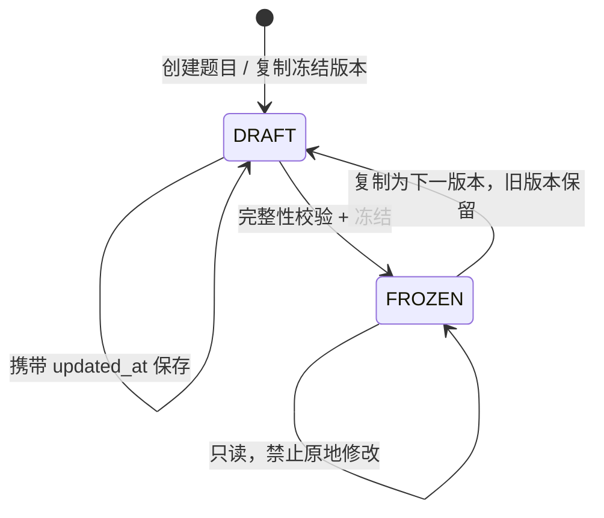

# 教师端后端架构

## 1. 分层职责

| 文件 | 职责 |
|---|---|
| `app/teacher/router.py` | HTTP 参数、当前用户、上传限额、响应、事务提交与冲突转换 |
| `app/teacher/schemas.py` | 四类题目及版本输入、类型/长度/数量/数值校验、禁止额外字段 |
| `app/teacher/problems.py` | 题库查询、课程知识点、内容配置、版本状态和复制 |
| `app/teacher/students.py` | CSV 解析、导入计划、预览签名、重新校验与名册写入 |
| `app/common/auth.py` / `permissions.py` | 原有会话和课程角色校验，所有模块共用 |
| `app/db/models` / `session.py` | 原有 PostgreSQL 模型、请求会话和连接配置 |

服务函数不自行提交；路由统一在 `write_transaction()` 中提交，异常回滚。数据库唯一约束的竞争冲突转为 409 `WRITE_CONFLICT`，不向浏览器返回 SQL 或连接参数。

## 2. 题目写入流程

编辑时先锁题目，再锁目标版本；比较带时区的 `expected_updated_at`，过期写入返回 `VERSION_CONFLICT`。被作业引用的版本同样拒绝修改。复制时锁题目，序号递增，单题至多保留一个可编辑草稿。

冻结前要求有效课程知识点和非空参考答案。编程题还要求输入输出说明、至少一个测试点、权重精确相加为 1；主观题要求至少一个评分维度，名称与评分描述完整，分值为正。冻结写入 `frozen_at`。

保存草稿时只替换该草稿的知识点和参考答案；测试集、量表保存为新配置修订。先前配置记录不修改，详细原因见 [teacher_database.md](database.md)。归档只改变题目状态，已有作业继续引用原版本。

## 3. CSV 两阶段导入

1. **解析**：仅接受 UTF-8 / UTF-8 BOM CSV；最大 2 MiB、2,000 行。检查表头、列数、必填、长度、字符及重复学号。
2. **计划**：匹配全局学号、登录名和班级，检查当前课程角色、同名班级歧义、跨课程资料冲突，给每行计算 `CREATE / ENROLL / UPDATE / UNCHANGED / ERROR`。
3. **预览**：只读，不创建用户或班级。返回行号、错误、变更字段、汇总和文件 SHA-256。合法计划签发 15 分钟 HMAC 令牌，绑定教师、课程、文件和相关数据库快照。
4. **确认**：同一文件、摘要、令牌及明确更新勾选提交。事务中获取全局名册导入 advisory lock，再锁相关身份/班级/成员，重新生成计划并校验数据库快照。
5. **写入**：班级 → 新学生 → 学生资料 → 课程成员，全部成功后一次提交。任何错误整批回滚；缺少旧学生不删除；不重置密码、激活状态或历史作业名单。
6. **重复请求**：如果所有目标记录已完全一致，返回 `replayed=true`；不会重复创建账号或成员。预览后资料发生其他变化则 409，要求重新预览。

全局锁仅协调本服务的导入。其他模块直接写全局身份时仍须遵守唯一约束，并协调相同资料变更规则；不能把 advisory lock 当作所有外部写入的强制保护。

## 4. 权限与边界

所有教师入口要求账户有效且为目标有效课程的 `ACTIVE / TEACHER` 成员。学生请求返回 403；未加入的课程与资源返回 404。问题 ID、版本 ID 均追溯其真实课程，不能依靠前端传入身份授权。

参考答案、隐藏测试只由教师详情返回。名册预览不向教师透露其他课程的真实资料，只提示冲突。确认日志只记录操作人/课程 ID、行数和摘要，不记录名单、原始文件或 token。新账户为 `PENDING`、无密码；学生激活和正式教学权限由共享账户政策处理。

## 5. 输入约束

题干最多 262,144 字符，题目配置整体最多 4 MiB；参考答案最多 20 份、知识点最多 30 个、测试点最多 200 个、评分维度最多 30 项。文本禁止 NUL。题目编号课程内唯一，创建后不修改；题型也不在现有题目上变更，避免错误迁移专用配置。

列表默认每页 20、最多 100。模糊搜索转义 SQL LIKE 通配符。分值使用 Decimal，ID 范围限制到 PostgreSQL BIGINT 正数。运行时不创建表，启动仍使用原有迁移。
