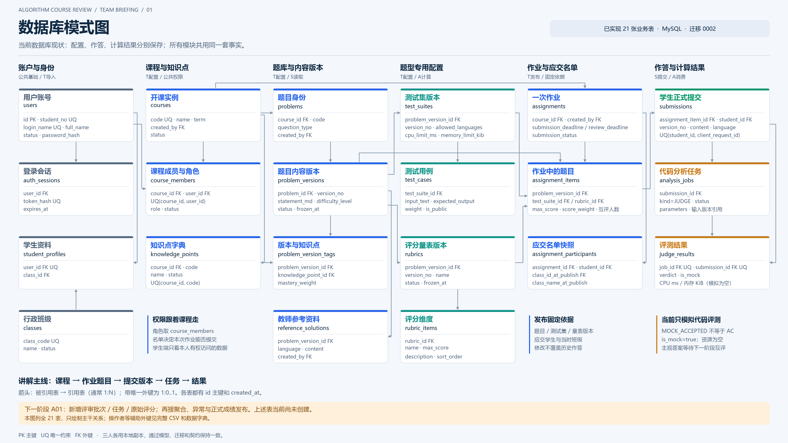
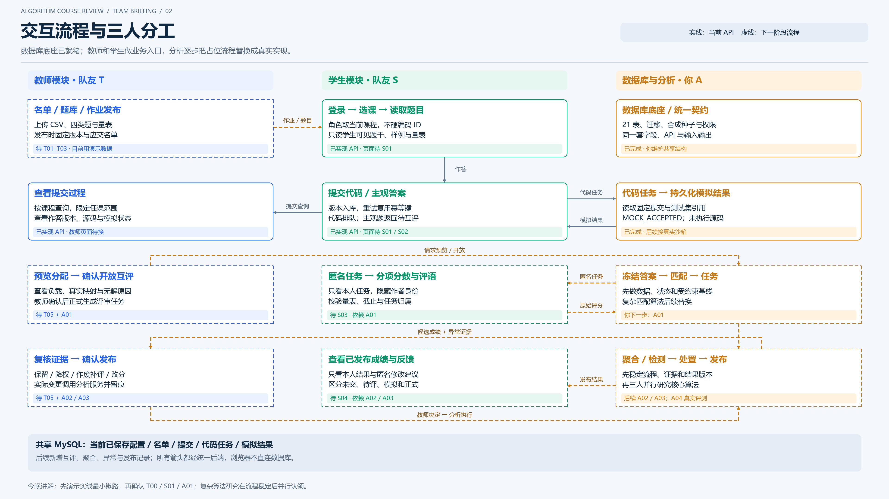

# 会议图：4K PNG与矢量源文件

日期：2026-10-21。两图均直接绘制为3840×2160像素，16:9，非低分辨率放大；字体使用Microsoft YaHei，适合本机Windows与会议投影。

## 01 数据库模式图

[4K PNG](01-database-schema-4k.png) · [可编辑SVG](01-database-schema-4k.svg) · [完整外键清单CSV](database-foreign-keys.csv)



图列出模型中的全部21张业务表、关键字段与25条主干关系。完整模型共34条外键，均见CSV；并非所有操作者/学生身份辅助外键都画出。箭头从被引用表指向引用表，通常1:N；唯一外键对应1:0..1。没有把规划互评/成绩表混入现有表数。

讲解时先沿课程→作业题目→提交→任务→结果，再补账户权限、题目版本、测试/量表与名单快照。

## 02 交互流程与三人分工

[4K PNG](02-interaction-flow-4k.png) · [可编辑SVG](02-interaction-flow-4k.svg)



蓝T教师、绿S学生、琥珀A数据库/分析。实线框与实线流程表示当前已实现API，页面仍需各自接入；虚线表示规划。教师导入/发布、互评、聚合/异常与正式发布都没有被画成已实现。

## 图形再生成

生成源为scripts/build_meeting_diagrams.py，读取SQLAlchemy模型只做元数据核对，不连接数据库、不读取凭据或学生资料。渲染依赖与应用运行依赖分开，Pillow是可选制图依赖。

```powershell
.\.venv\Scripts\python.exe -m pip install -r docs/diagrams/requirements-render.txt
.\.venv\Scripts\python.exe scripts/build_meeting_diagrams.py
```

默认中文字体路径为C:/Windows/Fonts/msyh.ttc和msyhbd.ttc；其他系统可通过DIAGRAM_FONT/DIAGRAM_FONT_BOLD指定支持中文的字体。SVG保留文字和图形对象，可继续编辑；PNG用于直接展示。模型新增表后脚本会要求同步图中节点，避免图与代码静默脱节。

图片仅概括关系和流程，精确字段与规则仍以[数据库](../DATABASE.md)、[数据字典](../database-schema.md)、[API](../API.md)和迁移为准。
