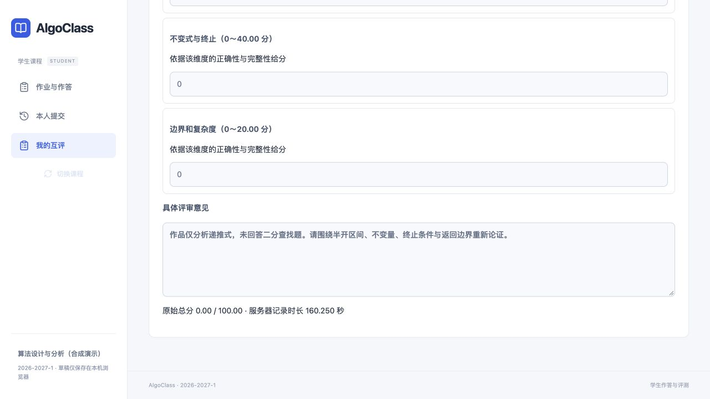

# 第③、④条链路验证记录

验证日期：2026-10-27；基线main 938a8d2。此记录是整合其他组员分支之前的互评模块验证，不代表六条链路全部完成。

- 后端全套：172 passed、1 skipped（本机缺少javac），包含互评真实数据、幂等、越权、封存/评分并发、补评和版本不可变性。
- 前端：53 passed；TypeScript、Prettier检查和生产构建通过。
- 最小费用流：24个小规模随机实例与独立穷举的凸负载最优值一致；217人、651任务，所有负载3，无自评/重复/缺少人数。耗时4.2592秒，仅代表本机合成样本。
- localhost独立HTTP：6名合成学生、18个初始任务、1个补评任务、3个分析版本、6份候选；原始评价完整保留，补评无既有重复关系。独立CLI worker与API分进程。
- 浏览器：教师实际创建/确认分配，学生实际提交全维度0分，教师封存12份评价、查看四类证据并确认不足状态、重算v2。6份0.00候选保留为有效零分，未被当成缺评。
- 浏览器发现Vue数字0被空值判断拒绝，已修正并增加前端回归；64位ID按字符串传输。
- 新迁移pg0007经过隔离测试库升级/降级/再升级及metadata一致性验证。后续整合时需与其他分支迁移串联，不能复用冲突的revision编号。

所有账户、作品与评分均为本机合成验收样本，不是课程真实学生成绩；实验不构成异常识别准确率声明。

运行方式见[互评运行手册](../../runbooks/peer-review-setup.md)，下游接口见[逐题候选交接](../../../design/analysis/peer-review-api.md)。
