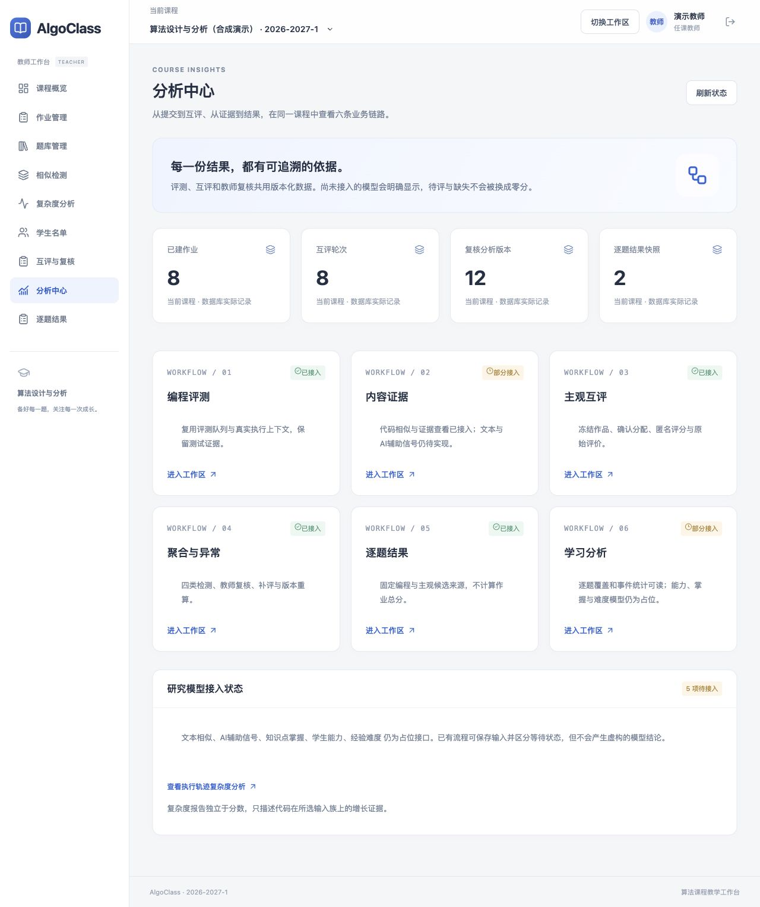
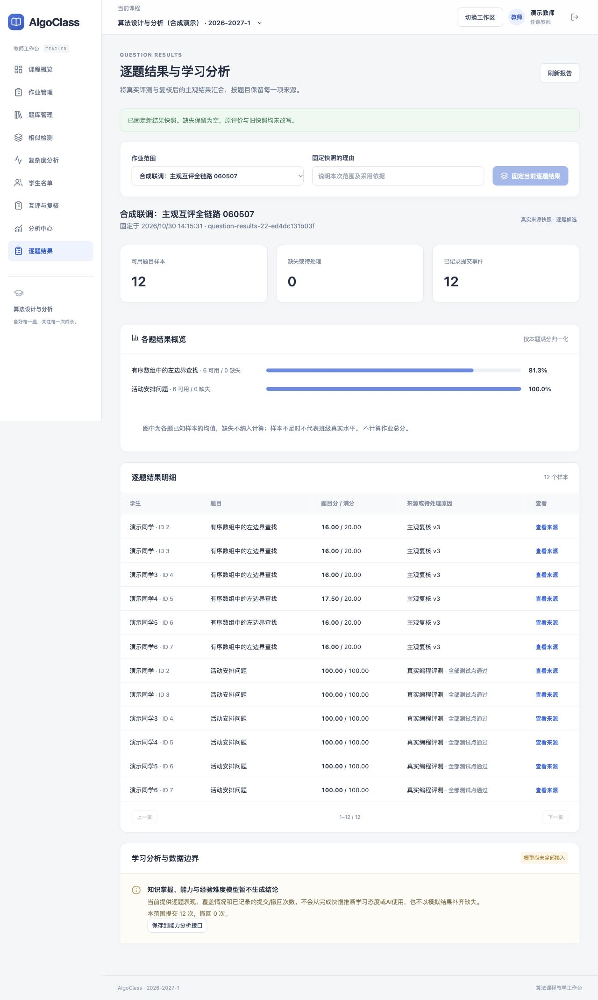
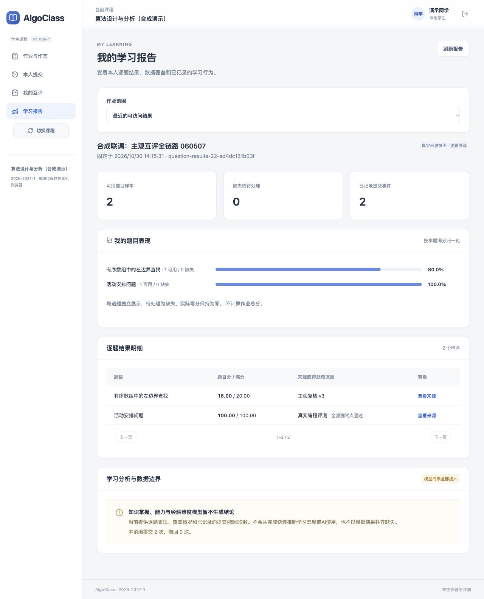
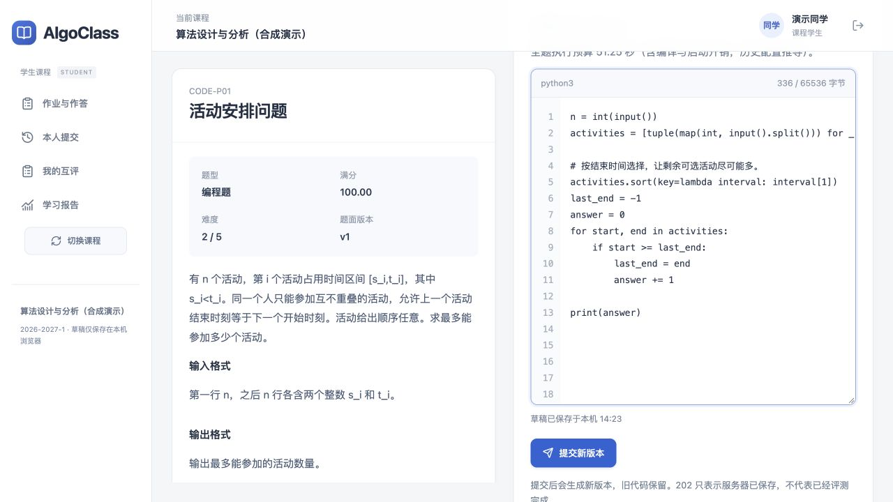
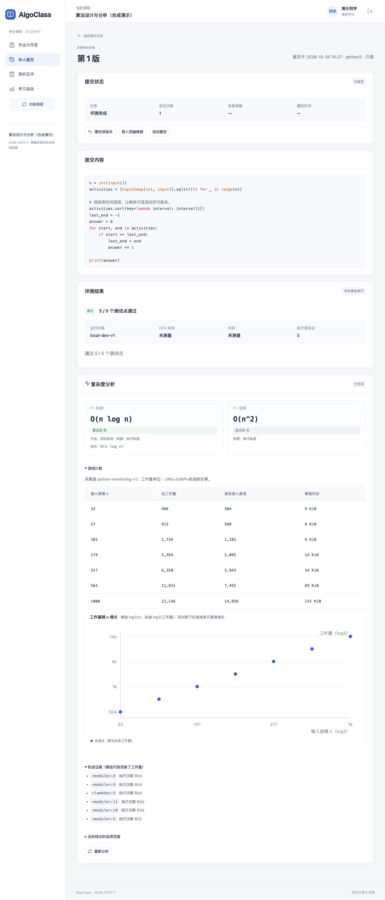

# 教师、学生与分析整合验收

日期：2026-10-30。整合main 938a8d2、互评实现2d71e18及组员轨迹分支213fa7f；合并历史保留，未改写组员原分支。迁移head pg0010，36张业务表。

## 完成度结论

①编程评测、③主观互评、④聚合异常及⑤现行逐题快照范围已接入。②代码相似可用，但文本/AI信号占位；⑥覆盖与记录统计可用，但掌握/能力/经验难度占位。共5个研究插件仍NOT_IMPLEMENTED，不能宣称六条全部完成。遵循项目2026-10-27取消作业总分/发布节点的约定。

## 自动化验证

- 后端：**320 passed / 3 skipped**，74.32秒。跳过项：两项需要本机没有的Java工具链；一项种子的max_n已接近最小档，按原用例条件跳过。
- 前端：**105 passed**（23个测试文件）。TypeScript、Prettier全量检查及生产构建通过。
- 迁移：隔离测试库验证空库升级、降级、再次升级及metadata一致；本机开发库先pg_dump备份后采用已核对schema串联，原34表行数逐表保持不变，新增复杂度两表。
- 新增结果边界测试：非模拟/当前上下文、等权证据、全通过、部分非等权留空、未知系统错误/矛盾判定拒绝、快照重放/不可变、学生安全投影、能力占位接口实际读取真实快照。
- 新增复杂度衔接测试：错误环境worker不领取任务；显式失败重试需新请求ID、最多3次且保存历史；旧attempt即使遇到新租约也不能写入。

## 独立HTTP与浏览器

所有账户、作品和评分均为本机DEMO_ALGO合成数据；使用真实HTTP和LOCAL执行，不是真实学生成绩。

完整脚本 `review_http_smoke --with-programming`：6位学生各交1份编程和1份主观作品，6份代码真实ACCEPTED；主观18个任务、1个补评、3个分析版本，原分保持不变，补评无重复关系。最终12份有来源的逐题结果，学生投影只有本人2份。可公开的合成元信息见[HTTP报告](http-report.json)。

浏览器实际执行：

1. 教师选择混合作业、填写理由、确认固定新快照；报告12份，来源分别为真实编程评测和主观复核v3。
2. 学生读取本人报告：2份结果，不包含其他同学名字、ID、题目分或班级统计。
3. 双栏作答区实际输入代码、保存本机草稿、提交新版本；真实通过5/5测试点。
4. 申请复杂度后发现worker环境与API不一致，已修复领取条件及重试；通过界面重新申请，报告实际完成，包含7档轨迹、增长图和证据。时间估计O(n log n)、置信度高；空间估计置信度低，不作为真实空间复杂度已被证明的声明。
5. 桌面页面实测宽1280px，无页面整体横向溢出；窄屏断点900/600px已实现，本次不宣称移动真机验收完成。

## 修复的实际衔接问题

- 重复pg0007：互评迁移改为pg0010，保留复杂度pg0007–pg0009。
- 插件/图合并：保留代码相似v2与互评算法v2；合并全部子管线，统一配置读取。
- 判定状态名：采用项目ACCEPTED常量，避免接口用AC、服务实际为ACCEPTED而误判未完成。
- 分数证据：只有可验证的等权测试才将部分通过率转换为题目分；未知保持空值。
- 复杂度环境：API/worker统一LOCAL；错误环境不能把合法任务消费为不合格。
- 复杂度失败恢复：原“重试”只返回旧失败；现在显式入队、幂等/次数有界、旧attempt隔离。
- 前端：修复学生题面/结果/复杂度正文贴边，统一留白、字体、卡片和导航；编辑器带行号，代码滚动局限于编辑区。

## 页面证据

设计和边界见[整合设计](../../../design/analysis/platform-integration.md)，启动方式见[运行手册](../../runbooks/platform-integration.md)。
