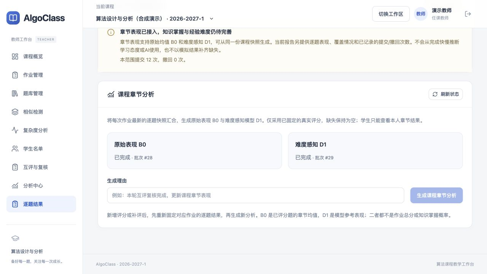
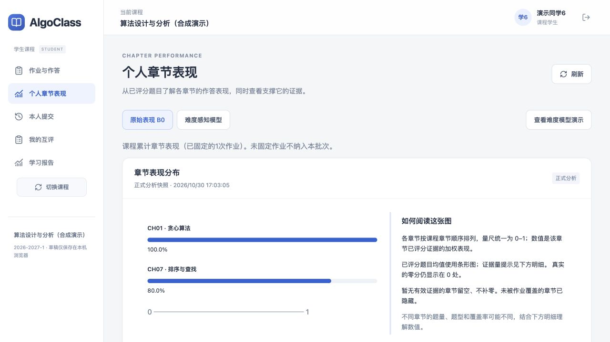
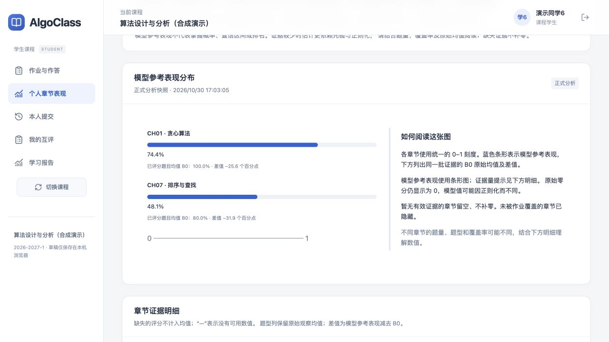

# Student ability 整合验收记录

日期：2026-10-30。本记录追加于首次平台整合验收，不改写此前320/105测试的历史报告。合并来源 `feat/student-ability-delivery`，提交 `151d89135f7cf5779e0f96d9b07b9d3cc06cb946`，保留其提交历史。

## 交付范围

- 合并B0、D1算法、章节映射、实验、独立API、学生章节页面与原有测试。
- 解决导航/管线路由与主文档合并冲突，保留互评、结果、相似与复杂度功能；修正自动合并导致的重复图标import。
- 作业逐题结果固定完整章节契约，再由课程快照采用每作业一个版本，接入正式B0/D1。
- 教师逐题结果页新增课程章节分析生成及状态；学生新增个人章节表现导航与范围说明。
- 补齐旧元数据拒绝、版本冲突、摘要校验、模拟隔离、学生本人投影、大小/范围限制、响应丢失重放。
- 修正通用worker领取时锁住父批次行的问题，使用FOR UPDATE OF analysis_runs，新增确定性并发回归。
- 调整教师卡片正文留白、表单对齐，修正少于3章节使用条形图时的阅读说明。

数据库仍为36张业务表，`alembic heads`仅有pg0010，无新增迁移。原数据和历史结果保留。详见[接入设计](../../../design/analysis/student-ability-integration.md)。

## 自动化验证

| 检查 | 结果 |
|---|---|
| backend `python -m pytest -q -rs --tb=short` | 423 passed，3 skipped，74.50s |
| frontend `vitest run` | 26 files，129 tests passed |
| frontend `vue-tsc --noEmit` | 通过 |
| frontend `prettier --check src` | 通过 |
| frontend `vite build` | 通过 |
| `git diff --check` | 通过 |
| `alembic heads` | pg0010单一head |

跳过项：两项依赖本机未安装的Java工具链，一项复杂度输入种子的max_n已在最小档。唯一提示为现有FastAPI TestClient对httpx的弃用提示。测试仅清理algorithm_review_test，未清理开发课程。

覆盖真实计分边界、主观复核产物进入B0、B0/D1本人读取、零分/缺失、跨作业合并和每作业版本防重、显式历史范围、映射版本冲突、旧元数据缺失、错误摘要、mock隔离、越权、64位ID、幂等及前端D1响应丢失重放。

完整回归中曾复现同批次两个worker偶发领不到独立任务；修复领取锁后专项23项及完整423项均通过。新增确定性测试在父批次行锁保持期间验证独立连接仍能领取任务。

## 真实HTTP与页面验证

`scripts/smoke_ability_integration_http.py`在既有合成DEMO_ALGO课程执行；只追加不可变快照与模型任务，不关闭活跃作业、不改变学生作品、名单或密码。输入来自已有真实LOCAL评测与教师复核产物；所有账户及作答是合成测试数据，不是现实学习者效度验证。

1. 作业8重新固定逐题快照23，包含6名合成学生、12个已评分样本、编程与主观两种真实来源。
2. 固定课程快照24；同request_id重放返回同一版本。
3. B0批次25：ability_b0 v2，OK、非mock。
4. D1批次26：difficulty_fractional v2，OK、非mock、收敛。
5. 两名学生接口各返回自己11章估计，无其他学生或证据题目key；教师访问本人学生接口与学生访问教师原始输入均403。
6. 正式与合成接口保持独立标记，正式结果不借用演示。
7. 浏览器教师页实际确认生成课程快照27、B0批次28、D1批次29；刷新状态两者完成。
8. 独立学生验收页使用demo.student06，实际切换B0/D1，显示贪心与排序查找的结果、覆盖、题型证据与版本。不重载用户原有作答标签页。

HTTP摘要见[ability-http-report.json](ability-http-report.json)，不含密码、token或原始作答。页面检查为1280×720桌面视口，未声称完成移动设备验收。

## 保留边界

B0/D1已实现并接入正式来源；旧ability契约仍保留，知识掌握、经验难度、文本相似及AI辅助信号仍为旧占位接口。正式过程轨迹本轮没有数据来源时保持UNAVAILABLE，合成轨迹仍只在演示中。继续遵守团队不计算作业总分的约定。PR保持可审查的整合分支，不直接改写main。
