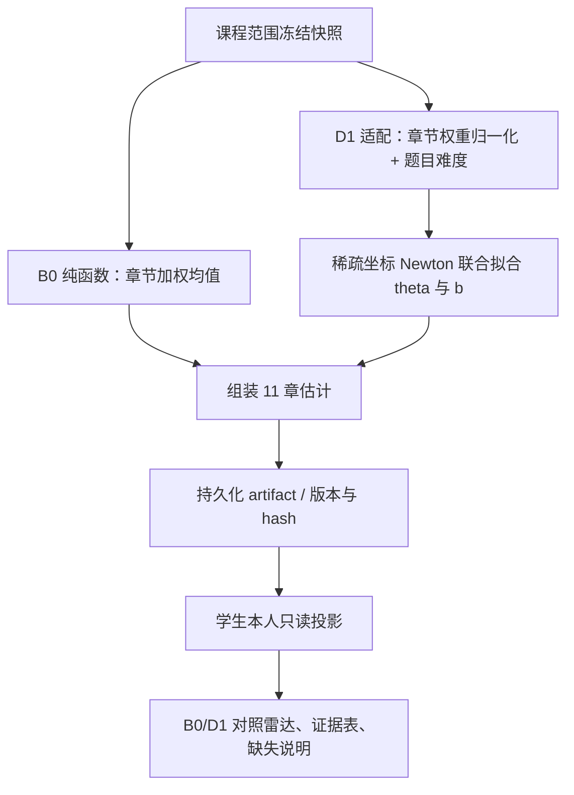

# 学生能力分析：问题建模、算法设计、复杂度与实验验证

**版本**　2026-11-09 · 基线 `837fa38` · 课程任务书《算法设计与分析课程作业指南2026v2》第 4 页课题一第三节、第四节
**交付范围**　学生章节表现的 B0 描述性基线与 D1 难度感知模型；不含作业总分、综合 rating、掌握概率或真人效度结论。
**复现材料**　`data/analysis/experiments/replay-2026-11-09/`（本次实际执行）与 `data/analysis/experiments/difficulty-v1/`（已归档原始实验）。
**证据分级**　本报告严格区分三类陈述：

| 标记 | 含义 | 本报告中的例子 |
|---|---|---|
| **观察** | 某个时点从页面、会话或既有回执看到的值；本轮没有重新执行或复算 | 2026-11-08 合成实操中的互评评分回传 |
| **复算** | 从冻结原始结果、协议或公式确定性推导，可逐项核对 | B0 100%、RMSE 表、配对差、复杂度量级 |
| **验证** | 在本克隆中实际运行命令并保存输出，或直接执行了被测函数 | 93.11 秒实验重放、B0 同名题小例 |

不把“观察”写成“验证”，也不把受控合成实验外推为真人能力结论。

---

## 一、问题建模

### 1.1 要回答的问题与输出对象

平台需要在题型不同、题目难度不同、评分尚不完整的条件下，说明学生在算法课程各章节的作答表现。直接平均分会把“简单题得高分”和“困难题得高分”混在一起，最终是否通过也无法描述修改过程。因此本模块采用双轨输出：

- **B0：已观测表现。** 在本次已布置且有有效定版评分的题目集合上，按章节计算加权均值，回答“在这些题上实际表现怎样”。
- **D1：参考难度模型表现。** 用学生章节参数和题目难度参数解释成绩，输出参考难度 0 上的模型期望分，回答“在模型定义的参考难度下预期表现怎样”。

两者输出对象不同，差值不能解释为学习进步。提交过程只作为独立观察，不进入能力总分。本轮不计算每次作业总分或综合 rating，不输出掌握概率、人口百分位或未经校准的置信区间。

### 1.2 实体、符号与作答关系

| 符号 | 含义 | 实现中的对应 |
|---|---|---|
| $s$ | 学生 | `student_key`，由认证身份或冻结名单产生 |
| $i$ | 作业题目实例 | `item_key`；同一题库题在不同作业中是不同实例 |
| $c$ | 章节 | CH01–CH11，顺序固定 |
| $P$ | 预期作答关系集合 | `scope.expected_pairs`，每条含 `SCORED/PENDING/NOT_SUBMITTED/INVALID` |
| $\Omega$ | 有效评分集合 | 状态为 `SCORED` 且存在唯一合法成绩的学生—题目对 |
| $y_{si}\in[0,1]$ | 单题归一化成绩 | 上游冻结的 `normalized_score`，可含真实 0 和 1 |
| $q_{ic}\ge0$ | 题目对章节的归因权重 | `chapter_weights`；有映射时总和约为 1 |
| $d_i\in\{1,2,3,4,5\}$ | 教师主观难度 | `difficulty`，只作为有序先验 |
| $a_i=\gamma(d_i-3)$ | 难度先验锚点 | `difficulty_scale`（冻结值 0.75）乘教师等级偏移 |
| $\theta_{sc}$ | 学生章节参数 | 无天然百分制单位 |
| $b_i$ | 经当前冻结评分校准的题目难度 | 若 `calibrate_items=false`，固定为教师锚点 |
| $\lambda_\theta,\lambda_b>0$ | 学生、题目正则化强度 | 冻结值 0.05、0.3 |

**题目实例的身份。** 课程快照中 `item_key = item-{assignment_item_id}`，题库代码 `item_code` 另存。两次作业复用同一道题时，`item_code` 相同但 `item_key` 不同，因此它们是两条独立作答证据，不按题库代码合并。课程快照对每次作业只采用一个 `COMPLETE` 逐题快照；默认选最新版本，显式选历史版本时同一作业出现两个版本会被拒绝。学生名单取各作业名单的并集，只在学生实际所在的作业名单中生成布置题对，不把“未布置”算成“未交”。

**章节与题型。** 题库共 120 题，70 道编程题按原文件夹单章归属；50 道主观题中 45 题已有暂定映射，5 题保持 `UNMAPPED`。编程、算法分析、证明、开放问答都参与分析；后三种在题型诊断中归为 `SUBJECTIVE`。同章两类题按 $\sum q$ 合并，不额外规定各占 50%。未映射题不强行归入雷达，但逐题证据仍保留，并通过 `unmapped_item_count` 报告。

### 1.3 输入契约、冻结链路与来源语义

D1 的输入是 `DifficultyInputV1`，内部包装 `AbilityInputV2` 与模型参数：

```text
DifficultyInputV1
├─ learning_input: AbilityInputV2
│  ├─ source_kind: DATABASE | SYNTHETIC_FIXTURE | DEMO
│  ├─ results_snapshot_version / scoring_policy_version
│  ├─ chapter_taxonomy_version / chapter_mapping_version
│  ├─ scope: 学生名单、作业 ID、预期作答关系
│  ├─ chapter_taxonomy: 11 章词表
│  ├─ items: 实例键、题库代码、版本、题型、满分、教师难度、章节权重
│  ├─ grades: 唯一采用的成绩、评分版本、来源引用、来源类型
│  └─ parameters: method=B0, min_items=3, min_coverage_items=0.5,
│                 merge_policy=CHAPTER_WEIGHT, interval_policy=NONE
├─ model_parameters: learner_l2, item_l2, difficulty_scale,
│                    max_iterations, tolerance, calibrate_items
└─ processes: 可选冻结提交事件；不参与主模型拟合
```

冻结链路为：


输入校验覆盖学生/题目引用、章节权重、评分范围、唯一性和状态一致性。相同学生—题目—成绩—版本的重复记录可去重并给出警告；同一学生—题目出现冲突定版成绩则拒绝。正式输入必须是 `DATABASE` 来源，不能由演示或模拟来源冒充；学生接口从认证身份推导 `student_key`，只返回本人结果，并且不回退到旧批次或模拟结果。

**与旧分支设计的差异（复算自设计文档与当前 main 代码）。** 2026-10-29 的交付设计把“等待上游正式逐题来源”作为交付时状态；当前 main 已通过课程级冻结快照接入真实编程与互评复核来源，并增加教师生成入口与学生本人入口。旧说明中的“B0/D1 待上游”不能继续作为现状；但正式真人效度、完整互评闭环和过程轨迹接入仍不在本轮证据范围内。当前实现标识为 `ability_d1 / difficulty_fractional / version 2 / ability-difficulty-v1`，复用已有分析任务、输入和结果表，无新增数据库迁移。

### 1.4 有效评分、真实零分与缺失语义

- **编程分**只读现有真实运行上下文、测试集数量、合法判定与通过数一致性验证的结果；部分得分要求等权测试点证据。模拟判定、系统错误或通过数与测试点数不一致的记录不进入 $\Omega$。
- **主观分**只读教师复核后的有效重算产物，保留版本与摘要引用；未封存、样本不足或待处理保留为 `PENDING`。
- **真实零分保持 0。** 未提交记为 `NOT_SUBMITTED`，待评记为 `PENDING`，其他证据不可用记为 `INVALID`；三者都不补零，也不参与 B0 分母的已评分权重。
- **已布置但无证据**与**未布置**严格分开：前者是 `NO_EVIDENCE`（有预期作答关系、无有效评分），后者是 `NOT_COVERED`（该章没有布置给该学生）。

### 1.5 章节输出状态与覆盖

对每个学生固定输出 11 章。章节状态由有效题数和覆盖率共同决定：

| 状态 | 判断 | 页面行为 |
|---|---|---|
| `NOT_COVERED` | 本章对该学生没有已布置题目 | 隐藏该轴 |
| `NO_EVIDENCE` | 已布置，但没有有效定版评分 | 留空并显示原因 |
| `LOW_EVIDENCE` | 有评分但不足 3 题，或评分覆盖不足 50% | 显示值，同时提示低证据 |
| `OK` | 达到公开的展示证据门槛 | 显示值、题数、覆盖和类型分项 |

覆盖统计同时给出按题数和按权重两种口径；Kish 有效数 $(\sum q)^2/\sum q^2$ 对权重整体缩放不变，只作均衡度诊断。3 题与 50% 是可配置工程门槛，不是测量学定理。全 0、全 1 或全等分只作诊断标记，不自动降为低证据；有效轴不足 3 个时不强画多边形。

### 1.6 小例：同名题跨作业独立、缺失保持空（验证）

下面的输入由 `backend/scripts/check_ability_worked_example.py` 构造，并调用真实 `ability_b0.analyze` 执行；输出保存在 `data/analysis/experiments/replay-2026-11-09/worked-example-output.json`，断言全部通过（`WORKED EXAMPLE OK`）。

| 学生 | 作业 | 题目实例 | 题库代码 | 章节 | 状态 | 成绩 |
|---|---|---|---|---|---|---|
| s1 | a1 | `item-11` | P-001 | CH01 | `SCORED` | 1.0 |
| s1 | a2 | `item-21` | P-001 | CH01 | `NOT_SUBMITTED` | — |
| s1 | a1 | `item-12` | P-002 | CH02 | `PENDING` | — |
| s2 | a2 | `item-21` | P-001 | CH01 | `NOT_SUBMITTED` | — |

按 B0 公式手算与程序输出一致：

- **s1/CH01**：已布置 2 题，已评分 1 题。$W_{\text{assigned}}=2$，$W_{\text{sum}}=1$，$B0=1.0/1=1.0$，题数覆盖 $1/2=0.5$。因有效题数 1 小于 3，状态为 `LOW_EVIDENCE`；`missing.not_submitted=1`。
- **s1/CH02**：已布置 1 题，0 题已评分，`value=null`，状态 `NO_EVIDENCE`，`missing.pending=1`。
- **s2/CH01**：只有未交记录，$W_{\text{sum}}=0$，`value=null`，状态 `NO_EVIDENCE`，`missing.not_submitted=1`；不会得到 0 分。
- 其余未布置章节为 `NOT_COVERED`。`diagnostics.unmapped_item_count=0`。

这个例子直接说明：同一题库代码 P-001 在两次作业中是两条独立记录；若按代码合并，s1/CH01 会被误算成“已布置 1 题、覆盖 100%”，掩盖第二次作业未交的事实。程序输出中 s1/CH01 的 `assigned_items=2`、`scored_items=1`、`coverage_items=0.5` 正是正确语义。

### 1.7 本章结论

问题建模的核心不是“把分数平均”，而是把**预期作答关系、有效评分、题目实例身份、章节权重和缺失原因**分别固定下来。只有在这些语义上，B0 的 100% 才能被解释为“一个有效评分 1.0 的题”，而不是“已掌握该章”；D1 的参考分也才能与原始均值分开陈述。

---

## 二、算法设计

### 2.1 B0：章节加权描述性基线

对学生 $s$ 在章节 $c$ 的已评分题集 $V_{sc}$：

$$
B0_{sc}=\frac{\sum_{i\in V_{sc}}q_{ic}y_{si}}{\sum_{i\in V_{sc}}q_{ic}},
\qquad
V_{sc}=\{i:(s,i)\in\Omega,\ q_{ic}>0\}.
$$

若 $V_{sc}=\varnothing$，输出 `null`，并区分 `NO_EVIDENCE`/`NOT_COVERED`。归因权重不是题目满分权重、题型固定占比或评分者可信度；它只表示题目对章节的归属强度。

**伪代码（对应 `ability_b0.py`）：**

```text
输入：AbilityInputV2（已再次校验）
items ← item_key → item
grades ← (student_key, item_key) → grade；同值重复保留并警告，冲突在契约层拒绝
assigned ← 按 (student_key, chapter) 收集 (pair, item, weight)
for student in 排序后的学生:
    for chapter in 按 order 排序的 11 章:
        rows ← assigned[student, chapter]，按 item_key 稳定排序
        scored ← rows 中 state=SCORED 的记录
        n, n_assigned ← len(scored), len(rows)
        W_sum ← Σ scored.weight
        W_assigned ← Σ rows.weight
        value ← Σ(weight × normalized_score) / W_sum  若 n>0，否则 null
        coverage_items ← n / n_assigned                若 n_assigned>0
        status ← NOT_COVERED / NO_EVIDENCE / LOW_EVIDENCE / OK
        by_type ← PROGRAMMING 与 SUBJECTIVE 的原始子均值
        flags ← ALL_ZERO / ALL_ONE / ALL_EQUAL_NON_EXTREME /
                MIXED_TYPES / CROSS_CHAPTER_ITEM / LOW_COVERAGE
        输出该章估计
```

排序均在固定键上进行，章节按 `order`、学生按 `student_key`，因此输入记录顺序变化不改变输出。计算使用 `Decimal`（精度 28）完成 B0 的加权和与除法，避免二进制浮点把 0.1 之类的权重引入展示误差。

### 2.2 D1：正则化分数响应模型

D1 把成绩看作 $[0,1]$ 上的连续分数，条件均值为：

$$
\eta_{si}=\sum_c q_{ic}\theta_{sc}-b_i,
\qquad
\mu_{si}=\sigma(\eta_{si})=\frac{1}{1+e^{-\eta_{si}}}.
$$

题目参数以教师难度锚点为中心校准：

$$
a_i=\gamma(d_i-3),\qquad b_i=a_i+\delta_i .
$$

目标函数为分数响应交叉熵加二次惩罚：

$$
\mathcal L=\sum_{(s,i)\in\Omega}
\left[\log(1+e^{\eta_{si}})-y_{si}\eta_{si}\right]
+\frac{\lambda_\theta}{2}\sum_{s,c}\theta_{sc}^{2}
+\frac{\lambda_b}{2}\sum_i(b_i-a_i)^2 .
$$

这是条件均值/准似然意义下的惩罚交叉熵，不把连续分数伪装成整数次伯努利试验，也不提供后验不确定性。目标对参数凸，严格正的二次惩罚使活跃参数上的解唯一并固定量尺；该优化性质不等于统计效度或无偏性。

**为什么需要正则化。** 全 0、全 1 或小样本会让无惩罚模型出现完全分离、参数发散；惩罚把无证据章节拉回 0 附近。完全没有评分的章节即使内部可给先验，也不在雷达中显示为有效分数。若 `calibrate_items=false`，$b_i\equiv a_i$，此时输出明确标为固定教师先验，不能声称“已校准”。

D1 适配层还做两件事：把数据库小数份额在契约允许的舍入范围内归一化为浮点权重（不改写原始快照）；只把有章节映射的题目送入模型，未映射题保留在 B0 证据中但不强行归类。

### 2.3 优化算法：确定性稀疏坐标 Newton

令题目偏移 $\delta_i=b_i-a_i$，把所有学生章节参数与题目偏移组成坐标向量 $v$。初值为 0，预测子缓存初始化为 $-a_i$。每条记录只连接非零章节参数和一个题目偏移；题目偏移系数为 $-1$。

对坐标 $j$，关联记录为 $A_j$，系数为 $x_{rj}$，惩罚为 $\lambda_j$：

$$
g_j=\lambda_jv_j+\sum_{r\in A_j}x_{rj}(\mu_r-y_r),
\qquad
h_j=\lambda_j+\sum_{r\in A_j}x_{rj}^2\mu_r(1-\mu_r)>0.
$$

候选更新为 $\Delta_j=-g_j/h_j$。实现把单步截断到 $[-2,2]$，再回溯检查该坐标相关目标函数没有增大；每步最多 40 次回溯。所有键固定排序，不使用随机优化顺序。

```text
输入：题目元数据、训练评分、正则化与优化参数
校验并去重学生—题目评分，按稳定键排序
建立稀疏“坐标 → 关联记录”索引
初始化学生参数=0，题目偏移=0，eta=-教师难度锚点
repeat 最多 max_iterations 次：
    按固定顺序遍历活跃坐标：
        由缓存 eta 计算梯度 g 和曲率 h
        若 |g| <= tolerance，跳过该坐标
        计算并截断 Newton 步
        回溯检查局部目标，更新参数与 eta 缓存
    重新计算全部活跃坐标梯度
    若最大绝对梯度 <= tolerance：converged=true，结束
返回参数、目标函数值、扫描次数和收敛标记
```

达到 180 次扫描上限但梯度未达标时返回 `converged=false`，页面明确标为暂定结果，不伪称优化成功。`sigmoid` 与 `softplus` 使用数值稳定形式，允许 0/1 端点且不直接求观测分数的 logit。

### 2.4 输出、预测与展示语义

对每个学生逐章输出：

- `value`：D1 参考难度 0 上的模型期望分 $\sigma(\hat\theta_{sc})$；缺有效评分时为 `null`。
- `baseline_value`：同一输入上的 B0 原始章节均值。
- `theta`：章节参数，仅供可解释诊断与版本审计。
- `status`、题数、权重总量、Kish 有效数、覆盖度、缺失原因。
- 编程/主观的**原始**子均值，不冒充模型分别估计的能力。
- 优化是否收敛、迭代次数、目标函数值、模型参数和证据版本。

留出题目的预测为 $\hat y_{si}=\sigma(\sum_cq_{ic}\hat\theta_{sc}-\hat b_i)$。未参与校准的新题沿用教师锚点，不能假装校准过。D1 与 B0 的差值可能来自题目难度、模型拟合与正则化，不能解释为学习进步。

**B0 与 D1 的差别（用一句话说清）：** B0 回答“这批已评分题的实际加权平均是多少”；D1 回答“在参考难度 0 上，模型认为该章的期望分是多少”。前者是描述统计，后者是带题目难度先验和收缩的模型输出。

### 2.5 从冻结结果到学生报告的流程



B0 与过程观察是独立逻辑分支；D1 因共享题目参数需要联合迭代，不宣称不同学生的拟合统计独立。正式和合成来源分别查询，最新等待/失败批次不会伪装成已完成的旧结果。

### 2.6 设计边界

- 教师 1–5 级难度只提供有序先验；映射尺度 0.75 是验证集选定参数，不等于教师等级已被校准为 logit。
- 不同课程没有共同锚点时，不能直接比较章节参数或参考分。
- 过程观察只描述首次/最近/最佳已观测分、首次 AC 序号和相邻同类失败对数，不改变 D1 损失或章节分；提交次数多不等于能力差。
- 本轮不输出掌握概率、置信区间或作业总分。

---

## 三、复杂度分析

### 3.1 符号

| 符号 | 含义 |
|---|---|
| $S$ | 学生数 |
| $C=11$ | 章节数 |
| $I$ | 题目实例数 |
| $P$ | 预期作答关系数（学生—题目实例） |
| $L$ | 单题非零章节权重数的上界（本数据通常为 1，跨章题最多 2） |
| $G$ | 输入评分记录数 |
| $R$ | 去重后的有效训练评分数，$R\le G$ |
| $D$ | 活跃参数数：学生章节参数 + 参与校准的题目偏移 |
| $T$ | 坐标扫描次数，$T\le180$ |
| $B=40$ | 单坐标回溯次数上限（固定常数） |
| $E$ | 过程事件数 |

### 3.2 B0 的时间与空间

`ability_b0.analyze` 的实际操作：

1. 建立题目映射：$O(I)$。
2. 评分去重：$O(G)$，字典空间 $O(G)$。
3. 遍历预期作答关系并按 `(student, chapter)` 收集：每条关系贡献 $L$ 个章节，$O(PL)$。
4. 对每个学生、每章取出该组记录并按 `item_key` 排序：设第 $k$ 组有 $n_k$ 条，排序总代价 $O(\sum_k n_k\log n_k)\le O(PL\log(PL))$。
5. 扫描每组计算加权和、覆盖、类型子均值、缺失计数和诊断标记：$O(PL)$。
6. 输出 $S\times C$ 条章节估计：$O(SC)$。

因此 B0 时间上界为

$$
O\bigl(I+G+PL\log(PL)+SC\bigr),
$$

空间为

$$
O(G+PL+SC).
$$

注意 $P$ 是“预期作答关系”，不是“已评分记录”；未交和待评也占 $P$，这正是覆盖率和 `NO_EVIDENCE` 能正确计算的原因。B0 使用 `Decimal`，常数因子高于浮点，但量级不变。

### 3.3 D1 的时间与空间

D1 先调用 B0 得到 `baseline_value`，再做模型准备与拟合：

1. B0：$O(I+G+PL\log(PL)+SC)$。
2. 过滤有章节映射的题目并归一化权重：$O(IL)$。
3. 构造观测列表：$O(G)$；`fit` 内部再次校验、去重并稳定排序：$O(IL+G\log G)$。
4. 建立学生章节坐标与题目偏移坐标，构建“坐标 → 关联记录”稀疏索引：每条观测至多 $L+1$ 个系数，$O(RL)$；坐标数为 $D\le SC+I_{\text{obs}}$。
5. 每次坐标扫描：
   - 遍历活跃坐标，每个坐标只扫描其关联记录，梯度/曲率总和 $O(RL)$；
   - 回溯最多 $B=40$ 次，每次只检查该坐标关联记录，最坏 $O(B\cdot RL)$，但 $B$ 是固定常数；
   - 收敛检查重新计算全部活跃坐标梯度：$O(RL+D)$。
6. 最多 $T=180$ 次扫描；达到梯度容差即提前结束。

因此 D1 拟合时间上界为

$$
O\bigl(I+G+PL\log(PL)+SC+G\log G+T(RL+D)\bigr),
$$

通常简写为 $O(T(RL+D))$ 加排序预处理。空间为

$$
O(RL+D+R+SC+I),
$$

其中 $RL$ 是稀疏索引，$D$ 是参数与缓存，$R$ 是预测子与分数缓存，$SC$ 是输出。实现没有构建 $R\times D$ 稠密矩阵；若构建，空间会退化为 $O(RD)$，在 80 学生 × 66 题的本实验中约为 $5280\times(880+66)$，明显大于稀疏方案。

### 3.4 过程观察与输出组装

过程观察按学生、题目分组并按 `sequence_no` 排序，$E$ 条事件最坏 $O(E\log E)$；它不参与优化循环。输出组装遍历 $S\times C$ 条估计，$O(SC)$。D1 输出还复制 B0 的证据字段并追加 `theta`、`baseline_value`、模型诊断，仍是线性组装。

### 3.5 算法耗时、实测耗时与数据库/页面时延

必须区分三种“时间”：

| 口径 | 本轮证据 | 说明 |
|---|---|---|
| 算法量级 | 上式 $O(T(RL+D))$ | 与数据规模、稀疏性、收敛次数有关 |
| 实验实测 | 93.11 s 总墙钟；144 次含优化器评估；D1 平均 1.19 s/次，B0 平均 0.0117 s/次；最多 134/180 次扫描 | 本机 Python 3.11.9，80 学生×66 题×11 章，六场景×六种子 |
| 数据库/页面时延 | **本轮未测量** | 实验脚本不连数据库；2026-11-08 的页面观察不含计时基准 |

历史归档报告记录 99.26 s、D1 平均 1.28 s、最多 134/180 次扫描；本次重放为 93.11 s、1.19 s，差异来自机器负载与 Python 版本，不能作为性能承诺。实际 API 时延还取决于快照读取、持久化和网络，不能用纯函数实验值替代。

### 3.6 规模与边界

课程快照限制为最多 100 次作业、300 名学生、10000 个学生—题目样本、8 MiB；单次分配/分析也有各自上限。复杂度分析支持到这些上限，但不意味着任意规模都能在固定秒数内完成。若 $D$ 随学生数和题数线性增长，$T(RL+D)$ 仍随有效评分数和参数数增长；稀疏场景下 $R$ 小，D1 会明显更快（本实验 sparse 场景 D1 平均约 0.17 s，常规场景约 1.2–1.6 s）。没有证据支持“难度模型在任何课程规模上都优于 B0”。

---

## 四、实验验证

### 4.1 对照与隔离

实验比较四个对照：

| 对照 | 训练及预测 |
|---|---|
| B0 | 按训练评分计算每人各章加权历史均值；跨章测试题按题目章节权重组合均值。训练中完全缺失的章节仅在预测基准中使用 0.5，产品雷达仍然留空。 |
| D0 | 同一分数响应优化器，所有题目难度固定为 0；学生惩罚从验证集独立选择，形成较强的无难度对照。 |
| Fixed | 使用教师难度锚点，不用训练评分校准题目；与 D1 共用选定参数，是锚点消融对照。 |
| D1 | 同时拟合学生章节参数和题目难度；题目以教师难度为惩罚中心。 |

所有对照严格隔离留出评分；题目校准只读取训练评分。B0 的 0.5 只用于预测基准，不是产品雷达值。

### 4.2 协议、数据构造与参数选择（复算自协议文件）

- 每个独立数据集 80 名虚构学生、11 章、66 题；每章 6 题，每三题中一题以 0.65/0.35 权重关联相邻两章。
- 学生参数由共享水平 $N(0,0.85^2)$ 加章节扰动 $N(0,0.65^2)$ 生成。
- 常规真难度为 $0.75(d-3)+N(0,0.25^2)$；教师标签在真等级上加 $N(0,0.45^2)$ 后四舍五入并截到 1–5。教师标签不是拟合器可访问的真难度。
- 给定真实期望分 $\mu$，实际部分分来自 $\mathrm{Beta}(14\mu,14(1-\mu))$，因此预测面对不可消除的评分波动。每个学生×题目至多一条评分。
- 已有题目按每位学生的完整学生×题目组随机分到 60% 训练、20% 验证、20% 测试；重复提交必须成组进入同一分割。选参只用验证集；冻结后训练+验证合并为约 80% 拟合、20% 测试。
- 新题任务每章整题留出一题，共 11 题；只在常规和错标教师两个场景运行。
- 验证种子 `1103,2207`；最终种子 `31001,32003,33013,34019,35023,36037`；场景偏移 `scenario_index*100000`；已有题分割 `+719`，新题分割 `+991`。验证与最终种子完全隔离。
- 六个场景全部保留：`difficulty_signal`、`mislabeled_teacher`、`sparse`、`mnar`、`no_difficulty`、`nonlinear_mismatch`。
- 候选参数六组，验证集等权平均 RMSE 分别为 `0.15323, 0.15680, 0.18135, 0.16992, 0.15606, 0.17123`；选中 `learner_l2=0.05, item_l2=0.3, difficulty_scale=0.75`。D0 独立选择 `learner_l2=0.5`。
- 优化预算 `max_iterations=180`、`tolerance=1e-6`，在核心优化器收敛基准之后、最终评估之前冻结。
- 主要指标是留出逐题 RMSE/MAE；辅助指标包括对真实 $\mu$ 的 RMSE、十分箱校准差、模拟参数相关、收敛、扫描次数和耗时。统计单位是独立生成的数据集，每场景 6 个重复；没有把同一数据集内数千条评分当成数千个独立实验。

### 4.3 本次复现执行（验证）

在 `backend/` 目录实际运行：

```powershell
python -m scripts.experiment_ability_difficulty --output ../data/analysis/experiments/replay-2026-11-09
```

结果（`replay-2026-11-09/execution.json`）：

- 72 次 D1 验证拟合、36 次 D0 验证拟合。
- 192 次最终任务×数据集×模型评估，其中 144 次含优化器。
- 144 次最终优化全部收敛，最多 134/180 次扫描；无 `final_nonconverged`。
- 总墙钟 93.11 s；D1 平均 1.19 s/次，B0 平均 0.0117 s/次。
- 环境 Python 3.11.9 / Windows 10 IoT Enterprise LTSC 2021。

**与归档结果逐项比对（复算）：**

- `protocol.json` 去除 `created_utc` 后与归档完全相同；源代码与核心优化器 SHA-256 与归档一致。
- 192 条最终评估的 RMSE、MAE、loss、迭代次数**逐位相同**（最大绝对差 0）。
- 少数辅助统计量（十分箱校准差、模拟参数相关）最大绝对差 `2.22e-16`，属于浮点末位差异。
- 归档 README 要求 Python 3.12+，本次使用 3.11.9；这是环境差异，不掩盖也不放大。墙上时间不同是预期结果。

结论：本次重放支持“已有题目结果在相同协议与代码下可复现”；不把墙上时间或辅助统计量的末位差异包装成完全一致。

### 4.4 已有题目留出结果

六个独立数据集的均值；`Δ` 为同一数据集内 D1−B0 的配对差，负数表示 D1 误差更低。`±` 是六个配对差的样本标准差，不是置信区间。

| 场景 | B0 RMSE | D0 RMSE | Fixed RMSE | D1 RMSE | D1 配对 ΔRMSE | D1 胜 B0 |
|---|---:|---:|---:|---:|---:|---:|
| 难度有信号 | 0.29530 | 0.28295 | 0.15248 | **0.12703** | −0.16827 ± 0.00801 | 6/6 |
| 教师错标 | 0.28617 | 0.27570 | 0.31256 | **0.13039** | −0.15578 ± 0.01536 | 6/6 |
| 稀疏评分 | 0.31771 | 0.28748 | 0.18822 | **0.17402** | −0.14369 ± 0.00973 | 6/6 |
| 非随机缺失 | 0.28405 | 0.26779 | 0.16304 | **0.13858** | −0.14547 ± 0.01205 | 6/6 |
| **无真实难度** | **0.13595** | 0.16080 | 0.25872 | 0.13903 | **+0.00308 ± 0.00171** | **0/6** |
| 非线性失配 | 0.32458 | 0.30959 | 0.19624 | **0.15866** | −0.16592 ± 0.01335 | 6/6 |

MAE 方向一致：

| 场景 | B0 MAE | D0 MAE | Fixed MAE | D1 MAE | D1 配对 ΔMAE |
|---|---:|---:|---:|---:|---:|
| 难度有信号 | 0.24867 | 0.24695 | 0.11676 | **0.09785** | −0.15083 |
| 教师错标 | 0.23936 | 0.23994 | 0.24218 | **0.10164** | −0.13772 |
| 稀疏评分 | 0.26508 | 0.25000 | 0.14596 | **0.13438** | −0.13070 |
| 非随机缺失 | 0.23377 | 0.23269 | 0.12380 | **0.10472** | −0.12904 |
| **无真实难度** | **0.10823** | 0.13456 | 0.20764 | 0.11132 | **+0.00309** |
| 非线性失配 | 0.27091 | 0.27012 | 0.15310 | **0.11716** | −0.15376 |

**新题整题留出：**

| 场景 | B0 RMSE | D0 RMSE | Fixed RMSE | D1 RMSE | D1 配对 ΔRMSE | D1 胜 B0 |
|---|---:|---:|---:|---:|---:|---:|
| 难度有信号 | 0.27346 | 0.26694 | 0.15110 | **0.14484** | −0.12862 ± 0.04106 | 6/6 |
| 教师错标 | 0.26771 | 0.26309 | 0.26250 | **0.24004** | −0.02767 ± 0.06447 | 4/6 |

**参数恢复诊断（模拟量尺，不是真人效度）：** 已有题目常规场景 D1 学生参数与模拟真值相关约 0.930，稀疏约 0.678，MNAR 约 0.836；常规题目难度相关约 0.995，错标场景约 0.985。真难度恒为零时相关系数无定义，文件保留 `null`。稀疏与选择偏差确实削弱参数恢复。

### 4.5 反例、退化与解释边界

1. **无真实难度时 D1 全部输给 B0。** 六个重复全部退化，平均 RMSE 从 0.13595 升到 0.13903（约 +2.3%），MAE 从 0.10823 升到 0.11132。错误难度先验和额外题目参数有代价；不能宣称“难度建模总是更好”。
2. **新题教师错标只胜出 4/6。** 平均改善但两次退化，配对差标准差 0.06447，大于平均改善 0.02767。已有题目上的校准成功不能外推为“能纠正从未作答题的错误难度标签”。
3. **稀疏场景参数恢复明显变弱。** D1 学生参数相关约 0.678，虽然预测仍优于 B0，但章节参数不应被当作稳定能力估计。
4. **MNAR 没有被显式建模。** 留出预测仍针对已出现评分，不代表对所有未作答题目的无偏预测。
5. **部分生成场景与模型结构相容。** 符合模型假设时的优势首先说明实现能恢复受控结构，不代表真实课程也有相同增益。
6. **只有六个最终独立重复。** 支持描述受控场景中的配对变化，不足以提供对真实课程的推广保证。
7. **模拟参数恢复、真实能力效度和教学效果是三件事。** 本实验只支持第一件的一部分。

### 4.6 2026-11-08 工程链路观察与冻结批次复算

以下来自交接说明中的 2026-11-08 合成实操证据。本克隆没有该次会话的冻结批次、截图或原始回执，因此只作为**观察**记录，不能标为“验证”：

| 环节 | 观察值 | 证据等级与说明 |
|---|---|---|
| 编程题 v2 真实执行 | 5/5 测试点通过 | 观察；与仓库既有 LOCAL 5/5 证据方向一致，但非本次重放 |
| 教师关闭提交并过截止后固定逐题结果 | 1/6 个有效样本 | 观察；说明 6 个预期作答关系中只有 1 个有有效评分 |
| B0 正式批次 | 完成 | 观察；本克隆未读取该批次 artifact |
| D1 正式批次 | 完成 | 观察；本克隆未读取该批次 artifact |
| 学生页面 · 贪心章 B0 | 100% | **可手算**：该章仅 1 个有效样本且成绩为 1.0，按 B0 公式得 1.0；不是“已掌握该章” |
| 学生页面 · 贪心章 D1 | 81.9% | **已复算**；从本机合成课程数据库取回第 4 批次的冻结输入，用当前 D1 实现重算，完整输出与存档一致。CH01 为 0.8185444501783715，页面四舍五入后为 81.9% |
| 另一个未交学生 | 无评分证据 | 观察；按本报告模型应输出 `NO_EVIDENCE`/`NOT_IN_SCOPE`，不得补 0 |
| 互评任务 | 6 个任务已打开 | 观察；说明分配/开放环节到达页面 |
| 互评评分回传 | 已观察 1 条评分 | 观察；不足以证明完整闭环 |
| 互评封存 | 无证据 | 未观察到封存动作 |
| 互评正式接入 B0/D1 | 无证据 | 未观察到聚合产物进入课程快照或能力批次 |

**互评覆盖程度结论：** 该次实操覆盖到“任务打开”和“单条评分回传”，**未覆盖**封存、聚合、复核后有效结果、课程快照、B0/D1 正式接入。因此本报告不能声称互评完整闭环已完成；D1 在该次观察中的输入也不应被假定包含互评分数。

仓库中另有 2026-10-30 的集成证据（`docs/implementation/evidence/integration/2026-10-30-student-ability.md`）：B0 批次 25、D1 批次 26 为 `OK`、非 mock，HTTP 与本人投影通过。这些是**仓库既有回执**，本轮未重跑；它们支持“工程链路已接通”，不替代 2026-11-08 的页面观察，也不证明真人效度。

### 4.7 小例验证（验证）

`backend/scripts/check_ability_worked_example.py` 使用真实 `ability_b0.analyze` 跑通 1.6 节的小例，断言：

- s1/CH01 的 `value=1`、`status=LOW_EVIDENCE`、`assigned_items=2`、`scored_items=1`、`coverage_items=0.5`；
- s1/CH02 的 `value=null`、`status=NO_EVIDENCE`、`missing.pending=1`；
- s2/CH01 的 `value=null`、`status=NO_EVIDENCE`、`missing.not_submitted=1`、`W_sum=0`。

输出保存在 `data/analysis/experiments/replay-2026-11-09/worked-example-output.json`，运行日志见同目录 `worked-example.log`。这是本轮唯一直接执行 B0 的小例验证；它验证语义，不验证真人能力。

### 4.8 结论适用范围

本报告可以支持：

- B0 的加权均值、覆盖、缺失和状态语义按契约实现；
- D1 的模型、正则化、稀疏坐标 Newton 和输出语义按设计实现；
- 在受控合成数据上，D1 在有难度信号的已有题上降低逐题预测误差，并在无真实难度时出现可复现的退化；
- 本次重放与归档主指标一致，实验协议和代码 hash 可核对；
- 同名题跨作业独立、缺失不补零的小例可执行验证。

本报告不能支持：

- 对真实学生能力、掌握概率、岗位胜任力或教学效果的效度结论；
- “D1 总是优于 B0”或“D1 能纠正新题错标”的普适结论；
- 互评完整闭环已完成、正式评分已发布或全部课程数据已接入；
- 页面时延、数据库性能或任意规模下的秒级承诺。

### 4.9 局限与剩余问题

1. **真人数据效度未验证。** 全部实验为合成数据；正式使用前需要经授权、定版的真实评分，并按课程时间和题目隔离做外部检验。
2. **无置信区间。** 本实现不输出后验不确定性；六个独立数据集的标准差不是学生能力置信区间。
3. **映射仍有未决项。** 5 个 `UNMAPPED` 题和部分待复核的跨章权重仍需课程负责人修订；新映射必须升级版本，不能改写历史结果。
4. **互评闭环未完成。** 2026-11-08 只观察到 6 个任务打开和 1 条评分回传，未观察到封存、聚合和正式接入。
5. **过程证据未正式接入。** 正式 D1 的 `process_evidence=UNAVAILABLE`；不从得分编造提交次数或首次通过。演示轨迹明确标为合成。
6. **环境差异。** 本次重放使用 Python 3.11.9，归档要求 3.12+；主指标逐位一致，辅助统计量有 `2.22e-16` 级差异。
7. **数据库/页面时延未测。** 实验脚本不连数据库；11 月 8 日页面观察不是计时基准。
8. **交付复核。** 本机 WSL 重跑 B0 小例和完整合成实验。192 条最终评估按任务、场景、种子和模型匹配，RMSE、MAE 和损失的绝对差小于 1e-12，迭代数和收敛状态一致。前端与真实接口的复核记录见 [UI 验收说明](platform-ui-polish.md)。

### 4.10 图表、输入与产出索引

| 图表/文件 | 输入 | 产出/用途 |
|---|---|---|
| 表 1.2 符号与实体 | `ability_contracts.py`、`course_results.py`、`question_results.py` | 建模语义 |
| 表 1.6 同名题小例 | `check_ability_worked_example.py` 内置输入 | `worked-example-output.json` |
| 图 2.5 数据流 | `student-ability-integration.md`、当前路由/服务代码 | 流程说明 |
| 表 4.4 已知题结果 | `replay-2026-11-09/summary.json` | RMSE/MAE/配对差 |
| 表 4.4 新题结果 | 同上 | 整题留出 |
| 图 4.4 主图 | 归档 `difficulty-v1/difficulty-model-validation.png`（由冻结 `summary.json` 绘制） | 六场景对照；本轮未重绘 4K 图 |
| 表 4.6 11 月 8 日观察 | 交接说明（本克隆无原始回执） | 工程观察与覆盖边界 |
| `execution.json` | 本次 CLI 输出 | 环境、耗时、收敛与归档比对 |
| `protocol.json` | 实验脚本冻结 | 种子、切分、网格、hash |

复现命令与文件说明见 `data/analysis/experiments/replay-2026-11-09/README.md`。原始归档实验见 `docs/design/analysis/difficulty-experiments.md` 与 `data/analysis/experiments/difficulty-v1/`。

### 4.11 AI 辅助说明

AI 辅助完成了资料检索、代码与文档整理、实验重放和表格汇总。所有实验数值来自实际脚本运行并保存的原始结果，不是语言模型估算；2026-11-08 的页面数值分别标注观察或复算。方法来源包括 Papke & Wooldridge（1996）的分数响应建模背景、Bolsinova 等（2022）的学生/题目区分背景和 Li 等（2022）的编程过程观察背景；本实现的章节载荷、二次惩罚、坐标优化器、输入契约和展示由项目独立组合设计，不声称复现上述论文或商业平台的完整算法。汇报者应能解释模型、复杂度、反例与系统边界。
