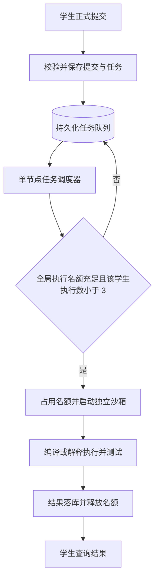

# 学生作答与评测设计讨论记录

更新时间：2026-10-24。本文记录本次讨论的范围与决定；是开发设计，不表示功能已实现。已有能力以实际代码和 [当前 API](API.md) 为准。

## 1. 本轮范围与分工

- 学生端负责读取作业和题目、编辑答案、本机草稿、正式提交、提交历史及编程评测反馈。
- 支持编程题、算法分析题、证明题、开放性问答题；后三类共用主观题作答流程。
- 本轮不开发互评、评分聚合、异常评审检测和正式成绩发布。
- 作业创建、选题、发布、应交名单、DDL 调整、提前关闭和重新开放由教师队友负责。学生模块沿用现有数据和接口约定；联调可使用现有演示作业。
- 教师侧尚缺的其他配合事项和共享数据变更需记录，由用户决策，不自行扩展教师业务。
- 本功能后续在用户已创建并切换到的 `feat/student-submission` 分支开发，沿用该分支，不另建开发分支。

### 统一入口与课程工作区

用户已确认：使用统一登录入口，登录时不要求选择教师或学生身份；登录后先选择课程，再进入课程详细区，按当前账号在该课程中的权限展示页面和功能。

```text
统一登录 → 可访问课程列表 → 选择课程 → 该课程的工作区
                                           ├─ 教师权限：教师功能
                                           └─ 学生权限：学生功能
```

- 首次使用初始密码的账号，登录后先完成强制修改密码，再进入课程选择；上图为已完成首次改密的常规流程。
- 复用现有 Vue 3 / TypeScript / Vite 工程、登录会话、请求客户端、Markdown 和公式渲染。
- 权限依据现有 `course_members.role`。同一账号可在不同课程中有不同角色；现有模型下，同一账号在同一课程只有一个角色。
- 不根据“账号是否在任何课程是教师”决定全局跳转；课程列表只展示当前账号有权访问的有效课程。
- 课程工作区可以按角色使用不同布局和菜单，入口及课程选择保持统一。登录后不自动跳过课程选择，即使只有一门课。
- 现有前端登录跳转、教师专用的当前课程状态和 `/access` 占位页需要接入此流程；这些是待实现的公共前端调整。
- 以下边界处理为建议，尚待开发时细化：无课程时展示空状态；课程卡片显示学期；刷新课程页校验权限后恢复；切换课程保存草稿并停止原页面轮询；课程权限变化后退回课程选择。
- 数据库沿用现有 PostgreSQL、SQLAlchemy 模型、表关系及 Alembic 迁移体系。评测统计及恢复能力的增量数据扩展单独协调，不重新设计账号、课程、作业和提交结构。

### 账号开通与首次登录

用户已确认采用发放初始密码的方案：教师或管理员开通账号、发放初始密码，学生首次登录后必须修改密码。

- 名单导入仍可创建待开通账号，显式开通后方可使用初始密码登录；不能仅因名单导入就认为账号可登录。
- 首次修改密码前只允许完成改密和退出等必要操作；限制须在后端落实，不能只隐藏前端页面。
- 建议每个账号使用独立生成的初始密码。重置密码后再次要求改密，并使旧登录会话失效；具体重置入口和发放流程需与负责队友对接。
- 当前尚无开通、初始密码发放、首次改密标记及改密接口。教师或管理员的操作入口作为配合事项记录，学生侧实现首次改密页面和对应认证流程。

### 自动续期

用户已确认需要自动续期。以下是建议的交互与实现边界，具体时间参数和接口仍待细化，不表示已实现：

- 沿用现有数据库会话和 Bearer 认证体系，在此基础上增加续期能力，不因该需求重做账号或课程权限体系。
- 学生持续编辑、切换题目或主动操作时，在会话到期前自动续期；编辑器操作未发送业务请求时也应被考虑。
- 仅有后台评测轮询或打开闲置页面不应无限延长登录；建议续期由近期实际操作触发，前端合并和节流续期请求，不上传作答内容来证明活跃。
- 用户已确认最长连续登录时长为 **24 小时**，从本次成功登录开始计算；自动续期不能突破此上限，到期后需重新登录，本机草稿保留。
- 用户已确认无实际操作 **2 小时**后登录失效；持续操作可自动续期，仍受最长连续登录 24 小时限制。后台评测轮询不算实际操作，续期提前量待细化。
- 后端仅能延长仍有效、未退出、账号可用的会话，并保留每次资源请求的课程权限检查；已过期或作废会话不能通过续期重新生效。
- 前端统一处理续期，多项请求同时触发时合并处理；临时网络中断应保留编辑内容，不把网络错误直接当成账号失效。
- 确实需要重新登录时保留本机草稿和作答位置；登录、必要的改密及课程选择完成后可继续作答。
- 已成功接收的提交和评测任务独立于登录状态继续处理；重新登录后可查询，不重复创建提交。
- 退出或密码重置应阻止旧会话继续续期。相关会话字段、账户改密标记及迁移增量需要与数据库负责人协调。

## 2. 已确认的产品规则

### 作答与提交

- 学生经后端接口读写，前端不直接连接数据库。
- 正式提交创建新版本，保留旧答案、代码、时间和结果，不覆盖历史。
- 编程提交先将答案与评测任务同事务落库，返回接收凭据；后台异步评测并保存结果。
- 主观提交保存答案，不创建编程评测任务，不触发互评，不生成分数。
- 修改后重新提交无需先撤回旧版本。
- 任务、结果和源码始终关联具体提交版本；旧任务晚完成不能覆盖新版本的界面状态。

### 语言

- 与教师端保持一致，完整语言范围为 Python 3（`python3`）、C++（`cpp`）、C（`c`）、Java（`java`）。
- 每道题的可选语言取其作业绑定测试配置的 `allowed_languages`，不向学生开放教师未允许的语言。
- 当前模拟执行器不代表上述语言已具备真实执行能力；真实评测需要补齐对应运行环境。

### 编程提交形式

用户已确认第一版采用单文件代码和标准输入输出，不支持多文件工程及自行安装依赖。

### 作业进度口径

用户已确认将“已提交”和“已通过”分开显示：编程题有正式提交即可显示已提交，真实评测全部测试点通过后显示已通过；主观题显示已提交，不显示已通过。排队、服务故障及模拟通过不能计为真实通过。

### 草稿

- 已确认采用本机自动保存，不上传数据库，不作为正式提交，不支持跨设备恢复。
- 建议按用户、作业题目和编程语言区分草稿，主观题不区分语言。
- 建议停止输入约 1 秒后保存，显示保存状态和时间；存储失败应明确提示。
- 进入作答页优先恢复本机草稿；没有草稿时可载入本人最近一次未撤回的正式提交。
- 切换语言保留各语言的草稿，正式提交后继续编辑应提示“有修改尚未提交”。
- 提交回执只确认当次发送的内容；等待响应期间的新编辑不能被误标为已提交或被清除。
- 本机草稿不在 DDL 自动转为正式提交。

### 编程题最佳提交

用户已确认按以下顺序逐项比较：

1. 通过测试点数量降序。
2. 通过数量相同，运行时间升序。
3. 时间也相同，内存占用升序。
4. 以上相同，取最近一次提交。

- 没有全部通过的提交时，同样选择通过数量最多的提交，再比较资源消耗。
- 以通过测试点的数量比较；现有测试点权重不自动代替这个数量，也不由该规则自行推导正式成绩。
- 比较范围为同一学生、同一作业题目、同一冻结测试配置下的未撤回正式提交。
- 用户已确认四种语言统一比较，沿用上述顺序，不按语言分组，不添加语言加权。
- 只使用真实完成的评测；模拟结果、排队中、执行中及执行服务故障不参与最佳结果比较。
- 新提交表现较差时保留原最佳版本。界面分别标识草稿、最近提交与当前最佳提交。
- 缺失时间和内存不能当成零；所有提交均未通过任何测试时应明确显示“尚未通过测试”。
- 时间比较采用被测程序实际 CPU 时间，排队、编译、沙箱启动和接口等待时间不计入。
- 各测试点 CPU 时间如何汇总、内存峰值口径、缺失指标以及全为零通过时的完整排序规则，仍需在真实评测契约中细化；不得隐式填零。

主观题后续最终答案沿用现有信息流文档中“截止前最后一次有效正式提交”的约定；本轮仅实现保存和版本查看。

## 3. 作业可见性和截止

沿用现有数据库、鉴权和服务端规则：

| 条件 | 学生行为 |
|---|---|
| 课程身份有效、在作业名单内且作业非草稿 | 可以读取学生可见的作业和题目 |
| 作业状态 `OPEN` 且服务端时间严格早于 `submission_deadline` | 可以新增正式提交 |
| `CLOSED` 或已到 DDL | 可以查看已有内容和记录，不能新增正式提交 |
| 不具备访问权限 | 不返回题目和答案数据 |

- 题目、测试集和量表读取作业绑定的固定版本，不改成读取题库最新版本。
- 前端倒计时和按钮状态只是提示，服务端校验决定是否接收；读取接口本身不会为客户端预留提交时间。
- DDL 前已成功接收的任务继续排队、执行和故障重试，即使完成时间晚于 DDL。
- 网络结果不明时复用原 `client_request_id` 和原请求内容重试；已成功请求可在 DDL 后重放，主动新增提交使用新请求标识。

## 4. 单节点评测架构

用户已确认：单节点、多个并发沙箱；本轮不做多节点，也不做跨课程调度机制。



### 并发限制

- 每名学生最多同时执行 **3 份提交**，按账号统计，覆盖其全部课程、作业和编程语言；限制在服务端统一执行。
- 第 4 份及后续提交仍正常接收、持久化和排队；不是限制学生只能提交 3 次。
- 节点总并发设为配置项，依据机器 CPU、内存和压测确定，当前未决定具体数值。实际执行数同时受全局上限和个人上限约束。
- 一次执行名额覆盖沙箱启动、编译和测试全过程；一份提交占一个名额，测试点在该提交内依次执行。
- 建议按入队先后挑选具备执行资格的任务；某学生已经执行 3 份时，暂时跳过其等待任务，让其他有资格的任务使用空闲名额。不引入课程配额、优先级或轮转机制。
- 名额检查、占用及任务领取必须协调为原子操作，不能依赖各执行进程各自检查数量后启动。

### 隔离与资源

- 隔离单位是一次提交，各任务有独立文件目录和执行环境，不能读取其他提交的数据。
- 编译和运行均需限制资源，限制网络、输出量及总执行时间；清理任务创建的进程和文件。
- 不同沙箱共享同一节点的物理资源，需控制总并发和资源配额，不能保证资源竞争完全消失。
- 编译器、解释器及测量环境需固定，避免比较不同运行环境下的资源数据。

## 5. 故障恢复和重复执行保护

用户已确认需要故障恢复，以下为拟采用的实现约束，尚未落地：

- 任务持久化，API 或执行器重启后不丢失已接收的提交。
- 执行中的任务记录执行归属、尝试标识、租约及心跳；执行器中断后可回收。
- 回收前确认旧沙箱及其子进程已终止，再释放名额和重新派发；节点重启时核对并清理遗留执行环境。
- 用尝试标识阻止过期执行器写回结果，避免旧执行覆盖重试结果；结果与任务终态原子保存。
- 基础设施故障支持有界自动重试，次数和退避参数待实现时确定；超过上限显示“评测服务失败”，保留提交和原因摘要。
- 编译错误、答案错误、超时及超内存属于正常评测结果，不作为基础设施故障反复重试。
- 恢复原任务不新增学生提交版本、不增加学生主动提交次数；保留可追踪的执行尝试信息。
- 用户已确认自动恢复最终失败后，保留原提交并允许对服务故障任务重新评测；即使已过 DDL，也可继续处理该原提交，但不能修改源码或其他原始提交内容。正常答案错误不因此获得截止后修改机会。

## 6. 排队和结果反馈

用户已确认需要排队反馈，建议界面映射如下；这不表示当前 API 已返回全部细分字段：

| 界面状态 | 含义 |
|---|---|
| 已接收，等待评测资源 | 任务已持久化，等待节点执行名额 |
| 已接收，等待个人并发名额 | 本人已有 3 份提交正在执行 |
| 正在评测 | 已领取执行名额，可后续细分编译和测试阶段 |
| 正在恢复／等待重试 | 基础设施故障后正在处理 |
| 评测完成 | 展示判定、通过数、CPU 时间、内存和允许公开的错误信息 |
| 评测服务失败 | 自动恢复未成功，保留答案，不算学生答案错误 |
| 已撤回 | 保留历史，排队任务取消；执行中撤回沿用当前禁止规则 |

- 前端通过本人提交详情轮询获取状态；终态停止，网络失败适当退避。
- 第一版不承诺精确队列名次或预计等待时间，调度会跳过达到个人上限的任务。
- 不返回其他学生身份、提交内容、隐藏测试输入输出和内部异常栈。
- 截止后的最佳结果在截止前已接收任务处理完成后确定；仍在恢复的任务不能静默算作最终失败答案。

### 现有公开／隐藏测试机制与待确认的反馈范围

代码核对结果：

- 数据库 `test_cases.is_public` 已区分公开和隐藏测试，教师请求模型及新增测试点默认 `false`。
- [教师题目编辑页面](../frontend/src/features/teacher/ProblemEditor.vue)已有“公开测试点”复选框；教师后端保存并返回对应配置。
- [学生题目视图](../backend/app/student/service.py)目前不返回测试集中的任何测试点明细，公开测试点也未单独返回；学生可见的是独立维护的 `public_examples_md` 题面样例。
- `public_examples_md` 与测试集中的 `is_public=true` 测试点是两套内容，现有实现没有自动同步关系。
- 真实执行及逐测试点结果尚未实现，现有模拟执行器不执行公开或隐藏测试。

已具备教师配置和学生读题时隐藏测试不外发的基础。是否展示公开测试点的输入输出、学生输出、逐点结果及其他反馈，仍待用户结合本次核对决定；不把“确认已有机制”视为已同意全部反馈方案。

## 7. 现有基础、需要扩展的内容和交接事项

### 已有基础

- 课程和名单权限、学生安全题目视图、DDL 校验、多版本及幂等提交。
- 编程提交与 `analysis_jobs` 同事务保存、单份提交查询、撤回和教师提交查询。
- 只有单个模拟 worker；`MOCK_ACCEPTED` 及空资源不能用于真实最佳提交比较。
- 学生页面尚待实现；`GET /me/submissions` 仍是下一阶段提案。

### 学生及评测模块需要补齐

- 学生路由和页面、本机草稿、本人历史、当前最佳提交查询及状态反馈。
- 单节点有界并发、每人 3 个执行名额、真实多语言沙箱及故障恢复。
- 通过测试点数和总测试点数、指标口径、必要的测试点执行信息与执行尝试记录。
- 任务租约、心跳、尝试标识及排队原因等字段或等价结构；当前模型不具备完整能力。
- 共享模型、迁移和 API 扩展应先给出契约并协调数据库负责人，新增迁移，不改写已应用迁移。

### 教师和共享规则交接清单

| 事项 | 本轮处理 |
|---|---|
| 创建、选题、发布、名单、DDL 和开关状态 | 留给教师队友，沿用现有约定 |
| 发布时固定已冻结的题目和测试／量表版本 | 按现有模型和教师文档交接，不重写教师发布功能 |
| 教师侧读取最终采用版本 | 交接编程最佳提交规则和主观最终版本约定，后续共同消费相同选择结果 |
| 教师允许语言和真实执行能力 | 沿用四语言枚举及每题允许列表，真实环境版本需在评测契约中固定 |
| 主观题必须有互评人数的现有约束 | 保留配置但本轮不执行互评；若要支持无互评配置的主观作业，另行决策 |
| 导入学生处于待激活状态 | 已确定采用开通并发放初始密码、首次登录改密；开通、发放和重置入口需负责队友配合 |
| 登录改密及自动续期 | 需要调整共享认证和学生交互，教师页共用；具体接口和增量迁移需协调 |

本文仅记录设计。本轮没有修改教师端、数据库模型、迁移或业务接口。

## 8. 后端功能模块清单

以下是本轮功能划分，不代表都已实现；复用现有后端基础，不在此规定内部进程和代码拆分细节。

| 功能模块 | 范围 |
|---|---|
| 账号、课程与权限 | 登录退出、首次改密、自动续期、可访问课程、当前课程角色、资源访问校验；开通和重置入口与负责队友对接 |
| 作业与题目读取 | 已发布作业、题目要求、固定版本、DDL、允许语言和资源限制 |
| 答案提交与版本 | 编程及主观答案保存、新版本、幂等重试、截止校验、撤回 |
| 评测任务管理 | 持久化排队、节点总并发、每人最多执行 3 份、状态、故障恢复与重试 |
| 代码执行与测试 | Python 3 / C++ / C / Java、隔离执行、测试点判定、资源测量 |
| 评测结果与最佳提交 | 结果保存、通过数及资源统计、按已确认顺序选择最佳版本 |
| 本人提交记录与反馈 | 本人历史、版本内容、最近及最佳提交、排队和结果查询 |

本机草稿属于前端功能；教师作业管理和互评不纳入本轮学生后端开发范围。
