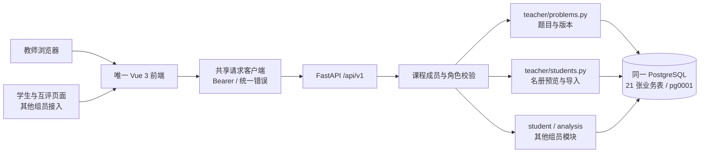

# 教师端架构与交付索引

本轮实现教师负责的两个优先功能：**题目管理**和**学生信息导入**，并建立三人共用的 Vue 前端骨架。教师端直接使用现有 FastAPI 服务与 PostgreSQL 数据库，不复制用户、题库、课程或班级表。

| 文档 | 内容 |
|---|---|
| [teacher_frontend.md](teacher_frontend.md) | 页面、路由、组件、状态及学生端接入位置 |
| [teacher_backend.md](teacher_backend.md) | 服务分层、事务、版本保护和权限 |
| [teacher_database.md](teacher_database.md) | 共享表读写边界、状态与配置快照 |
| [teacher_api.md](teacher_api.md) | 已实现接口、请求样例和错误处理 |
| [teacher_setup.md](teacher_setup.md) | 启动、验收、测试与后续事项 |

## 1. 总体结构

## 2. 已实现的功能

- 登录、教师课程选择、课程概览、统一布局、错误及请求编号展示。
- 四类题目列表与筛选，创建草稿、修改草稿、历史版本查询、冻结、从冻结版本复制新草稿、归档和恢复。
- Markdown / LaTeX 安全预览；教师参考答案；编程测试配置；主观题评分量表；课程知识点维护。
- 学生名单分页查询、姓名/学号与班级筛选；CSV 模板、逐行预览、确认导入、重复导入处理。
- 后端按课程校验教师身份，学生接口继续使用原有安全投影，不返回教师答案及隐藏测试。

## 3. 与另外两位组员的边界

1. 学生端、互评、分析仍复用同一个前端工程、登录会话和后端模型。页面分别放在 `frontend/src/features/student`、`analytics`。
2. 新学生以 `PENDING`、无密码方式创建，符合底座契约。本轮不决定激活和密码发放政策，不自动赋予教师权限。
3. 本轮不新增表、不改模型、不改已应用迁移 `pg0001`；套题、测试集及量表仍由既有表保存。
4. 后续作业发布必须同时验证 **ProblemVersion 为 FROZEN**、配置属于该版本且完整有效，不能仅依据配置自身的 `FROZEN` 状态发布。
5. 作业创建/发布、互评开放、教师复核、成绩发布及真实执行沙箱尚未在本轮实现。现有教师提交查询接口保留；不把本轮交付等同于整个课程项目完成。

## 4. 建议 GitHub 交接方式

当前功能分支为 `feat/teacher-portal`。审阅时先看本索引与数据库边界，再看 API 和测试。可将现有教师 Issue 中 T00、T01、T02 的对应条目作为本轮范围；T03 及后续任务单独推进。不要关闭整个教师大 Issue。

共享数据结构、状态或接口发生变化时，提交中同步更新 `docs/teacher_*.md`、相关契约和 OpenAPI 快照。真实学生名单、密码与数据库文件不得进入提交。
